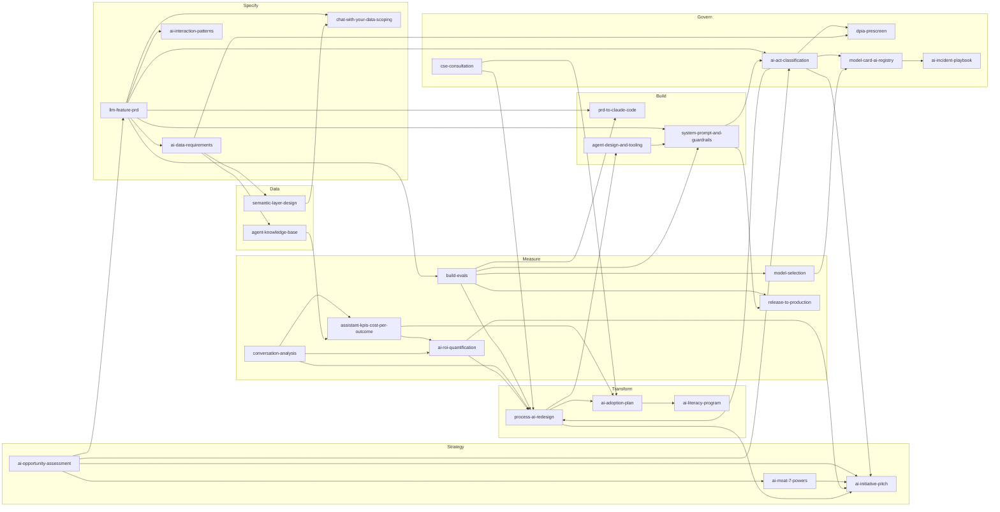

# ai-pm-skills — Product Requirements Document

**Version:** 1.0 · **Date:** 2026-11-01 · **Owner:** Alex Darmon · **Status:** PRD approved for build, no code yet

---

## 1. Summary

**ai-pm-skills is an open-source set of 26 tested skills that take an AI or Data product from framing to budget, build, measurement and compliance, in a regulated European enterprise.**

Each skill is a folder an agent (Claude Code, Codex, Cursor, a custom agent) loads on demand: a `SKILL.md` with the method, templates, sources, and an eval suite run by `claude plugin eval`. The repo is a system, not a list: every skill plugs into two shared backbones, the **autonomy ladder** (L0 to L5) and the **ROI model** (volume × quality × value).

README promise, one line:

> *Tested skills for AI product managers who ship in regulated companies.*

| Item | Value |
| --- | --- |
| Repo name | `ai-pm-skills` (GitHub: alexandre-darmon) |
| Format | [Agent Skills](https://agentskills.io) open standard: `SKILL.md` + progressive disclosure |
| Skill count | 26 at v1.0, hard cap 30 |
| Stages | Strategy · Specify · Data & Knowledge · Build · Measure · Govern · Transform |
| Test harness | `claude plugin eval`, native format, 3 cases minimum per skill, scored with and without the skill; pass rate shown in README |
| Language | English skills; French legal annexes where the law is French |
| License | To decide (section 14) |
| Owner | Alex Darmon, solo, about 1 hour per day |

---

## 2. Problem

**AI products in banks, insurers and retailers rarely die on the PRD. They die on four questions the PM cannot answer: is it legal, does it work, is it adopted, and what did it return.**

The PM playbook (Cagan, Torres, Lenny) covers discovery and delivery; it says nothing about golden datasets, autonomy levels, AI Act annexes or works-council consultation. The ML playbook covers models and says nothing about sponsors, budgets and change.

### What exists and why it does not close the gap

| Existing resource | What it gives | What it lacks |
| --- | --- | --- |
| Generic PM prompt packs and skill repos (dozens on GitHub) | PRD, roadmap, user-story templates | Nothing AI-specific; never tested; no compliance; copied in an afternoon |
| Anthropic, OpenAI, Cursor skill libraries | Engineering and coding workflows | Built for developers, not for the PM who frames, measures and governs |
| LangChain, Langfuse, Braintrust docs | How to trace and evaluate | Tool-bound; no method for deciding what to measure or when to ship |
| Law-firm and consultancy AI Act guides | The regulation explained | PDF prose; not actionable inside the PM's working tool; no link to product decisions |
| Internal enterprise playbooks | Company-specific rules | Not shareable, usually stale, rarely tested |

### Three failure patterns the repo targets

Each seen first-hand on internal assistants and data platforms in banking and retail:

1. **Measured usage, not value.** Dashboards count sessions; nobody samples answers, nobody knows which knowledge base is stale, nobody can state cost per correct outcome. The ROI stays a slide.
2. **Autonomy by accident.** Teams jump from a chat assistant to an agent that acts, with no explicit level, no gate, no guardrail test. Risk and AI Act obligations rise silently.
3. **Compliance as a final gate.** AI Act classification, DPIA and CSE consultation arrive after build, and the project is reworked or quietly shelved.

The repo's bet: the skills a PM actually needs for AI products are specific, few (20 to 30), and only credible if each one is tested like code.

---

## 3. Goals, non-goals, success metrics

**Goal: a PM who installs the repo can run an AI product end to end in a regulated company, and can prove each skill works before trusting it.**

### Goals

1. Cover the seven stages of an AI product's life with 26 specific skills, none generic.
2. Ship every skill with an eval suite; the README shows each skill's pass rate and date.
3. Make the autonomy ladder and the ROI model the shared language of all skills.
4. Give compliance (AI Act, GDPR, French labour law) the same actionable form as product work: checklists and questions, inside the agent, never a PDF.
5. Be usable from any agent that reads `SKILL.md`: Claude Code first, Codex and Cursor verified.
6. Serve the author's own missions first: every Wave 1 skill is one Alex runs on a live client problem within the month.

### Non-goals

- Not a general PM playbook: no roadmap, OKR, user-story or stakeholder-map skills unless AI-specific.
- Not legal advice: skills produce classifications, questions and checklists for counsel, never a conformity verdict.
- Not a redistribution of books or newsletters: skills state the author's own rules and cite the source; no excerpts.
- Not a SaaS, a web app, a marketplace or a course. A repo and a README.
- Not an eval tool: the repo uses `claude plugin eval` and a small deterministic grader script; it builds no harness of its own.
- Not more than 30 skills, ever. A 31st replaces one.

### Success metrics

| Metric | 3 months | 12 months | How measured |
| --- | --- | --- | --- |
| Skills shipped with passing suites | 8 | 26 | CI report in README |
| Skills used on a real client mission | 4 | 15 | Author's log |
| GitHub stars | 100 | 500 | GitHub |
| Issues or PRs from strangers | 1 | 20 | GitHub |
| Weekly installs (`npx skills add`, clone) | 20 | 150 | GitHub traffic |
| Eval pass rate, repo average | 80% | 90% | `claude plugin eval` results JSON |
| Legal skills verified within 90 days | 100% | 100% | `last_verified` frontmatter, CI check |
| Articles published, one per wave | 1 | 4 | aiunmagic.com |

The first issue opened by someone the author does not know is the moment the repo stops being a portfolio and becomes a product.

---

## 4. Users and jobs to be done

| User | Context | Job to be done | What they open first |
| --- | --- | --- | --- |
| **Primary: AI / Data PM in a regulated enterprise** (bank, insurer, retailer, utility) | Owns an internal assistant, a chat-with-data product or an agent; reports to a business sponsor and a DSI; legal and DPO in the loop | "When I frame, build or measure an AI product, I want a method that already includes evals and compliance, so I don't discover the blockers after build." | `llm-feature-prd`, `ai-act-classification`, `assistant-kpis-cost-per-outcome` |
| **Secondary: freelance consultant or agency PM** | Parachuted on an AI initiative, must look credible in week one | "When I land on a client's AI project, I want a repeatable way to audit and structure it in days." | `ai-opportunity-assessment`, `process-ai-redesign` |
| **Secondary: engineering lead or tech lead** | Builds the thing; tired of PRDs that ignore evals and guardrails | "When the PM hands me a spec, I want evals, autonomy level and guardrails already defined." | `build-evals`, `system-prompt-and-guardrails` |
| **Tertiary: student or career switcher** | Learning AI PM; audience of aiunmagic.com and the university course | "I want to see what the job actually looks like, with real artefacts." | README walkthrough, `ai-literacy-program` |
| **Author** | Runs client missions with these skills, 1 h/day on the repo | "Every skill I write must save me time on my next mission and be worth publishing." | All of Wave 1 |

Design implication: skills are written for the primary user and tested on the author's own missions. Students read; they are not designed for.

---

## 5. Positioning and differentiation

**Positioning statement:** for AI and Data PMs in regulated companies, ai-pm-skills is the only skill library that is specific to AI products, covers EU compliance as product work, and ships every skill with a passing test suite.

### Four differentiators, in order of defensibility

1. **Tested.** Each skill has an eval suite and a visible pass rate, including the score delta with vs without the skill. No other PM skill repo tests its skills. This is also the hardest thing to copy, because it requires the cases, not just the prose.
2. **Compliance as skills.** AI Act classification, DPIA pre-screen, CSE consultation, model card and AI registry, incident playbook. Written for a PM's working tool, dated and sourced.
3. **A spine.** The autonomy ladder and the ROI model connect the skills. A reader sees a method, not a folder of prompts.
4. **Lived.** Every rule comes from a problem the author met on a real deployment. Cases in the suites are anonymised real briefs.

### What the repo deliberately is not

- Not broader than competitors. Narrower.
- Not prettier. Plain Markdown, GitHub-native.
- Not opinion-free. Each skill makes calls (e.g. "no A/B below this sample size", "no L4 without action guardrails").

### Adjacent projects and how they connect

| Project | Relationship |
| --- | --- |
| evalblink (PyPI) | Not the repo's test harness. Optional tool for model and classifier comparisons inside `model-selection` and `conversation-analysis`. |
| nanoagent | Reference implementation for `agent-design-and-tooling`; emits traces used in `assistant-kpis-cost-per-outcome` demos. |
| aiunmagic.com | Publishes one article per wave; hosts the pedagogical companion to `ai-literacy-program`. |
| My Companion (BNP) | Live source for `conversation-analysis`, `assistant-kpis-cost-per-outcome`, `agent-knowledge-base`. Data never leaves the client; only the method is published. |

---

## 6. Design principles — the 10 rules every skill follows

1. **Specific or absent.** If a skill would read the same for a non-AI product, it is not in the repo.
2. **Tested or draft.** A skill without a passing suite is in `drafts/`, not in the catalog, and not in the README count.
3. **Sourced and dated.** Every rule names its source (book, regulation, article, own experience). Legal skills carry `last_verified`; a CI check flags any past 90 days.
4. **Checklist, not verdict.** Legal and risk skills produce classifications, questions for counsel and checklists. They never output "compliant".
5. **Anchored numbers only.** Any ROI, gain or productivity figure must trace to volume × quality × value with named inputs. No free-floating percentages.
6. **The ladder is the spine.** Any skill that touches autonomy, risk, release or governance references the L0–L5 ladder in `foundations/`, never a local definition. Each skill cites a synced copy in its own `references/`, so it works when installed alone; CI fails if a copy drifts from the original.
7. **One skill, one job.** Inputs and outputs fit in a screen. Two jobs = two skills. A skill that needs another one says so in `depends_on`.
8. **Progressive disclosure.** Frontmatter `description` is the trigger (under 200 characters). `SKILL.md` body is the method (under 2 000 words). Heavy material lives in `references/` and is loaded only when needed.
9. **Own words, cited ideas.** Books and newsletters are sources, never content. No excerpts longer than a sentence.
10. **Thirty is the ceiling.** A new skill must replace or merge an existing one once the catalog hits 30.

---

## 7. Repository architecture

### 7.1 Folder layout

```
ai-pm-skills/
├── README.md                      # promise, catalog table with pass rates, install, 60-second example
├── LICENSE
├── CONTRIBUTING.md                # how to author a skill, how to add cases, review checklist
├── foundations/                   # shared backbones, read by many skills
│   ├── autonomy-ladder.md         # L0–L5, gates, obligations per level
│   ├── roi-model.md               # volume × quality × value, baseline rules
│   ├── eval-conventions.md        # grader types, thresholds, case format, holdout policy
│   └── sources.md                 # bibliography with one-line "what we take from it"
├── skills/
│   ├── <skill-name>/
│   │   ├── SKILL.md               # frontmatter + method (the only file always loaded)
│   │   ├── references/            # deep material, loaded on demand; synced copies of cited foundations
│   │   ├── templates/             # output templates (markdown, yaml, csv)
│   │   └── evals/                 # `claude plugin eval` cases, one folder per case (≥3)
│   │       └── <skill-name>-001/
│   │           ├── prompt.md      # frontmatter (name, tags, expected_outcome) + scenario sent to the agent
│   │           └── graders/       # one file per check: regex, tool_used, llm
│   └── ...
├── drafts/                        # same structure, no passing suite yet; not counted
├── templates/skill/               # starting point for a new skill, cases included
├── baselines/                     # frozen results JSON per skill (model, judge model, date, delta)
├── .claude-plugin/plugin.json     # install as a Claude Code plugin
├── scripts/
│   ├── validate_skills.py         # structure check: frontmatter, headings, cases, graders, foundation copies (--sync writes them)
│   ├── run_evals.sh               # `claude plugin eval` per changed skill, with its own threshold
│   ├── check_freshness.py         # fails CI if a legal skill's last_verified > 90 days
│   └── build_readme_table.py      # regenerates the catalog table from frontmatter + results
└── .github/workflows/
    ├── validate.yml               # on push and PR: structure check
    ├── evals.yml                  # on PR: changed skills, cheap model; nightly: full suite
    └── freshness.yml              # weekly
```

Private holdout cases (20% of each suite) live outside the repo, in a private repo `ai-pm-skills-holdout`, pulled by the nightly job only. See section 11.

### 7.2 `SKILL.md` specification

Frontmatter (YAML), all fields required unless marked optional:

| Field | Type | Rule |
| --- | --- | --- |
| `name` | string | kebab-case, equals folder name |
| `description` | string | the trigger; ≤ 200 chars; states *when* to use, in the user's words |
| `stage` | enum | strategy · specify · data · build · measure · govern · transform |
| `version` | semver | bumped on any rule change |
| `last_verified` | date | mandatory for `govern` skills; optional elsewhere |
| `depends_on` | list | skill names whose output this skill consumes |
| `feeds` | list | skill names that consume this skill's output |
| `autonomy_relevant` | bool | true if the skill reads or sets an L-level |
| `sources` | list | ids from `foundations/sources.md` |
| `eval_threshold` | number | pass threshold for the skill's cases; 0.80 by default, 0.90 for `govern` and flagship skills |
| `status` | enum | draft · tested · verified-in-mission |

Body structure (fixed headings, so graders can check structure):

1. **When to use** — 3 to 5 trigger situations, and 2 anti-triggers ("do not use when…").
2. **Inputs** — what the agent must have or ask for; which are mandatory.
3. **Method** — numbered steps; each step says what to produce and the rule it applies.
4. **Output** — the exact artefact, pointing to `templates/`.
5. **Rules and red lines** — the opinions: what the skill refuses to do.
6. **Links** — which foundation (as `references/<file>.md`, its synced copy) and which other skills it calls.
7. **Sources** — ids, one line each.

### 7.3 README

- One-line promise, then a 60-second example (install, run one skill, see output).
- Catalog table generated from frontmatter: stage · skill · description · pass rate · last run · status.
- "How it's tested" paragraph linking to `foundations/eval-conventions.md`.
- "Not legal advice" notice above the Govern section.
- A 10-second GIF: a skill triggering inside Claude Code and producing its artefact.

### 7.4 Installation targets

- Claude Code: `skills/` directory or plugin manifest (`.claude-plugin/plugin.json`) so `claude plugin details` shows token cost.
- Codex / Cursor / others: via the Agent Skills standard (`npx skills add alexandre-darmon/ai-pm-skills`).
- Verified matrix in README: which agents were tested, on which date.

---

## 8. The backbone

### 8.1 Autonomy ladder (foundations/autonomy-ladder.md)

The ladder is the single definition of "how autonomous" used by every skill. A process step, an assistant or an agent is always at one level, and moving up requires passing a gate.

| Level | Name | Who acts | Human role | Gate to enter this level | Typical obligations that rise |
| --- | --- | --- | --- | --- | --- |
| **L0** | Manual | Human | Does the work | — | — |
| **L1** | Assisted | Human | Does the work, AI suggests | Offline eval on golden set ≥ threshold; user tested on 5 people | Transparency to users; AI literacy (AI Act art. 4) |
| **L2** | Human in the loop | AI produces, human validates every output | Validates 100% | L1 in production 4 weeks; quality KPI stable; guardrails on output tested | Logging; DPIA pre-screen if personal data |
| **L3** | Human on the loop | AI acts, human sees exceptions and a sample | Reviews exceptions + sample | Shadow run ≥ 2 weeks; false-positive rate of guardrails known; escalation path tested | Incident playbook; CSE consultation if it changes work organisation |
| **L4** | Autonomous with guardrails | AI acts within limits; automatic stop | Sets limits, reviews reports | Action guardrails (scope, caps, approvals) tested in redteam; canary passed; rollback in one click | High-risk classification check (AI Act annex III); human oversight design (art. 14); model card |
| **L5** | Self-improving loop | AI acts and improves on its own outcomes until plateau | Intervenes at plateau | L4 stable 3 months; eval gate automated; drift detection live | Continuous monitoring; change-management of the model itself; registry update on each version |

Rules shared by all skills:

- Levels are assigned **per process step**, not per product. A product can be L3 on routing and L1 on drafting.
- You never skip a level in production. You may skip in design.
- Moving down a level is always allowed and never needs approval.
- The gate is a measured fact (a score, a run, a test), never an opinion.

### 8.2 ROI model (foundations/roi-model.md)

```
ROI (per use case, per period) =
    volume            # outcomes produced by the AI in the period
  × quality           # share of outcomes judged correct / accepted
  × unit value        # € value of one correct outcome (time saved × loaded cost, or error cost avoided)
  − run cost          # tokens + infra + licences
  − change cost       # training, support, review time
```

Rules:

- **Volume** comes from traces or conversation classification (skill `conversation-analysis`), never from declared usage.
- **Quality** comes from sampled evaluation (`build-evals`, `assistant-kpis-cost-per-outcome`), never from thumbs-up alone.
- **Unit value** comes from the business (interviews, time studies), conservative, sourced, with the assumption written down.
- A baseline before deployment is mandatory; without it the ROI is a projection and is labelled so.
- Any skill that outputs a gain must show these five lines. Otherwise the output fails its grader.

---

## 9. Skill catalog — 26 skills across 7 stages

Legend: **P0** Wave 1 (weeks 1–6) · **P1** Wave 2–3 · **P2** Wave 4. Graders: *exact* (deterministic check), *checklist* (structure and mandatory items), *judge* (LLM with rubric, calibrated).

### Stage 1 — Strategy (3)

#### S1 · `ai-opportunity-assessment` — P1
- **Purpose:** decide in one page whether an AI idea deserves a PRD, and in which form (build, buy, API, or not at all).
- **Trigger:** "Should we do this with AI?", a sponsor pitches a use case, a vendor demo lands.
- **Inputs:** the problem in the business's words; who suffers it and how often; data available (source, volume, quality, access); current process cost; constraints (sovereignty, latency, languages).
- **Outputs:** one-page assessment: problem fit, data readiness score (0–5 on 5 axes), feasibility by approach (rule-based, classic ML, LLM, agent), build/buy/API recommendation with reasons, target autonomy level, first risk flags (personal data, high-risk domain), go / no-go / explore.
- **Rules:** no AI if a deterministic rule solves 80%; data readiness below 2/5 blocks a go; always name the non-AI alternative.
- **Depends on / feeds:** — / `ai-moat-7-powers`, `llm-feature-prd`, `ai-act-classification`.
- **Sources:** Cagan (Inspired, product risk types), Fitzpatrick (The Mom Test for problem validation), own enterprise checklist.
- **Evals (3):** a use case where a SQL rule suffices (expected: no-go on AI); a document-extraction case with poor data (expected: explore, readiness < 2); a support-triage case (expected: go, LLM, L2).
- **Graders:** checklist (all sections present, readiness scored, alternative named) + judge (recommendation coherent with inputs).

#### S2 · `ai-moat-7-powers` — P2
- **Purpose:** find where a defensible advantage exists for an AI product when the model itself is a commodity.
- **Trigger:** "What's our moat?", an investment committee asks about defensibility, a competitor launches a similar assistant.
- **Inputs:** product description, data owned, workflow position, customers, competitors.
- **Outputs:** 7 Powers scan (scale economies, network economies, counter-positioning, switching costs, branding, cornered resource, process power) each rated present / buildable / absent with evidence; the one or two powers to invest in; what the model does *not* protect.
- **Rules:** a conversational interface alone is never a moat; "better prompts" is never a moat; proprietary data and embedded workflow are checked first.
- **Depends on / feeds:** `ai-opportunity-assessment` / `ai-initiative-pitch`.
- **Sources:** Helmer (7 Powers), own thesis on data and distribution moats.
- **Evals (3):** an internal assistant on public knowledge (expected: no moat, counter-positioning possible); a tool on 10 years of proprietary claims data (expected: cornered resource); a chat UI over a public API (expected: absent on all seven).
- **Graders:** checklist (seven powers rated, evidence per rating) + judge.

#### S3 · `ai-initiative-pitch` — P1
- **Purpose:** turn an assessed initiative into a pitch that gets a sponsor and a budget, with every number anchored.
- **Trigger:** budget committee, comex slot, sponsor meeting, "write the one-pager".
- **Inputs:** outputs of S1 (and S2 if available), ROI model lines, target autonomy level, risk flags from G1, the audience (DSI, business, comex).
- **Outputs:** a one-page memo (front-loaded thesis, 1/3/1 rhythm), a three-minute spoken version, one slide, an objection table (top 5 objections and the fact that answers each), and the single ask with date.
- **Rules:** each influence lever (social proof, authority, commitment, scarcity, reciprocity) must rest on a verifiable fact; the ask is a pilot, not a programme; the business owner presents, the DSI supports; demo before discourse; no unanchored percentage.
- **Depends on / feeds:** S1, S2, M6, G1 / `ai-adoption-plan`.
- **Sources:** Cole (online writing: thesis first, specificity), Cialdini (Influence, ethical use), Hagel (Power of Pull: make it pulled, not pushed), own copywriting rules.
- **Evals (3):** inputs with a weak ROI (expected: pitch asks for a measurement pilot, not a rollout); inputs with a high-risk flag (expected: risk named before objections); a pitch draft with a free-floating "30% productivity" (expected: skill rewrites it as anchored or removes it).
- **Graders:** checklist (thesis in first sentence; one dated ask; every number sourced; objection table present; risk named; zero unanchored %).

### Stage 2 — Specify (4)

#### P1 · `llm-feature-prd` — P0
- **Purpose:** write a PRD for an LLM-powered feature that an engineering lead can build and an evaluator can test.
- **Trigger:** "Write the PRD", a go from S1, a feature request involving generation, extraction, classification or an agent.
- **Inputs:** S1 output or equivalent; target users; success metric; constraints (latency, cost per call, sovereignty, languages); data sources.
- **Outputs:** PRD with fixed sections: problem, users, non-goals, autonomy level per step, happy path and failure paths, eval plan stub (what "correct" means, how it's sampled), guardrail requirements (input, output, action), data requirements pointer, compliance flags, KPIs, rollout plan (shadow → canary → GA), open questions.
- **Rules:** a PRD without an eval section is incomplete; failure paths are mandatory (wrong answer, no answer, injection, out-of-scope); autonomy level is stated per step; the KPI is an outcome, not usage.
- **Depends on / feeds:** S1 / M1, B1, B2, P2, G1.
- **Sources:** Cagan, Torres (outcomes over output), own PRDs.
- **Evals (3):** a summarisation feature (expected: eval plan with reference summaries and rubric); an agent that books refunds (expected: L2 then L3 path, action guardrails); a brief with no success metric (expected: skill asks before writing).
- **Graders:** checklist (all sections; autonomy per step; ≥ 3 failure paths; eval stub; KPI is outcome).

#### P2 · `ai-data-requirements` — P1
- **Purpose:** specify the data an AI feature needs, its quality bar, lineage, legal basis and refresh.
- **Trigger:** PRD done, "what data do we need", a data team asks for a spec, a DPO asks what is processed.
- **Inputs:** PRD; data catalog or table list; access constraints; retention rules.
- **Outputs:** data requirements sheet: sources, fields, volumes, quality thresholds (completeness, freshness, duplication), legal basis per field, personal-data flags, pseudonymisation plan, refresh cadence, owner per source, lineage sketch.
- **Rules:** every personal-data field has a legal basis or is dropped; freshness is a number, not "regular"; one owner per source or the source is out.
- **Depends on / feeds:** P1 / D1, D2, G2.
- **Sources:** own data-platform work; GDPR art. 5–6; data-quality dimensions (DAMA).
- **Evals (3):** a feature using customer emails (expected: pseudonymisation plan, legal basis per field); a feature on product catalog only (expected: no personal-data flags, freshness defined); a source with no owner (expected: flagged as blocker).
- **Graders:** checklist + exact (every field has owner and legal basis or drop).

#### P3 · `chat-with-your-data-scoping` — P1
- **Purpose:** scope a "chat with your data" or text-to-SQL product so that it is trustworthy, bounded and testable.
- **Trigger:** "Let users ask questions to the data", a BI team wants natural language, a vendor proposes text-to-SQL.
- **Inputs:** the question inventory (top 50 questions users actually ask), the semantic layer state (D1), data sensitivity, user population.
- **Outputs:** scoping doc: allowed question classes, forbidden classes, metric definitions required (pointer to D1), answer format (number + SQL + source + confidence), golden question set (≥ 50 Q→A pairs), accuracy target by class, escalation path to an analyst, autonomy level (almost always L1–L2).
- **Rules:** no production without a semantic layer for the metrics in scope; every answer shows its SQL and source; accuracy is measured per question class, never globally; a question outside scope gets a refusal, not a guess.
- **Depends on / feeds:** P1, D1 / M1, B2.
- **Sources:** own semantic-layer work; text-to-SQL eval literature (Spider, BIRD for method, not scores).
- **Evals (3):** 50 questions with 10 ambiguous metrics (expected: ambiguous ones blocked until defined); a request for free-form questions on HR data (expected: forbidden class, L1 only); a scope with no golden set (expected: skill generates the set from the inventory).
- **Graders:** checklist (allowed/forbidden, golden set ≥ 50, accuracy per class, answer format) + exact (every metric in scope maps to a D1 definition).

#### P4 · `ai-interaction-patterns` — P2
- **Purpose:** design the user-facing behaviour of an AI feature so users trust it correctly: not too much, not too little.
- **Trigger:** UX design of an assistant, "how should it show uncertainty", complaints that users over-trust or ignore the AI.
- **Inputs:** PRD; autonomy level; user research notes; error profile from evals.
- **Outputs:** interaction spec: how sources and confidence are shown, correction and feedback affordances, refusal wording, escalation to human, latency expectations and progressive display, voice/text decisions, what is logged from feedback.
- **Rules:** confidence is shown only if calibrated; every answer is correctable in one action; refusals explain scope; feedback feeds the eval set.
- **Depends on / feeds:** P1, M1 / B2, T2.
- **Sources:** own UX work on assistants; human-AI interaction guidelines (Microsoft HAX, Google PAIR as references).
- **Evals (3):** an L1 drafting assistant (expected: edit-first UI, no autonomy affordances); an L3 triage agent (expected: exception queue design, sample review); a feature with uncalibrated scores (expected: confidence hidden, replaced by sources).
- **Graders:** checklist + judge.

### Stage 3 — Data & Knowledge (2)

#### D1 · `semantic-layer-design` — P1
- **Purpose:** define the metrics, dimensions and joins an AI (or a human) may use, with one owner and one definition each.
- **Trigger:** before any chat-with-data; metric disputes between teams; a dashboard migration (e.g. Dataiku → dbt).
- **Inputs:** list of metrics in use, current SQL or BI definitions, owners, conflicts known.
- **Outputs:** semantic layer spec: metric name, business definition, formula, grain, allowed dimensions, source tables, owner, status (certified / draft / deprecated), test for each metric; a conflict register; a migration order.
- **Rules:** one definition per metric name; a metric without a test is draft; deprecated metrics keep an alias for 90 days; the AI only reads certified metrics.
- **Depends on / feeds:** P2 / P3, M4.
- **Sources:** dbt semantic layer docs, own data-platform migrations.
- **Evals (3):** two teams with conflicting "active customer" (expected: conflict register, decision needed, both kept as draft); 20 metrics with no tests (expected: all draft, test stubs generated); a migration brief (expected: ordered plan, certified-first).
- **Graders:** exact (one definition per name, owner per metric, test per certified metric) + checklist.

#### D2 · `agent-knowledge-base` — P1
- **Purpose:** build and keep fresh the knowledge an assistant or agent relies on, with ownership and staleness rules.
- **Trigger:** "Set up the RAG", answers are outdated, nobody knows who maintains the KB, a new domain is added.
- **Inputs:** candidate sources (docs, wikis, tickets), their owners, update frequency, sensitivity, the question inventory.
- **Outputs:** KB plan: source register (owner, refresh cadence, sensitivity, format), inclusion/exclusion rules, chunking and metadata guidance, freshness policy (expiry per source type), a monthly review ritual, and a "stale answer" KPI definition linked to M4.
- **Rules:** no source without an owner; every source has an expiry date; the KB has a retirement path for sources; quality by KB is measured, not assumed.
- **Depends on / feeds:** P2 / M4, M5, T1.
- **Sources:** own My Companion observations (method only), RAG practice literature.
- **Evals (3):** 40 sources, 12 without owners (expected: 12 excluded or escalated); HR policies updated yearly vs product specs weekly (expected: distinct expiry); a KB with mixed sensitivity (expected: segregation rule).
- **Graders:** exact (owner and expiry per source) + checklist.

### Stage 4 — Build (3)

#### B1 · `prd-to-claude-code` — P1
- **Purpose:** turn a PRD into a build brief an agentic coding tool can execute without inventing scope.
- **Trigger:** PRD approved, "let's prototype", a vibe-coding session starts.
- **Inputs:** PRD (P1); stack constraints; existing repo (if any); eval cases (M1) when they exist.
- **Outputs:** `CLAUDE.md` / `AGENTS.md` with constraints and conventions; a `specs/` folder (one file per module, acceptance criteria as tests); a task list ordered by risk; a definition of done that includes the evals passing; a "do not build" list.
- **Rules:** acceptance criteria are executable (tests or eval cases), not prose; the eval suite runs in the build loop; scope outside `specs/` is refused; secrets and client data never enter the repo.
- **Depends on / feeds:** P1, M1 / B3, M3.
- **Sources:** own unmagic.ai and nanoagent repos (specs folder convention), Anthropic Claude Code best practices.
- **Evals (3):** a PRD with vague "fast" latency (expected: brief asks for a number or sets a tested default); a PRD with three modules (expected: three spec files, risk-ordered tasks); a PRD mentioning client data (expected: synthetic fixtures, data exclusion rule).
- **Graders:** checklist + exact (every acceptance criterion maps to a test or case).

#### B2 · `system-prompt-and-guardrails` — P1
- **Purpose:** write the system prompt and the three guardrail layers (input, output, action) as one coherent, tested unit.
- **Trigger:** first prompt draft, a jailbreak found, an agent gets tools, moving up the ladder.
- **Inputs:** PRD; autonomy level per step; tools available to the agent; sensitive data classes; latency and cost budget.
- **Outputs:** system prompt (role, scope, refusal policy, format); guardrail spec per layer with mechanism, latency budget, cost per call, failure action; a redteam case set (≥ 20 injections, ≥ 10 out-of-scope, ≥ 5 action-limit attempts) added as cases tagged `redteam` in the skill's `evals/`; false-positive budget.
- **Rules:** no L3 without tested output guardrails; no L4 without action guardrails (scope, caps, approvals); each guardrail has a latency and cost line (cheap classifiers first, frontier last); guardrails are defence in depth, never a guarantee; the skill refuses to claim "safe".
- **Depends on / feeds:** P1, B3 / M1, M3, G1.
- **Sources:** OWASP Top 10 for LLM applications, own guardrail work, AI Act art. 14 (human oversight).
- **Evals (3):** a refund agent with no caps (expected: caps + approval rule added, L4 blocked); a prompt with "be helpful" and no scope (expected: scope and refusal added); a redteam run with 30% false positives (expected: tuning plan, not acceptance).
- **Graders:** checklist (three layers, budgets, redteam set sizes) + exact (redteam pass rate ≥ threshold, false positives ≤ budget, measured by the eval run).

#### B3 · `agent-design-and-tooling` — P1
- **Purpose:** design an agent's loop, tools and permissions from its target autonomy level, before any framework choice.
- **Trigger:** "Make it an agent", a workflow has branches and tools, a framework debate starts.
- **Inputs:** process steps with their L-levels (from T1 or P1); candidate tools (APIs, DBs, actions); failure modes; latency and cost constraints.
- **Outputs:** agent design doc: loop type (single-step, plan-execute, multi-agent only if justified), tool list with schemas, permission matrix (tool × level × approval), memory policy, stop conditions, trace schema (what is logged, outcome event fields), framework recommendation last.
- **Rules:** start with a raw loop (nanoagent reference) and add a framework only for a named need; every tool call is logged with an outcome field; multi-agent requires a written justification; permissions follow the ladder.
- **Depends on / feeds:** P1, T1 / B2, M4.
- **Sources:** nanoagent (own), Anthropic "Building effective agents", own enterprise agent work.
- **Evals (3):** a linear 3-step workflow (expected: no multi-agent, single loop); an L4 step with payment tool (expected: cap + approval in matrix); a design without stop conditions (expected: added, with max steps and budget).
- **Graders:** checklist + exact (permission matrix covers every tool × level).

### Stage 5 — Measure (6)

#### M1 · `build-evals` — P0
- **Purpose:** build the evaluation set and graders that decide whether an AI feature, model or skill is good enough.
- **Trigger:** PRD eval stub exists, before any model choice, before any release, when quality is disputed.
- **Inputs:** the task definition; 20+ real examples (anonymised); what "correct" means to the business; constraints on judge cost.
- **Outputs:** golden set (50–80 cases, 20% private holdout); grader per case type (exact, checklist, judge rubric); judge calibration report (agreement with 20 human-labelled cases ≥ 80%); frozen baseline run; threshold; cases in `claude plugin eval` format.
- **Rules:** real cases over synthetic; the judge is calibrated before it is trusted; holdout never in the public repo; thresholds are per question class; the baseline is frozen with model name and date; outputs are scored on cost per success, not score alone.
- **Depends on / feeds:** P1 / M2, M3, B2, T1 (gates).
- **Sources:** Anthropic eval guidance, own golden-set practice.
- **Evals (3):** a task with only 8 examples (expected: skill asks for more or generates with a flagged synthetic ratio); a judge at 62% agreement (expected: rubric revision loop, not acceptance); a suite with a single global threshold on 4 question classes (expected: split per class).
- **Graders:** checklist + exact (holdout ratio, calibration ≥ 0.80, baseline frozen).

#### M2 · `model-selection` — P1
- **Purpose:** choose a model for a use case with evidence, and record the decision so it can be redone when a new model ships.
- **Trigger:** "Which model?", a new model release, a cost review, a sovereignty requirement.
- **Inputs:** the suite from M1; candidate models (including hosted-in-EU and small models); constraints (hosting, data residency, latency, structured output, context).
- **Outputs:** comparison run on the M1 suite (evalblink or equivalent); decision record (one page): candidates, scores per class, cost per success, latency p95, structured-output error rate, hosting compliance, chosen model, reasons, re-evaluation date and trigger.
- **Rules:** never choose on public benchmarks; cost per success is the primary economic metric; sovereignty constraints are filters, not criteria; the decision record names the date and the suite version.
- **Depends on / feeds:** M1 / M3, G4.
- **Sources:** own model-selection decisions in banking.
- **Evals (3):** a frontier model slightly better but 20× costlier (expected: cheaper model chosen, with the gap quantified); a candidate hosted outside EU on personal data (expected: filtered out, not scored); a classification task (expected: small models and specialised decision models included as candidates).
- **Graders:** checklist (record complete, cost per success, re-eval date) + exact (filters applied).

#### M3 · `release-to-production` — P1
- **Purpose:** take a new version (prompt, model, KB, skill) to production through offline eval, shadow, canary and A/B, choosing the right rung for the traffic available.
- **Trigger:** "Can we ship this?", a model update from the provider, a prompt change, a KB refresh.
- **Inputs:** M1 suite result for the new version; traffic volume; business metric and its variance; rollback capability; autonomy level.
- **Outputs:** release plan: offline gate result, shadow duration and comparison metric, canary share and guardrails with automatic rollback triggers, A/B feasibility (sample size calculation) or explicit fallback to shadow + canary, decision owner, post-release review date.
- **Rules:** offline eval first, always; A/B only if the sample-size calculation passes (the skill computes it); the production metric is a business outcome, not the judge score; provider model updates are treated as releases; L5 bandit switching only when L4 is stable and documented.
- **Depends on / feeds:** M1, B2 / M4.
- **Sources:** own release practice; Kohavi et al. (Trustworthy Online Controlled Experiments) for A/B rules.
- **Evals (3):** 1 800 weekly users, 3-point lift sought (expected: A/B infeasible, shadow + canary plan); a new version failing offline by 2 points (expected: no release, diagnostic); a provider announces a model deprecation (expected: treated as release with shadow run).
- **Graders:** checklist + exact (sample size computed; offline gate before any online step).

#### M4 · `assistant-kpis-cost-per-outcome` — P0
- **Purpose:** define and compute the KPIs of an assistant or agent that reflect value: quality by domain, adoption by population, cost per correct outcome.
- **Trigger:** "Build the dashboard", a sponsor asks for ROI, usage is up but nobody knows if it helps, a KB seems stale.
- **Inputs:** traces or logs; conversation classification (M5); sampled quality scores (M1 graders); population data; cost data.
- **Outputs:** KPI spec (definitions, formulas, sources, refresh); a reference dashboard layout (volume by use case, quality by KB/domain, adoption curve by population, cost per outcome, stale-answer rate); an outcome-event convention (`outcome_id`, `result`, `value_eur`) attached to the trace id; a monthly review template.
- **Rules:** no KPI without a definition and a source; usage KPIs are never shown without a quality KPI beside them; cost per outcome uses successes as denominator; every KB has a quality line.
- **Depends on / feeds:** M1, M5, D2 / M6, S3, T2.
- **Sources:** own My Companion dashboard work (method only), OpenTelemetry GenAI semantic conventions.
- **Evals (3):** logs with no outcome field (expected: outcome convention added, sampled quality as interim); a dashboard spec with sessions only (expected: quality and cost lines added); three KBs with different freshness (expected: quality by KB).
- **Graders:** checklist (five KPI families present, definitions, sources) + exact (cost per outcome formula uses successes).

#### M5 · `conversation-analysis` — P0
- **Purpose:** classify every conversation of an assistant (use case, domain, sentiment, language, resolution) anonymously and reliably, to feed KPIs and ROI.
- **Trigger:** "What do people use it for?", KB prioritisation, ROI volume needed, a quarterly review.
- **Inputs:** anonymised transcripts; a draft taxonomy; 150–200 hand-labelled conversations; candidate classifiers; PII rules.
- **Outputs:** frozen taxonomy (8–12 use cases, rules for edge cases); annotation guide; classification suite (evalblink or equivalent) comparing candidates on agreement per dimension and cost per conversation; chosen classifier with thresholds; monthly drift check design; output schema joined to M4.
- **Rules:** PII masking before any model call; taxonomy frozen before labelling; agreement measured per dimension; low-confidence cases routed to review, not forced; the classifier is re-measured monthly on a fresh sample.
- **Depends on / feeds:** M1, D2 / M4, M6, T1.
- **Sources:** own My Companion classification work (method only).
- **Evals (3):** a taxonomy with overlapping classes (expected: merge or rule); a candidate at 0.0004 €/conversation with 78% agreement vs a frontier at 92% (expected: hybrid routing by confidence); transcripts with names and IBANs (expected: masking step blocks until done).
- **Graders:** checklist + exact (taxonomy size, PII step present, agreement per dimension).

#### M6 · `ai-roi-quantification` — P2
- **Purpose:** compute the ROI of a deployed AI product with the five-line model, a baseline and sourced unit values.
- **Trigger:** budget renewal, "what did it return", a CFO review, scaling decision.
- **Inputs:** M5 volumes by use case; M4 quality by use case; unit values from business interviews (template provided); run and change costs; baseline measurement.
- **Outputs:** ROI sheet per use case and total; assumptions register with source and confidence; sensitivity on the three weakest assumptions; the "do not claim" list (gains without baseline); a one-paragraph statement for S3.
- **Rules:** no baseline, no ROI claim (projection, labelled); unit values are conservative and interviewed, never assumed; every number traces to a line; sensitivity is mandatory.
- **Depends on / feeds:** M4, M5 / S3, T1.
- **Sources:** foundations/roi-model.md, own ROI work.
- **Evals (3):** inputs without baseline (expected: projection label, baseline plan); a unit value of 45 min saved per use with no source (expected: flagged, interview template proposed); three use cases with one negative ROI (expected: shown, not hidden).
- **Graders:** exact (five lines per use case, baseline flag) + checklist.

### Stage 6 — Govern (5)

#### G1 · `ai-act-classification` — P0
- **Purpose:** classify an AI use case under the EU AI Act (prohibited, high-risk annex III, transparency obligations, minimal) and list the obligations and the questions for counsel.
- **Trigger:** any new AI use case; moving up the ladder; a legal review request; a vendor claims "AI Act compliant".
- **Inputs:** use case description; domain (HR, credit, insurance, education, critical infrastructure…); who is affected; autonomy level; provider vs deployer role; general-purpose model used.
- **Outputs:** classification memo: role (provider/deployer), risk category with the article and annex point cited, obligations list with deadlines, deployer duties (human oversight, logging, transparency, literacy), open questions for counsel, a "what changes if we move to L+1" line.
- **Rules:** checklist and questions, never a conformity verdict; every claim cites the article; `last_verified` ≤ 90 days or the skill warns; HR, credit scoring, insurance pricing and essential services are checked against annex III first; GPAI usage is flagged separately.
- **Depends on / feeds:** S1, P1, B2 / S3, G2, G4, T1.
- **Sources:** Regulation (EU) 2024/1689 (text), European Commission guidelines, CNIL AI resources, French implementing texts as published.
- **Evals (3):** CV screening assistant (expected: annex III employment, high-risk, deployer obligations listed); an internal IT FAQ bot (expected: minimal risk, transparency only); a customer chatbot moving from L2 to L4 on account actions (expected: obligations delta explicit).
- **Graders:** checklist (role, category, article cites, obligations, counsel questions, L+1 line) + exact (no "compliant" verdict in output).

#### G2 · `dpia-prescreen` — P1
- **Purpose:** decide whether a data protection impact assessment is needed and pre-fill its product sections.
- **Trigger:** personal data in scope; DPO asks; new data source; profiling or automated decisions.
- **Inputs:** P2 data requirements; purpose; populations; automated decision flags; vendors and transfers.
- **Outputs:** pre-screen against the nine EDPB criteria and the CNIL list; recommendation (DPIA required / recommended / not needed) with reasons; pre-filled sections (purpose, data, flows, recipients, retention, risks, measures); questions for the DPO; transfer flags.
- **Rules:** two or more EDPB criteria = DPIA recommended, stated as such; transfers outside the EU are flagged, not assessed; the DPO decides, the skill prepares.
- **Depends on / feeds:** P2, G1 / G4.
- **Sources:** GDPR art. 35, EDPB WP248 guidelines, CNIL DPIA list and PIA tool.
- **Evals (3):** employee chat logs analysed for sentiment (expected: DPIA recommended, criteria named); product-catalog search (expected: not needed); a US-hosted LLM on customer data (expected: transfer flag).
- **Graders:** checklist + exact (criteria count rule applied).

#### G3 · `cse-consultation` — P0
- **Purpose:** determine whether deploying an AI tool in a French company requires informing or consulting the CSE, and prepare the file.
- **Trigger:** any AI tool touching employees' work; monitoring or evaluation of employees; a change in work organisation; a company of 11+ or 50+ employees.
- **Inputs:** headcount; what the tool does; who uses it; whether it monitors, evaluates or changes tasks; timeline.
- **Outputs:** memo: obligation level (none / information / consultation) with the Code du travail articles cited; what the file must contain (purpose, functioning, data, impact on jobs and conditions, training plan); timeline with legal delays; questions for HR and legal; a plain-language presentation outline for the CSE meeting.
- **Rules:** consultation precedes deployment, never follows; any monitoring capability triggers the stricter path; the memo states that HR/legal decide; `last_verified` enforced; French annex carries the article text references.
- **Depends on / feeds:** G1, T2 / T1, T2.
- **Sources:** Code du travail art. L2312-8, L2312-38 and related; CNIL guidance on employee monitoring; case law summaries as published.
- **Evals (3):** a 300-employee bank deploying a drafting assistant (expected: consultation, articles cited, timeline); a 9-employee startup (expected: no CSE, information good practice); an assistant that logs per-employee usage (expected: monitoring path, stricter).
- **Graders:** checklist + exact (articles cited, "HR/legal decide" sentence present).

#### G4 · `model-card-ai-registry` — P1
- **Purpose:** document an AI system for the internal registry and for the AI Act's record-keeping, in a form product and legal both accept.
- **Trigger:** go-live; a new version; an audit; a registry request from compliance.
- **Inputs:** M2 decision record; M1 suite results; B2 guardrail spec; G1 classification; owners.
- **Outputs:** model card (purpose, model and version, data, evals and limits, guardrails, autonomy level, known failure modes, owners, review date); registry entry in the company's format; a changelog convention per version.
- **Rules:** every card has a review date; limits and failure modes are mandatory sections; the card is updated at each release (M3 calls it).
- **Depends on / feeds:** M1, M2, B2, G1 / M3, G5.
- **Sources:** Mitchell et al. (Model Cards), AI Act record-keeping articles, own registry templates.
- **Evals (3):** a card without failure modes (expected: rejected, section required); a version bump without changelog (expected: changelog generated from diff); an L4 agent card (expected: guardrails and oversight sections filled).
- **Graders:** checklist (sections) + exact (review date present).

#### G5 · `ai-incident-playbook` — P2
- **Purpose:** prepare the response to an AI incident (harmful output, data leak, wrong action, drift) including who decides to roll back and what must be reported.
- **Trigger:** go-live at L3+; after a near-miss; compliance asks for the playbook; an incident.
- **Inputs:** autonomy level; guardrail spec; monitoring in place; rollback capability; regulatory classification.
- **Outputs:** playbook: incident classes and severities; detection sources; first 60 minutes checklist; rollback decision owner; communication templates (users, sponsor, DPO, CSE if relevant); reporting obligations check (AI Act serious incidents for high-risk, GDPR 72 h breach notification); post-incident review template feeding the eval set.
- **Rules:** rollback authority is a named role, not a committee; every incident becomes eval cases; reporting deadlines are computed, not described.
- **Depends on / feeds:** B2, G1, G4, M3 / M1.
- **Sources:** AI Act serious incident provisions, GDPR art. 33, own incident practice.
- **Evals (3):** an agent that issued 40 wrong refunds (expected: rollback owner, user comms, cases added); a prompt-injection leak of internal doc (expected: breach assessment, 72 h clock); drift detected with no harm (expected: lower severity, eval refresh).
- **Graders:** checklist + exact (deadlines computed).

### Stage 7 — Transform (3)

#### T1 · `process-ai-redesign` — P1 (flagship)
- **Purpose:** redesign a business process into an AI-enabled process with an explicit autonomy level per step, a path to reach it, and the trade-offs.
- **Trigger:** "Automate this process", an efficiency programme, a process with high volume and exceptions, an ROI target.
- **Inputs:** process documentation; volumes; time per step; exception rates; current cost; data per step; risk and regulatory context; appetite for autonomy.
- **Outputs:** redesign dossier: step table (current state, target level L0–L5, why not L+1, gate to reach target); scenarios (conservative / target / ambitious) with the five ROI lines each; migration path (level by level, with gates from M1 and conditions from B2); trade-off table (cost per outcome, risk, reversibility, obligations per scenario); dependencies on G1/G3; plan with milestones.
- **Rules:** levels per step, never per process; every target level names its gate; scenarios are compared on cost per outcome and reversibility, not on "efficiency"; a step touching employees' evaluation triggers G3; an L4+ step triggers G1 re-check; no scenario without a human fallback.
- **Depends on / feeds:** S1, M5, M6, G1, G3, B3 / S3, T2, B3.
- **Sources:** foundations/autonomy-ladder.md and roi-model.md; own process-redesign practice in banking; Hammer (reengineering) for method lineage.
- **Evals (3):** a KYC document review process (expected: L2 extraction, L3 verification, L1 decision; gates named); a request for "full automation" of complaint handling (expected: L4 on routing only, human on decisions, trade-offs); a process with 40% exceptions (expected: lower target levels, exception redesign first).
- **Graders:** checklist (step table, three scenarios, five ROI lines, trade-offs, gates) + exact (every step has level and gate; every L4+ step references G1).

#### T2 · `ai-adoption-plan` — P2
- **Purpose:** plan the human side of an AI deployment: populations, champions, training, communication, resistance, and the adoption metrics that prove it worked.
- **Trigger:** go-live approaching; adoption below target; a redesign (T1) approved; sponsor asks "how do we get people to use it".
- **Inputs:** populations and their current tools; T1 or P1; adoption KPIs from M4; constraints (CSE timeline, training capacity); known objections.
- **Outputs:** adoption plan: persona map (champions, pragmatists, sceptics, blockers) with size; sequencing (pilot population, waves); champion programme; training plan by population (what, format, duration); communication calendar; objection handling table; adoption metrics with targets per wave; feedback loop into the KB (D2) and evals (M1).
- **Rules:** adoption is measured by population, not globally; the pilot population is chosen for learning, not for ease; every objection has an owner; training is tied to real tasks of that population; sceptics get a seat, not a memo.
- **Depends on / feeds:** T1, M4, G3, P4 / T3, S3.
- **Sources:** Kotter (change), Rogers (diffusion), own university course and coaching practice, Cialdini for communication design.
- **Evals (3):** 2 000 advisors and 60 managers (expected: waves, managers first, champions per branch); adoption stuck at 30% with high satisfaction (expected: diagnosis = awareness/access, not quality); a sceptical union context (expected: G3 link, sceptics in design).
- **Graders:** checklist + judge.

#### T3 · `ai-literacy-program` — P2
- **Purpose:** design the AI literacy programme the AI Act expects of deployers (art. 4) and that adoption actually needs, by population and by autonomy level.
- **Trigger:** AI Act literacy obligation; adoption plan needs training; onboarding of a new population; an incident revealing misuse.
- **Inputs:** populations and roles; tools and their L-levels; existing training; time available per person.
- **Outputs:** programme: learning objectives per population (what they must understand about the tool's limits, oversight duties, data rules); formats and durations (micro-modules, hands-on with their real tasks); assessment design; evidence of completion for the registry; a refresh cadence tied to releases.
- **Rules:** literacy is role-specific, never one generic e-learning; anyone with oversight duties (L2+) is trained on failure modes; completion is recorded; content is refreshed when the tool changes level.
- **Depends on / feeds:** T2, G1, G4 / T2.
- **Sources:** AI Act art. 4 and Commission guidance; own pedagogy (aiunmagic.com, university course); Feynman method for explanation design.
- **Evals (3):** reviewers of an L3 agent (expected: failure-mode training, oversight duties); executives sponsoring AI (expected: limits and governance, 1 hour); a generic "AI for all" e-learning proposal (expected: rejected as sole measure).
- **Graders:** checklist + judge.

### Backlog — candidates for slots 27–30 (not in v1.0)

| Candidate | Why it waits | Enters if |
| --- | --- | --- |
| `ai-vendor-assessment` | Build/buy covered in S1; vendor due diligence (DPA, training on data, deprecation, EU hosting) is distinct and frequent | three missions ask for it |
| `retrieval-evaluation` | Partially in M1 and D2 | RAG-heavy users open issues on it |
| `synthetic-data-for-evals` | Risky if misused; M1 flags synthetic ratio | a safe method is validated on a mission |
| `ai-cost-forecasting` | Partially in M2 and M6 | token economics become a recurring sponsor question |

---

## 10. Dependency map

The repo reads as a path. Each arrow means "output of A is an input of B".



Three hubs carry the repo:

- **`llm-feature-prd` (P1)** feeds five skills: the specification hub.
- **`build-evals` (M1)** gates five skills: the quality hub. Nothing ships, moves up a level or is chosen without it.
- **`process-ai-redesign` (T1)** consumes seven skills: the synthesis hub and the proof that the repo is a system.

The autonomy ladder is read by P1, B2, B3, M3, G1, G3, G5, T1, T2, T3 (ten skills). The ROI model is read by S3, M4, M6, T1 (four skills).

---

## 11. Evaluation strategy

**Every skill is tested like code: fixed cases, deterministic graders first, a judge only where needed, a run with and without the skill, a frozen baseline, a threshold.**

The harness is `claude plugin eval` ([docs](https://code.claude.com/docs/en/plugin-evals)), used in its native format: no adapter, no harness of our own.

### 11.1 Case format (`skills/<name>/evals/<name>-<nnn>/`)

One folder per case. The folder name is the case `name`, prefixed with the skill name.

**`prompt.md`**: frontmatter, then the scenario the skill receives, anonymised.

```markdown
---
name: llm-feature-prd-003
description: Brief with no success metric (source - anonymised client brief, 2026)
tags: [llm-feature-prd, p0, edge-case]   # first tag is always the skill name (validator)
expected_outcome: asks for a success metric before writing
runs: 3
max_turns: 10
allowed_tools: [Read, Glob, Grep, Skill]
---

<the brief or scenario the skill receives, anonymised>
```

**`graders/*.md`**: one file per check, frontmatter plus an optional body.

```markdown
---
type: regex            # graders/asks-metric.md: must include
pattern: success metric
flags: i
---
```

```markdown
---
type: regex            # graders/no-free-gain.md: must not include, red line
pattern: '\d+\s?% productivity'
match: not_contains
weight: 5
---
```

```markdown
---
type: tool_used        # graders/triggered.md: the description actually fired this skill
tool: Skill
input_match: llm-feature-prd
---
```

```markdown
---
type: llm              # graders/coherence.md: judge, optional, never on govern skills
---
The answer refuses to write the PRD without an outcome metric and lists it as an open question.
```

### 11.2 Graders

The PRD names three grader kinds; each maps to native `claude plugin eval` graders.

| Grader | Native type | Used for | Cost | Rule |
| --- | --- | --- | --- | --- |
| **exact** | `regex` (must include, `match: not_contains`, `count:N`), `tool_used`, `file_exists` | mandatory words, counts, articles cited, red-line phrases, formula lines | none | deterministic; a red-line grader gets a weight high enough that one failure drops the case below threshold |
| **checklist** | one `regex` per mandatory item (heading, field, section) | fixed-heading outputs | none | items are weighted; mandatory items weigh more than optional ones |
| **judge** | `llm` | coherence, reasoning quality, appropriateness of recommendation | tokens | calibrated: ≥ 80% agreement with 20 human-labelled cases per skill before use; criteria in the grader body; 2-of-3 votes; frontier judge for calibration, then a cheap pinned `--judge-model` |

Every case also carries a `tool_used: Skill` grader with `input_match: <skill>`: it proves the `description` triggers this skill, not just any skill of the plugin. In a two-arm run it is reported as an indicator, not scored.

Scoring: a run scores the weighted share of graders passed; a case scores the mean of its runs and passes at or above the skill's `eval_threshold`; the skill's pass rate is the share of passing cases.

A skill may use all three kinds. Legal skills use exact + checklist only (no judge decides legal reasoning).

### 11.3 Thresholds and baseline

- Pass threshold per skill: **0.80** by default, set in `eval_threshold`. Flagship (T1) and legal skills: 0.90. `scripts/run_evals.sh` passes it as `--threshold`.
- **With vs without.** Every run has two arms, with and without the skill (`--ablation with-without`, the default). A skill must beat the model alone: a mean delta ≤ 0 fails the skill whatever its score. This is rule 1, "specific or absent", measured.
- **One skill per run.** Runs always target one skill folder (`claude plugin eval skills/<name>` or `drafts/<name>`). A run from the repo root would also pick up the cases of drafts and templates, whose skills are not loaded.
- Baseline: the results JSON (`--json`) of the first passing run, frozen with model, judge model and date in `baselines/<skill>.json`. Every later run is compared to it, never to an absolute.
- A skill whose pass rate drops below threshold on the nightly run is demoted to `drafts/` by CI and removed from the README count until fixed.

### 11.4 Holdout and contamination

- 20% of each skill's cases live in the private repo `ai-pm-skills-holdout`. They are never published and never used in articles.
- The nightly job checks out the holdout repo and runs it with `--eval-dir`; the PR job runs public cases only.
- If public and holdout pass rates diverge by more than 10 points for two weeks, the public set is assumed contaminated or overfitted and is refreshed.

### 11.5 CI

| Job | Trigger | Scope | Model | Budget |
| --- | --- | --- | --- | --- |
| `validate` | push, pull request | all skills and drafts: frontmatter, headings, cases, graders | none | — |
| `evals-pr` | pull request | changed skills, public cases, `--runs 1` | one cheap model | < 1 € per run (`--max-cost-usd`) |
| `evals-nightly` | daily | all skills, public + holdout | baseline model + one challenger | < 5 € per run (`--max-cost-usd`) |
| `freshness` | weekly | `govern` skills | none | fails if `last_verified` > 90 days |
| `readme` | on main | regenerate catalog table | none | — |

Eval jobs run `claude plugin eval <skill-folder> --trust-plugin --no-publish --json`, with model and judge model pinned and `ANTHROPIC_API_KEY` as a repository secret. Changed skills come from `git diff --name-only`; a change in `foundations/` runs every skill.

### 11.6 Cheap graders first

A yes/no check (does the output contain a conformity verdict? is the recommendation go, no-go or explore?) is a `regex` or `tool_used` grader, not a judge. When a judge is needed, calibrate it with a frontier model, then pin a cheap `--judge-model` that meets the same ≥ 80% bar; the frontier judge stays the reference for recalibration. Specialised decision models (e.g. TypeSafe's Jev) wait until `claude plugin eval` can call them.

---

## 12. Roadmap — at one hour per day

Twenty-five hours a month. One skill per week including its three cases, plus one week per wave for foundations, README and the article. No new repo during the roadmap.

| Wave | Weeks | Deliverables | Exit criterion |
| --- | --- | --- | --- |
| **0 — Foundations** | 1–2 | Repo skeleton, `autonomy-ladder.md`, `roi-model.md`, `eval-conventions.md`, `sources.md`, `SKILL.md` template, structure CI, plugin manifest, first paid `claude plugin eval` run on one case (two arms) | structure CI green; `claude plugin eval skills/<name>` scores one case with and without the skill |
| **1 — Lived skills (P0)** | 3–8 | P1 `llm-feature-prd`, M1 `build-evals`, M4 `assistant-kpis-cost-per-outcome`, M5 `conversation-analysis`, G1 `ai-act-classification`, G3 `cse-consultation` | 6 skills passing; M5 and M4 used on a live mission; README live; article 1: "Why PM skills need tests" |
| **2 — The spine** | 9–15 | S1, S3, M2, B2, D2, T1 (flagship) | T1 passes at 0.90 and calls G1, G3, M1 by reference; article 2: "Six levels of autonomy" |
| **3 — Build and data** | 16–23 | P2, P3, D1, B1, B3, G2, G4, M3 | 20 skills; Codex and Cursor install verified; article 3: "Shadow, canary, A/B for AI features" |
| **4 — Complete and release** | 24–30 | S2, P4, M6, G5, T2, T3; v1.0 tag; Show HN; submission to Agent Skills directories | 26 skills, average pass ≥ 85%, holdout in place, first external issue |

Rules of the road:

- A week where the skill does not pass is a week where the cases are improved, not a week where the skill is published anyway.
- Every skill is run once on a real artefact of the author's current mission before publication.
- Anything that is not one of the 26 skills, the foundations, the README, the CI or the four articles waits until v1.0.

---

## 13. Risks and mitigations

| Risk | Likelihood | Impact | Mitigation |
| --- | --- | --- | --- |
| Legal skills read as legal advice; a user relies on them | Medium | High | "Checklist, not verdict" rule; disclaimer in README and in each `govern` skill output; exact grader fails any output containing a conformity verdict |
| Legal content goes stale (AI Act guidance, French texts) | High | High | `last_verified` + weekly CI; 90-day cap; sources with dates; a "verify before use" line in output when > 60 days |
| IP: book or newsletter content reproduced | Low | High | Own-words rule; sources cited as ideas; no excerpts > one sentence; review checklist in CONTRIBUTING |
| Client confidentiality leaks through cases | Medium | High | Cases anonymised by a written procedure; synthetic entities; client sign-off for any recognisable pattern; holdout private |
| Eval theatre: graders check structure, not usefulness | High | Medium | Judge grader on at least one case per skill; mission-use requirement before publication; `verified-in-mission` status visible |
| Scope creep beyond 30 skills | High | Medium | Hard cap in principles; backlog table; a 31st replaces one |
| Maintenance burden once users arrive | Medium | Medium | CI does the grading; issue templates; "one release per wave" cadence; no SLA promised |
| Agent Skills standard or Claude Code plugin format changes | Medium | Low | Skills are plain Markdown; adapters live in `scripts/`; install matrix re-verified per wave |
| `claude plugin eval` is young; its format or flags change | Medium | Medium | Native format, no adapter to maintain; the validator pins the conventions; re-verified each wave (discovery of `skills/<name>/evals/` checked 2026-11-01) |
| Author time drops below 1 h/day | Medium | High | Waves are independent; a paused repo still shows passing skills; no deadline communicated publicly |
| Holdout leaks into training data of a model used as judge | Low | Medium | Holdout never in prompts sent to providers that train on data; EU-hosted or no-training endpoints for holdout runs |

---

## 14. Open decisions

| Decision | Options | Leaning | Decide by |
| --- | --- | --- | --- |
| License | MIT for everything · Apache-2.0 · MIT code + CC BY 4.0 skill text | MIT code + CC BY 4.0 text (attribution for the method, freedom for the scripts) | Wave 0 |
| Skill language | English only · English with French legal annexes · bilingual | English with French annexes for G1, G3 (articles and texts) | Wave 0 |
| Final name | `ai-pm-skills` · `aipm-skills` · `regulated-ai-pm` | `ai-pm-skills` (clear, searchable) | Wave 0 |
| Eval format | evalblink suite · native `claude plugin eval` · both | **Decided 2026-11-01:** native `claude plugin eval` cases inside each skill; evalblink only for model and classifier comparisons (M2, M5) | Done |
| Distribution surface | GitHub only · also Claude Code plugin manifest · also skills directories | GitHub + plugin manifest at v1.0; directories at Show HN | Wave 4 |
| Holdout storage | private repo · encrypted folder in main repo | private repo (simpler CI secret) | Wave 0 |
| Judge model policy | frontier for all · cheap after calibration · decision model when available | frontier to calibrate, then a cheap pinned `--judge-model` | Wave 1 |
| Case anonymisation procedure | manual · scripted with review | scripted (NER masking) + manual review checklist | Wave 1 |

---

## 15. Appendix

### A. `SKILL.md` template

```markdown
---
name: llm-feature-prd
description: Write the PRD for an LLM feature with autonomy level per step, failure paths, eval plan and guardrails. Use when asked for the PRD of anything that generates, extracts, classifies or acts.
stage: specify
version: 1.0.0
last_verified: 2026-11-01
depends_on: [ai-opportunity-assessment]
feeds: [build-evals, prd-to-claude-code, system-prompt-and-guardrails, ai-data-requirements, ai-act-classification]
autonomy_relevant: true
sources: [cagan-inspired, torres-continuous-discovery, own-prds]
eval_threshold: 0.80
status: draft
---

# llm-feature-prd

## When to use
- A go from `ai-opportunity-assessment`, or a sponsor asks for "the PRD".
- The feature generates, extracts, classifies, retrieves or acts with an LLM.
- Do not use for a non-AI feature, or before the problem is validated.

## Inputs
Mandatory: problem statement, users, success metric (outcome), constraints (latency, cost, sovereignty, languages).
Ask if missing: data sources, current process, risk context.

## Method
1. Restate the problem and the outcome metric in one sentence each. Refuse to continue without an outcome metric.
2. List the steps the feature performs. Assign an autonomy level per step (references/autonomy-ladder.md). Justify why not L+1.
3. Write the happy path, then at least three failure paths: wrong answer, no answer, out-of-scope or injection.
4. Write the eval stub: what "correct" means per step, how cases will be sampled, who labels (hand to build-evals).
5. List guardrail requirements per layer: input, output, action (hand to system-prompt-and-guardrails).
6. Point to data requirements and compliance flags (ai-data-requirements, ai-act-classification).
7. Define KPIs as outcomes and the rollout path: shadow → canary → GA.
8. List open questions with owners.

## Output
`templates/prd.md`, all headings present, no empty section.

## Rules and red lines
- No PRD without an eval section.
- No step without an autonomy level.
- No usage KPI without an outcome KPI beside it.
- No unanchored gains.

## Links
references/autonomy-ladder.md · build-evals · system-prompt-and-guardrails · ai-act-classification

## Sources
- cagan-inspired: product risks (value, usability, feasibility, viability) frame the failure paths.
- torres-continuous-discovery: outcome over output for the KPI section.
- own-prds: section structure and the eval-stub practice.
```

### B. Eval case template

A folder `evals/<skill>-<nnn>/` holding `prompt.md` and `graders/`. Copy one from `templates/skill/evals/`.

```markdown
---
name: <skill>-<nnn>
description: <one line> (source - <origin, year>)
tags: [<skill>, <tags>]
expected_outcome: <one sentence, what a good run does>
---

<scenario, anonymised>
```

Graders: `graders/triggered.md` (`type: tool_used`, `tool: Skill`) in every case, plus `regex` graders for must-include, must-not-include and checklist items, and an optional `llm` grader with its criteria in the body.

### C. Skill card template (for new proposals)

```
#### <ID> · `<name>` — P<n>
- Purpose:
- Trigger:
- Inputs:
- Outputs:
- Rules:
- Depends on / feeds:
- Sources:
- Evals (3):
- Graders:
```

### D. Sources register (foundations/sources.md, excerpt)

| id | Work | What the repo takes from it |
| --- | --- | --- |
| cagan-inspired | Cagan, *Inspired* | the four product risks; PM owns outcomes |
| torres-continuous-discovery | Torres, *Continuous Discovery Habits* | outcome over output; opportunity trees as framing |
| fitzpatrick-mom-test | Fitzpatrick, *The Mom Test* | problem validation questions in S1 |
| helmer-7-powers | Helmer, *7 Powers* | the moat scan in S2 |
| cialdini-influence | Cialdini, *Influence* | ethical persuasion levers in S3 and T2 |
| cole-online-writing | Cole, *The Art and Business of Online Writing* | thesis-first, specificity, rhythm in S3 |
| hagel-power-of-pull | Hagel, Seely Brown, Davison, *The Power of Pull* | make initiatives pulled, not pushed (S3) |
| kohavi-experiments | Kohavi et al., *Trustworthy Online Controlled Experiments* | A/B feasibility and pitfalls in M3 |
| mitchell-model-cards | Mitchell et al., *Model Cards for Model Reporting* | card structure in G4 |
| eu-ai-act | Regulation (EU) 2024/1689 | classification, obligations, literacy, incidents |
| gdpr | Regulation (EU) 2016/679 + EDPB WP248 | DPIA criteria, breach notification |
| code-du-travail | Code du travail, L2312-8 and related | CSE information and consultation |
| owasp-llm-top10 | OWASP Top 10 for LLM Applications | guardrail threat classes in B2 |
| anthropic-agents | Anthropic, *Building effective agents* | loop-first, framework-last in B3 |
| otel-genai | OpenTelemetry GenAI semantic conventions | trace and outcome-event fields in M4 |
| own-* | Author's missions (anonymised) | every "lived" rule; cases |