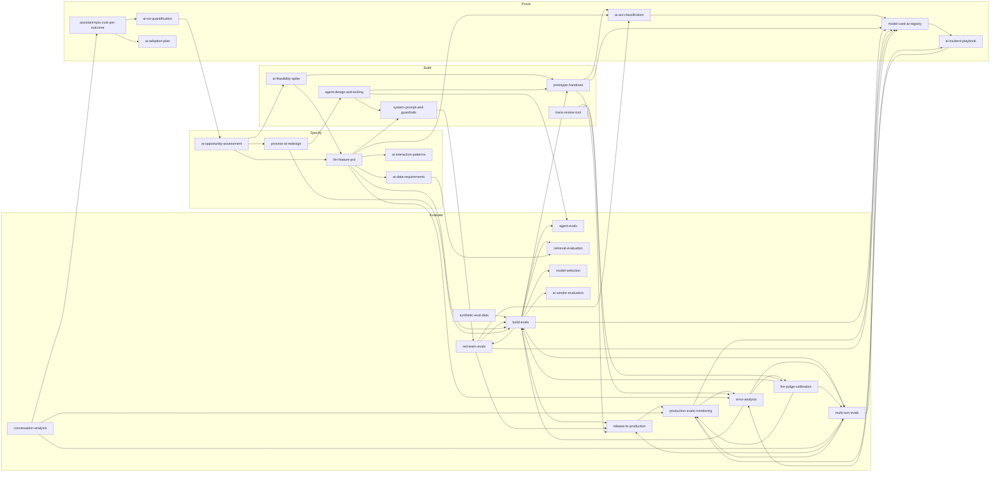

# ai-pm-skills — Product Requirements Document

**Version:** 2.4 · **Date:** 2026-11-12 · **Owner:** Alex Darmon · **Status:** v2.4 brings the catalog to 29 skills: `red-team-evals` and `multi-turn-evals` join the Evaluate block (see §9 and the change log in §15). v2.3 (2026-11-11) added a Build block between Specify and Evaluate. v2.0 (2026-11-09) repositioned the repo on "Evals as evidence"; v1.0 was dated 2026-11-01.

---

## 1. Summary

**ai-pm-skills is an open-source set of 29 skills in four blocks (Specify, Build, Evaluate, Prove), each tested before it enters the catalog, that help an AI product manager in a regulated European enterprise build to learn, then prove three things: that a feature works, what each correct answer costs, and what the regulator will ask for. Evaluation is the spine: the repo calls it *evals as evidence*.**

Each skill is a folder an agent (Claude Code, Codex, Cursor, a custom agent) loads on demand: a `SKILL.md` with the method, templates, sources, and an eval suite run by `claude plugin eval`. The repo is a system, not a list: every skill plugs into shared backbones: the **evals-as-evidence frame** (three readers, six rules, the AI Act article map), **eval statistics** (intervals, sample sizes, judge correction), the **autonomy ladder** (L0 to L5), the **ROI model** (volume × quality × value) and, for Build skills, **build to learn** (what a PM-built artefact is for, who owns what, the red lines).

README promise, one line:

> *Evals as evidence: prove an AI feature works, what each correct answer costs, and what the regulator will ask for.*

| Item | Value |
| --- | --- |
| Repo name | `ai-pm-skills` (GitHub: alexandre-darmon) |
| Format | [Agent Skills](https://agentskills.io) open standard: `SKILL.md` + progressive disclosure |
| Skill count | 29, hard cap 30 |
| Blocks | Specify (what correct means) · Build (build to learn) · Evaluate (offline and online) · Prove (to the sponsor and the regulator), drawn as a loop |
| Test harness | `claude plugin eval`, native format, 3 cases minimum per skill, scored with and without the skill; pass rate shown in README |
| Language | English skills; French legal annexes where the law is French |
| License | MIT for code, CC BY 4.0 for skills, foundations and docs |
| Owner | Alex Darmon, solo, about 1 hour per day |

---

## 2. Problem

**AI products in banks, insurers and retailers rarely die on the PRD. They die on four questions the PM cannot answer: is it legal, does it work, is it adopted, and what did it return.**

The PM playbook (Cagan, Torres, Lenny) covers discovery and delivery; it says nothing about golden datasets, autonomy levels, AI Act annexes or works-council consultation. The ML playbook covers models and says nothing about sponsors, budgets and change.

### What exists and why it does not close the gap

| Existing resource | What it gives | What it lacks |
| --- | --- | --- |
| Generic PM prompt packs and skill repos (dozens on GitHub) | PRD, roadmap, user-story templates | Nothing AI-specific; never tested; no compliance; copied in an afternoon |
| Anthropic, OpenAI, Cursor skill libraries | Engineering and coding workflows | Built for developers, not for the PM who frames, measures and governs |
| LangChain, Langfuse, Braintrust docs | How to trace and evaluate | Tool-bound; no method for deciding what to measure or when to ship |
| Law-firm and consultancy AI Act guides | The regulation explained | PDF prose; not actionable inside the PM's working tool; no link to product decisions |
| Internal enterprise playbooks | Company-specific rules | Not shareable, usually stale, rarely tested |

### Three failure patterns the repo targets

Each seen first-hand on internal assistants and data platforms in banking and retail:

1. **Measured usage, not value.** Dashboards count sessions; nobody samples answers, nobody knows which knowledge base is stale, nobody can state cost per correct outcome. The ROI stays a slide.
2. **Autonomy by accident.** Teams jump from a chat assistant to an agent that acts, with no explicit level, no gate, no guardrail test. Risk and AI Act obligations rise silently.
3. **Compliance as a final gate.** AI Act classification arrives after build, and nobody can show the evidence it asks for: thresholds set before testing, representative test data, accuracy declared, performance watched after release.
4. **Evals as theatre.** A judge nobody validated, one global score, twelve cases presented as proof, no interval. The number looks precise and decides nothing.

The repo's bet: the skill that separates an AI PM from a PM is evaluation, read as evidence for three readers (the user, the sponsor, the regulator). The skills are specific, few (at most 30), and only credible if each one is tested like code, with the unfavourable results published.

---

## 3. Goals, non-goals, success metrics

**Goal: a PM who installs the repo can decide what to measure, when to ship, what a correct answer costs and what evidence counsel gets, and can see how well each skill itself was tested.**

### Goals

1. Cover four blocks (Specify, Build, Evaluate, Prove) with at most 30 specific skills, evaluation first: error analysis, judge validation, agent and retrieval evals, production monitoring.
2. Ship every skill with an eval suite; the README shows each skill's pass rate and date.
3. Make evals-as-evidence, eval statistics, the autonomy ladder and the ROI model the shared language of all skills.
4. Treat the AI Act as a consumer of eval evidence: one classification skill, and every article that asks for testing or monitoring mapped to the eval artefact that answers it. Checklists and questions, never a verdict.
7. Apply the method to the repo itself: regex, template-only control and a blind judge side by side, with 95% intervals, before any headline number.
5. Be usable from any agent that reads `SKILL.md`: Claude Code first, Codex and Cursor verified.
6. Serve the author's own missions first: every Wave 1 skill is one Alex runs on a live client problem within the month.

### Non-goals

- Not a general PM playbook: no roadmap, OKR, user-story or stakeholder-map skills unless AI-specific.
- Not legal advice: skills produce classifications, questions and checklists for counsel, never a conformity verdict.
- Not a redistribution of books or newsletters: skills state the author's own rules and cite the source; no excerpts.
- Not a SaaS, a web app, a marketplace or a course. A repo and a README.
- Not an eval tool: the repo uses `claude plugin eval` and a small deterministic grader script; it builds no eval harness of its own. The method stays harness-neutral (Inspect, Promptfoo). `trace-review-tool` specifies a thin review app; the user's coding agent builds it in their own environment, and the repo ships no app.
- Not a general compliance library: GDPR impact assessments and French works-council consultation were retired in v2.0; the AI Act stays because its articles ask for eval evidence.
- Not more than 30 skills, ever. A 31st replaces one.

### Success metrics

| Metric | 3 months | 12 months | How measured |
| --- | --- | --- | --- |
| Skills shipped with passing suites | 8 | 24 | CI report in README |
| Skills used on a real client mission | 4 | 15 | Author's log |
| GitHub stars | 100 | 500 | GitHub |
| Issues or PRs from strangers | 1 | 20 | GitHub |
| Weekly installs (`npx skills add`, clone) | 20 | 150 | GitHub traffic |
| Eval pass rate, repo average | 80% | 90% | `claude plugin eval` results JSON |
| Legal skills verified within 90 days | 100% | 100% | `last_verified` frontmatter, CI check |
| Articles published, one per wave | 1 | 4 | aiunmagic.com |

The first issue opened by someone the author does not know is the moment the repo stops being a portfolio and becomes a product.

---

## 4. Users and jobs to be done

| User | Context | Job to be done | What they open first |
| --- | --- | --- | --- |
| **Primary: AI / Data PM in a regulated enterprise** (bank, insurer, retailer, utility) | Owns an internal assistant, a chat-with-data product or an agent; reports to a business sponsor and a DSI; legal and DPO in the loop | "When I must say whether an AI feature is good enough, I want evidence my sponsor, my engineers and counsel accept, so the decision does not rest on a demo." | `build-evals`, `error-analysis`, `assistant-kpis-cost-per-outcome`, `ai-act-classification` |
| **Secondary: freelance consultant or agency PM** | Parachuted on an AI initiative, must look credible in week one | "When I land on a client's AI project, I want a repeatable way to audit and structure it in days." | `ai-opportunity-assessment`, `process-ai-redesign` |
| **Secondary: engineering lead or tech lead** | Builds the thing; tired of PRDs that ignore evals and guardrails | "When the PM hands me a spec, I want evals, autonomy level and guardrails already defined." | `build-evals`, `system-prompt-and-guardrails` |
| **Tertiary: student or career switcher** | Learning AI PM; audience of aiunmagic.com and the university course | "I want to see what the job actually looks like, with real artefacts." | README walkthrough, `error-analysis`, `build-evals` |
| **Author** | Runs client missions with these skills, 1 h/day on the repo | "Every skill I write must save me time on my next mission and be worth publishing." | All of Wave 1 |

Design implication: skills are written for the primary user and tested on the author's own missions. Students read; they are not designed for.

---

## 5. Positioning and differentiation

**Positioning statement:** for AI and Data PMs in regulated European companies, ai-pm-skills is the decision side of LLM evaluation: what to measure, when to ship, what one correct answer costs, and what evidence the regulator gets. Engineering-oriented eval courses and skills (Husain and Shankar, Eugene Yan, Anthropic's guides) teach how to build evals; this repo restates their methods for the PM's decisions and adds two things they leave out: cost per correct outcome, and the AI Act articles that turn eval habits into duties. Other repos do parts of this: none of it is claimed as unique.

**Named frame:** *Evals as evidence* (`foundations/evals-as-evidence.md`): three readers, six rules, one article map. The regulatory window is short: annex III high-risk obligations apply from 2 December 2027.

### Four differentiators, in order of defensibility

1. **Evaluation as the spine, with the statistics right.** Thirteen of the 29 skills evaluate: error analysis, judge validation with TPR and TNR, synthetic data, agents (pass^k), retrieval, vendors, release, production monitoring, attack campaigns, whole conversations. Every score carries its number of cases and its interval.
2. **Tested, honestly.** Each skill has an eval suite scored with and without the skill, against its own template, and by a blind judge; all three are published, including where the gain is small.
3. **Evidence for the regulator.** One AI Act skill, and an article map (arts. 9, 10, 15, 17, 26(5), 72, 73) that links each duty to the eval artefact that answers it. Checklist, not verdict.
4. **Lived.** Every rule comes from a problem the author met on a real deployment. Cases in the suites are anonymised real briefs.

### What the repo deliberately is not

- Not broader than competitors. Narrower.
- Not prettier. Plain Markdown, GitHub-native.
- Not opinion-free. Each skill makes calls (e.g. "no A/B below this sample size", "no L4 without action guardrails").

### Adjacent projects and how they connect

| Project | Relationship |
| --- | --- |
| evalblink (PyPI) | Not the repo's test harness. Optional tool for model and classifier comparisons inside `model-selection` and `conversation-analysis`. |
| nanoagent | Reference implementation for `agent-design-and-tooling`; emits traces used in `assistant-kpis-cost-per-outcome` demos. |
| aiunmagic.com | Publishes one article per wave; hosts the pedagogical companion to the eval skills, in English and French. |
| Live assistant mission (anonymised) | Live source for `conversation-analysis`, `assistant-kpis-cost-per-outcome`, `ai-data-requirements`. Data never leaves the client; only the method is published. |
| Husain and Shankar's evals course and evals-skills | The engineering reference this repo complements and credits; methods restated, never copied. |

---

## 6. Design principles — the 10 rules every skill follows

1. **Specific or absent.** If a skill would read the same for a non-AI product, it is not in the repo.
2. **Tested or draft.** A skill without a passing suite is in `drafts/`, not in the catalog, and not in the README count.
3. **Sourced and dated.** Every rule names its source (book, regulation, article, own experience). Legal skills carry `last_verified`; a CI check flags any past 90 days.
4. **Checklist, not verdict.** Legal and risk skills produce classifications, questions for counsel and checklists. They never output "compliant".
5. **Anchored numbers only.** Any ROI, gain or productivity figure must trace to volume × quality × value with named inputs. No free-floating percentages.
6. **The ladder is the spine.** Any skill that touches autonomy, risk, release or governance references the L0–L5 ladder in `foundations/`, never a local definition. Each skill cites a synced copy in its own `references/`, so it works when installed alone; CI fails if a copy drifts from the original.
7. **One skill, one job.** Inputs and outputs fit in a screen. Two jobs = two skills. A skill that needs another one says so in `depends_on`.
8. **Progressive disclosure.** Frontmatter `description` is the trigger (under 200 characters). `SKILL.md` body is the method (under 2 000 words). Heavy material lives in `references/` and is loaded only when needed.
9. **Own words, cited ideas.** Books and newsletters are sources, never content. No excerpts longer than a sentence.
10. **Thirty is the ceiling.** A new skill must replace or merge an existing one once the catalog hits 30.

---

## 7. Repository architecture

### 7.1 Folder layout

```
ai-pm-skills/
├── README.md                      # promise, catalog table with pass rates, install, 60-second example
├── LICENSE                        # MIT for code; points to CC BY 4.0 for the rest
├── LICENSE-CC-BY-4.0              # skills, foundations, docs
├── CONTRIBUTING.md                # how to author a skill, how to add cases, review checklist
├── foundations/                   # shared backbones, read by many skills
│   ├── autonomy-ladder.md         # L0–L5, gates, obligations per level
│   ├── roi-model.md               # volume × quality × value, baseline rules
│   ├── eval-conventions.md        # grader types, thresholds, case format, holdout policy
│   ├── evals-as-evidence.md       # the frame: three readers, six rules, AI Act article map
│   ├── build-to-learn.md          # Build skills: what a PM-built artefact is for, who owns what, red lines
│   ├── eval-statistics.md         # intervals, sample sizes, paired comparisons, judge correction, pass^k
│   └── sources.md                 # bibliography with one-line "what we take from it"
├── docs/
│   └── evaluation.md              # the evaluation process explained with diagrams
├── skills/
│   ├── <skill-name>/
│   │   ├── SKILL.md               # frontmatter + method (the only file always loaded)
│   │   ├── references/            # deep material, loaded on demand; synced copies of cited foundations
│   │   ├── templates/             # output templates (markdown, yaml, csv)
│   │   └── evals/                 # `claude plugin eval` cases, one folder per case (≥3, plus ≥1 negative)
│   │       └── <skill-name>-001/
│   │           ├── prompt.md      # frontmatter (name, tags, expected_outcome) + scenario sent to the agent
│   │           ├── graders/       # one file per check: regex, tool_used, llm; red lines named redline-*.md
│   │           └── fixtures/      # good.md and bad.md (hand-written) plus good-*/bad-* real answers: they test the graders
│   └── ...
├── drafts/                        # same structure, no passing suite yet; not counted
├── templates/skill/               # starting point for a new skill, cases included
├── baselines/                     # <skill>.json: the latest recorded run (model, judge model, date, skillHash, casesHash, scores with and without)
│   └── history.jsonl              # every recorded run appended, pass or fail
├── .claude-plugin/marketplace.json # install all tested skills or one, as Claude Code plugins
├── scripts/
│   ├── validate_skills.py         # structure check: frontmatter, headings, cases, graders, foundation copies (--sync writes them), free grader checks and evidence gate (§11.7)
│   ├── run_evals.py               # `claude plugin eval` per changed skill: threshold, delta rule, red lines in every run, negative cases, discrimination report, recorded runs, --regrade
│   ├── check_freshness.py         # fails CI if a legal skill's last_verified > 90 days
│   └── build_readme_table.py      # regenerates the catalog table from frontmatter + results
└── .github/workflows/
    ├── validate.yml               # on push and PR: structure check
    ├── evals.yml                  # on request only: PR label `run-evals` (changed skills) or manual run (`all`)
    └── freshness.yml              # weekly
```

Private holdout cases (20% of each suite) live outside the repo, in a private repo `ai-pm-skills-holdout`, pulled by the full-suite run only. See section 11.

### 7.2 `SKILL.md` specification

Frontmatter (YAML), all fields required unless marked optional. It follows the [Agent Skills specification](https://agentskills.io/specification): only `name`, `description`, `license` (`CC-BY-4.0`), `compatibility`, `metadata` and `allowed-tools` sit at the top level, because claude.ai, the Skills API and `skills-ref validate` reject any other key. Every field below `description` goes under `metadata:`, as a quoted string (the spec maps string keys to string values); lists are comma-separated.

| Field | Type | Rule |
| --- | --- | --- |
| `name` | string | kebab-case, equals folder name |
| `description` | string | the trigger; ≤ 200 chars; states *when* to use, in the user's words |
| `stage` | enum | specify · build · evaluate · prove |
| `version` | semver | bumped on any rule change |
| `last_verified` | date | mandatory for `legal` skills; optional elsewhere |
| `legal` | bool | optional, default false; true when the skill reads the law (no judge grader, threshold ≥ 0.90, `last_verified` mandatory) |
| `depends_on` | list (comma-separated) | skill names whose output this skill consumes |
| `feeds` | list (comma-separated) | skill names that consume this skill's output |
| `autonomy_relevant` | bool | true if the skill reads or sets an L-level |
| `sources` | list (comma-separated) | ids from `foundations/sources.md` |
| `eval_threshold` | number | pass threshold for the skill's cases; 0.80 by default, 0.90 for `legal` and flagship skills |
| `status` | enum | draft · tested · verified-in-mission |

Body structure (fixed headings, so graders can check structure):

1. **When to use** — 3 to 5 trigger situations, and 2 anti-triggers ("do not use when…").
2. **Inputs** — what the agent must have or ask for; which are mandatory.
3. **Method** — numbered steps; each step says what to produce and the rule it applies.
4. **Output** — the exact artefact, pointing to `templates/`.
5. **Rules and red lines** — the opinions: what the skill refuses to do.
6. **Links** — which foundation (as `references/<file>.md`, its synced copy) and which other skills it calls.
7. **Sources** — ids, one line each.

### 7.3 README

- One-line promise, then a 60-second example (install, run one skill, see output).
- Catalog table generated from frontmatter: stage · skill · description · pass rate · last run · status.
- "How it's tested" paragraph linking to `foundations/eval-conventions.md`.
- "Not legal advice" notice above the Prove section.
- A 10-second GIF: a skill triggering inside Claude Code and producing its artefact.

### 7.4 Installation targets

- Claude Code: `skills/` directory or plugin marketplace (`.claude-plugin/marketplace.json`) so `claude plugin details` shows token cost.
- Codex / Cursor / others: via the Agent Skills standard (`npx skills add alexandre-darmon/ai-pm-skills`).
- Verified matrix in README: which agents were tested, on which date.

---

## 8. The backbone

### 8.1 Autonomy ladder (foundations/autonomy-ladder.md)

The ladder is the single definition of "how autonomous" used by every skill. A process step, an assistant or an agent is always at one level, and moving up requires passing a gate.

| Level | Name | Who acts | Human role | Gate to enter this level | Typical obligations that rise |
| --- | --- | --- | --- | --- | --- |
| **L0** | Manual | Human | Does the work | — | — |
| **L1** | Assisted | Human | Does the work, AI suggests | Offline eval on golden set ≥ threshold; user tested on 5 people | Transparency to users; AI literacy (AI Act art. 4) |
| **L2** | Human in the loop | AI produces, human validates every output | Validates 100% | L1 in production 4 weeks; quality KPI stable; guardrails on output tested | Logging; DPIA pre-screen if personal data |
| **L3** | Human on the loop | AI acts, human sees exceptions and a sample | Reviews exceptions + sample | Shadow run ≥ 2 weeks; false-positive rate of guardrails known; escalation path tested | Incident playbook; CSE consultation if it changes work organisation |
| **L4** | Autonomous with guardrails | AI acts within limits; automatic stop | Sets limits, reviews reports | Action guardrails (scope, caps, approvals) tested in redteam; canary passed; rollback in one click | High-risk classification check (AI Act annex III); human oversight design (art. 14); model card |
| **L5** | Self-improving loop | AI acts and improves on its own outcomes until plateau | Intervenes at plateau | L4 stable 3 months; eval gate automated; drift detection live | Continuous monitoring; change-management of the model itself; registry update on each version |

Rules shared by all skills:

- Levels are assigned **per process step**, not per product. A product can be L3 on routing and L1 on drafting.
- You never skip a level in production. You may skip in design.
- Moving down a level is always allowed and never needs approval.
- The gate is a measured fact (a score, a run, a test), never an opinion.

### 8.2 ROI model (foundations/roi-model.md)

```
ROI (per use case, per period) =
    volume            # outcomes produced by the AI in the period
  × quality           # share of outcomes judged correct / accepted
  × unit value        # € value of one correct outcome (time saved × loaded cost, or error cost avoided)
  − run cost          # tokens + infra + licences
  − change cost       # training, support, review time
```

Rules:

- **Volume** comes from traces or conversation classification (skill `conversation-analysis`), never from declared usage.
- **Quality** comes from sampled evaluation (`build-evals`, `assistant-kpis-cost-per-outcome`), never from thumbs-up alone.
- **Unit value** comes from the business (interviews, time studies), conservative, sourced, with the assumption written down.
- A baseline before deployment is mandatory; without it the ROI is a projection and is labelled so.
- Any skill that outputs a gain must show these five lines. Otherwise the output fails its grader.

---

### 8.3 Evals as evidence (foundations/evals-as-evidence.md)

An eval in a regulated company is evidence owed to three readers: the user (correct answers on real questions), the sponsor (cost per correct outcome) and the regulator (bars set before testing, representative data, monitoring after release). Six rules turn a score into evidence: decided before seen, measured with its uncertainty, traceable, per class, kept when unfavourable, checklist not verdict. The file maps AI Act arts. 9(6)–(8), 10(3)–(4), 15, 17(1)(d), 26(5), 72 and 73 to the eval artefact that answers each.

### 8.4 Eval statistics (foundations/eval-statistics.md)

One page of formulas every evaluate skill uses: the case as the unit, Wilson intervals and the rule of three, sample size per class, gating on the lower bound for costly classes, paired comparisons (a gap under 2√d / n is a tie), bootstrap over cases, the judge-corrected pass rate (Rogan–Gladen), Cohen's kappa, pass^k for agents, control limits for production rates, A/B sample size.

---

## 9. Skill catalog — 29 skills in four blocks

Legend: **P0** first, **P1** next, **P2** later. Codes: S Specify, B Build, E Evaluate, P Prove. Graders: *exact* (deterministic check), *checklist* (structure and mandatory items), *judge* (LLM with rubric, validated with TPR and TNR). Skills marked *legal* follow the legal rules (§7.2). Entries for skills kept from v1.0 are unchanged except for their codes.

Status (2026-11-12): all 29 entries are in the catalog (`skills/`, status `tested`), each with a passing recorded run on its current text. The last two in were `red-team-evals` (E12) and `multi-turn-evals` (E13), in slots 28 and 29; slot 30 stays free and `drafts/` is empty.

### Specify — what correct means (5)

#### S1 · `ai-opportunity-assessment` — P1
- **Purpose:** decide in one page whether an AI idea deserves a PRD and in which form; on a go or explore, write the sponsor ask that will settle it: one dated pilot, stop conditions and an evidence plan.
- **Trigger:** "Should we do this with AI?", a sponsor pitches a use case, a vendor demo lands, a comex slot needs the one-pager, a draft pitch carries a gain nobody can trace.
- **Inputs:** the problem in the business's words; who suffers it and how often; current process and cost; data (source, volume, quality, access); constraints; risk context; any quality already measured (n, chosen how); audience and decision date when money is asked.
- **Outputs:** problem and evidence; non-AI alternative with n of N; data readiness 0–5 on 5 axes; feasibility by approach; build, buy or API; cost of a wrong answer and target level; risk flags; decision (go, no-go, explore), and on explore, when the open question is whether the model can do the task at an acceptable cost per correct answer, a time-boxed spike with B1; gain in five lines labelled a projection, low and high from interval bounds; evidence plan (metric per class, cases per class, labellers, date, thresholds signed before the run); one dated ask; stop conditions (metric, threshold, where and when read, action); AI-specific objections.
- **Rules:** no AI if a rule covers about 80%; readiness below 2/5 blocks a go; always name the non-AI alternative; no quality claim without n of N; while the gain is unmeasured the ask is a pilot, never a rollout; no pilot without a stop condition; never "compliant".
- **Depends on / feeds:** — / S2, B1, E1, P3, P2.
- **Sources:** cagan-inspired, fitzpatrick-mom-test, miller-error-bars, own-enterprise-checklist, repo-chanmeng, repo-vishalhabib, repo-yoseph.
- **Evals (5 + 1 negative):** invoice prioritisation a query covers (expected: no-go on AI); clause extraction on scanned, unlabelled contracts (expected: explore, readiness < 2/5); B2B ticket triage (expected: go, LLM workflow at L2); comex ask for a 9,000-user rollout on liked tests (expected: dated measurement pilot, stop condition, sized sample); draft pitch with "30% productivity" (expected: anchored or removed, projection from the 76–87% interval); negative: PRD request after a go.
- **Graders:** exact and checklist regexes; red lines: no go on AI, no go on poor data, no L4/L5 launch, no rollout ask, no free 30%.

#### S2 · `llm-feature-prd` — P0
- **Purpose:** write a PRD for an LLM-powered feature that an engineering lead can build and an evaluator can test.
- **Trigger:** "Write the PRD", a go from S1, a feature request involving generation, extraction, classification or an agent.
- **Inputs:** S1 output or equivalent; target users; success metric; constraints (latency, cost per call, sovereignty, languages); data sources. Optional: the B1 spike report (n of N per class, cost per correct answer, failure classes), which seeds the eval stub and open questions and is never release evidence.
- **Outputs:** PRD with fixed sections: problem, users, non-goals, autonomy level per step, happy path and failure paths, eval plan stub (what "correct" means, how it's sampled; each criterion and gate written as one testable line that a Spec Kit constitution can import), guardrail requirements (input, output, action), data requirements pointer, compliance flags, KPIs, rollout plan (shadow → canary → GA), open questions.
- **Rules:** a PRD without an eval section is incomplete; failure paths are mandatory (wrong answer, no answer, injection, out-of-scope); autonomy level is stated per step; the KPI is an outcome, not usage.
- **Depends on / feeds:** S1, B1 / E1, B2, S3, P3.
- **Sources:** Cagan, Torres (outcomes over output), own PRDs.
- **Evals (3):** a summarisation feature (expected: eval plan with reference summaries and rubric); an agent that books refunds (expected: L2 then L3 path, action guardrails); a brief with no success metric (expected: skill asks before writing).
- **Graders:** checklist (all sections; autonomy per step; ≥ 3 failure paths; eval stub; KPI is outcome).

#### S3 · `ai-data-requirements` — P1
- **Purpose:** specify everything an AI feature reads or writes: structured fields and where each flows (prompt, retrieved context, logs, eval set, vendor, training), and the documents it retrieves from (source register, owners, expiry, dated versions, who may see what).
- **Trigger:** PRD done, "what data do we need", a DPO asks what is processed, "set up the RAG / vector store", stale or contradictory answers, an unowned knowledge base, one index mixing public and restricted documents.
- **Inputs:** PRD or feature description; candidate tables, fields and documents; users; owners, access constraints, retention, change frequency, sensitivity, volumes (asked if missing).
- **Outputs:** blockers first; Part A fields (personal data, lawful basis, owner), flow table with retention per destination, quality thresholds measured today, pseudonymisation plan; Part B source register (owner, refresh, expiry, effective dates, sensitivity, users allowed), excluded sources, dated versions, access control at retrieval, no-source behaviour, labelled queries for E1 and E6, stale-answer KPI.
- **Rules:** one owner per source or it is out (never "index everything"); every personal-data field has a lawful basis or is dropped; freshness and expiry are numbers; never clean the sample before measuring; restricted documents never share an index without access control at retrieval; replaced versions are dated, not deleted.
- **Depends on / feeds:** S2 / E1, E6, E4, E10, P1, S5.
- **Sources:** dama-dmbok, gdpr, own-data-platform, own-assistant-mission, own-rag-practice, repo-vishalhabib, repo-product-on-purpose, repo-chanmeng.
- **Evals (5 + 2 negatives):** customer-email drafting (expected: lawful basis per field, flow table with retention); catalog search with no personal data (expected: numeric freshness); claims table with no owner (expected: blocker, owner named, unfiltered sample); 40 sources, 12 unowned, "index everything" (expected: 12 excluded, expiry, no-source behaviour, labelled queries); yearly HR policies against weekly specs (expected: distinct expiry, dated versions, stale-answer KPI); negatives: MRR definition dispute, assistant KPI dashboard.
- **Graders:** exact and checklist regexes; red lines: lawful basis "TBD", vague freshness, ownerless table used as is, everything indexed, vague expiry.

#### S4 · `ai-interaction-patterns` — P2
- **Purpose:** design the user-facing behaviour of an AI feature so users trust it correctly: not too much, not too little.
- **Trigger:** UX design of an assistant, "how should it show uncertainty", complaints that users over-trust or ignore the AI.
- **Inputs:** PRD; autonomy level; user research notes; error profile from evals.
- **Outputs:** interaction spec: how sources and confidence are shown, correction and feedback affordances, refusal wording, escalation to human, latency expectations and progressive display, voice/text decisions, what is logged from feedback.
- **Rules:** confidence is shown only if calibrated; every answer is correctable in one action; refusals explain scope; feedback feeds the eval set.
- **Depends on / feeds:** S2, E1 / B2, P6.
- **Sources:** own UX work on assistants; human-AI interaction guidelines (Microsoft HAX, Google PAIR as references).
- **Evals (3):** an L1 drafting assistant (expected: edit-first UI, no autonomy affordances); an L3 triage agent (expected: exception queue design, sample review); a feature with uncalibrated scores (expected: confidence hidden, replaced by sources).
- **Graders:** checklist + judge.

#### S5 · `process-ai-redesign` — P1 (flagship)
- **Purpose:** redesign a business process into an AI-enabled process with an explicit autonomy level per step, a path to reach it, and the trade-offs.
- **Trigger:** "Automate this process", an efficiency programme, a process with high volume and exceptions, an ROI target.
- **Inputs:** process documentation; volumes; time per step; exception rates; current cost; data per step; risk and regulatory context; appetite for autonomy.
- **Outputs:** redesign dossier: step table (current state, target level L0–L5, why not L+1, gate to reach target); scenarios (conservative / target / ambitious) with the five ROI lines each; migration path (level by level, with gates from E1 and conditions from B2); trade-off table (cost per outcome, risk, reversibility, obligations per scenario); dependencies on P3 and on employee-representative information; plan with milestones.
- **Rules:** levels per step, never per process; every target level names its gate; scenarios are compared on cost per outcome and reversibility, not on "efficiency"; a step touching employees' work or evaluation is flagged for HR and counsel (workers' representatives informed before use); an L4+ step triggers a P3 re-check; no scenario without a human fallback.
- **Depends on / feeds:** S1, E11, P2, P3, B3 / P6, B3.
- **Sources:** foundations/autonomy-ladder.md and roi-model.md; own process-redesign practice in banking; Hammer (reengineering) for method lineage.
- **Evals (3):** a KYC document review process (expected: L2 extraction, L3 verification, L1 decision; gates named); a request for "full automation" of complaint handling (expected: L4 on routing only, human on decisions, trade-offs); a process with 40% exceptions (expected: lower target levels, exception redesign first).
- **Graders:** checklist (step table, three scenarios, five ROI lines, trade-offs, gates) + exact (every step has level and gate; every L4+ step references P3).

### Build — build to learn (5)

The Build skills that make something (B1, B3, B4, B5) cite `references/build-to-learn.md`: a PM-built artefact is evidence and a handover, never production code. The PM sets the question, the cases, the bar and the kill date; a coding agent writes the prototype; AI engineers own everything production.

#### B1 · `ai-feasibility-spike` — P0
- **Purpose:** a throwaway prototype on the real model that answers one question before a PRD or a budget bet: can the model do this task well enough, and at what cost per correct answer.
- **Trigger:** "Can the model actually do this?"; a spike, POC or hackathon build; an "explore" outcome from S1; spike results to read; someone wants to reuse spike numbers as validation evidence.
- **Inputs:** the task; the question classes and the costliest error; the model and hosting route production would use; where the cases come from. Ask: the decision and who takes it; today's process cost or the value of one correct answer (for the appetite); the target autonomy level; whether the spike's tool and model contract are authorised. When results are in: counts per class, the bar and appetite written before the run, spend and hours from logs.
- **Outputs:** spike report (`templates/spike-report.md`): the one question; the items fixed and signed before the build (appetite as a time box in days and a maximum cost per correct answer, target and stop line per class, case count per class, kill date, decision taker); tool, data and size check; lethal-trifecta check; design (workflow or agent, and why); criteria drift log; per class n of N, Wilson interval and reading (clears, promising, undecided, short, dead); cost per correct answer against the appetite, plus rework of wrong answers, and hours from logs; decision (go to PRD, reshape or stop); what `build-evals` must do before any release claim; `scripts/spike_readout.py`. Optional: an acceptance brief a coding agent can run (`templates/acceptance-brief.md`).
- **Rules:** no production credentials or production personal data in a spike; the tool must be authorised and registered, and even then cases are synthetic, anonymised or pseudonymised; a spike number is never release or validation evidence, nor the system's accuracy; nothing is built before the question, appetite, bar, case count and kill date are written, and the bar and appetite never move after results (only the criteria may, logged); a class never "meets the bar" when its lower bound is under it; cost is per correct answer, and a future price drop is not a measurement; no extension past the kill date without a new appetite; workflow before agent; never all three legs of the lethal trifecta; the spike never sets an autonomy level.
- **Depends on / feeds:** S1 / S2, E1, B5.
- **Sources:** cagan-prototypes-products, singer-shape-up, kromer-learn-measure-build, shankar-validators, wilson-interval, willison-lethal-trifecta, metr-ai-dev-productivity, anthropic-agents, esma-qa-2103, dora-rts-ict-risk, dora, gdpr, replit-db-incident, own-spikes.
- **Evals (5 + 1 negative):** claims-email triage agent to be built "over a few weeks" (expected: one question, time box in days, cost ceiling derived from handler minutes, stricter bar and more cases for bodily injury, kill date, workflow first, forwarding removed in code); 2,000 real CRM complaints through a team API account opened on a company card (expected: refused as an unauthorised ICT asset, ICT third-party and DPO processor questions, a few dozen synthetic cases per type, kill date, outbound leg removed); 37 of 40 synthetic cases with the definition of correct changed twice, offered as the validation pack for an L3 go-live (expected: refused as evidence, about 80–97%, cases sampled from traffic and sized per category, criteria frozen); KYC extraction at 28 of 30 and 9 of 10 against a 90% bar (expected: about 79–98% and 60–98%, not demonstrated, go for passports only, reshape registry extracts, `build-evals` sizing); invoice-coding agent at 41 of 50 for 31 EUR against a 0.25 EUR ceiling (expected: about 0.76 EUR per correct coding, three times the ceiling, rework added, price drop unmeasured, reshape into a workflow or stop); negative: is AI right for supplier-payment prioritisation (S1).
- **Graders:** regex and tool checks, no judge; red lines: time box in days, no real data in the spike, not release evidence, no validation claim, not demonstrated on the point estimate, no go and no PRD recommendation over appetite.

#### B2 · `system-prompt-and-guardrails` — P1
- **Purpose:** write the system prompt and the three guardrail layers (input, output, action) as one coherent, tested unit.
- **Trigger:** first prompt draft, a jailbreak found, an agent gets tools, moving up the ladder.
- **Inputs:** PRD; autonomy level per step; tools available to the agent; sensitive data classes; latency and cost budget.
- **Outputs:** system prompt (role, scope, refusal policy, format); guardrail spec per layer with mechanism, latency budget, cost per call, failure action; a redteam case set (≥ 20 injections, ≥ 10 out-of-scope, ≥ 5 action-limit attempts) added as cases tagged `redteam` in the skill's `evals/`; false-positive budget.
- **Rules:** no L3 without tested output guardrails; no L4 without action guardrails (scope, caps, approvals); each guardrail has a latency and cost line (cheap classifiers first, frontier last); guardrails are defence in depth, never a guarantee; the skill refuses to claim "safe".
- **Depends on / feeds:** S2, B3 / E1, E9, P3, B4.
- **Sources:** OWASP Top 10 for LLM applications, own guardrail work, AI Act art. 14 (human oversight).
- **Evals (3):** a refund agent with no caps (expected: caps + approval rule added, L4 blocked); a prompt with "be helpful" and no scope (expected: scope and refusal added); a redteam run with 30% false positives (expected: tuning plan, not acceptance).
- **Graders:** checklist (three layers, budgets, redteam set sizes) + exact (redteam pass rate ≥ threshold, false positives ≤ budget, measured by the eval run).

#### B3 · `agent-design-and-tooling` — P1
- **Purpose:** design an agent's loop, tools and permissions from its target autonomy level, before any framework choice.
- **Trigger:** "Make it an agent", a workflow has branches and tools, a framework debate starts.
- **Inputs:** process steps with their L-levels (from S2 or S5); candidate tools (APIs, DBs, actions); failure modes; latency and cost constraints.
- **Outputs:** agent design doc: loop type (single-step, plan-execute, multi-agent only if justified), tool list with schemas, permission matrix (tool × level × approval), memory policy, stop conditions, trace schema (what is logged, outcome event fields), framework recommendation last; a prototype check: the tool set run on a local MCP server with synthetic or anonymised data and no production credentials, on about 10 representative tasks, before handoff to engineering, with the traces read and tool names, descriptions and response sizes fixed before the prompt.
- **Rules:** start with a raw loop (nanoagent reference) and add a framework only for a named need; every tool call is logged with an outcome field; multi-agent requires a written justification; permissions follow the ladder; the MCP prototype is evidence for the design, not the build (references/build-to-learn.md), and is recorded as "not yet run" when skipped.
- **Depends on / feeds:** S2, S5 / B2, P1, B4, B5.
- **Sources:** nanoagent (own), Anthropic "Building effective agents" and its guide to writing tools, the MCP specification, own enterprise agent work.
- **Evals (3):** a linear 3-step workflow (expected: no multi-agent, single loop); an L4 step with payment tool (expected: cap + approval in matrix); a design without stop conditions (expected: added, with max steps and budget).
- **Graders:** checklist + exact (permission matrix covers every tool × level).

#### B4 · `trace-review-tool` — P1
- **Purpose:** specify the thin, single-file review app a coding agent builds in the company's own environment, so domain experts can label exported traces fast, and the minimum capture contract per model call that makes traces judgeable.
- **Trigger:** "build us a quick labelling tool"; experts must label a few hundred outputs before an error analysis, a judge calibration or a release; exported traces lack what a reviewer needs and engineering asks what to log per call; someone asks how long traces and labels are kept.
- **Inputs:** the feature and what its traces contain; the named experts and the number of traces; the decision the labels feed; personal-data rules and the DPO. Ask: monthly volume and classes; feedback signals for targeted strata; minutes per trace and loaded cost; the storage already approved for this data class; whether the system may be high-risk.
- **Outputs:** review app brief (`templates/review-app-brief.md`): gap check first (use an approved tool if one exists); the ICT asset question before any production-derived data; masking in the export step with consistent placeholders and a residual-leak check sized by 3/n; a separate seeded sampling script (random and targeted streams, dev/test split); one screen per trace with pass/fail plus critique; `reviewer_id` from the company login and `labelled_at` on every label, append-only; approved storage; exports in the formats E2 and E3 read; smoke test on 10 known traces and review by a fresh session; review cost and cost per correct output; the capture contract (prompt and model version, retrieved ids, tool calls, guardrail hits, human overrides, tokens and cost, latency, join key to the business outcome, in `references/capture-contract.md`); retention questions for counsel (AI Act art. 12, 19, 26(6), the financial-institution clause, the application date, GDPR minimisation); kill date and owner.
- **Rules:** never load unmasked production personal data, and no production-derived data, even masked, before the app is approved as an ICT asset; never save a label without reviewer identity and timestamp, never overwrite one; the app never samples or sorts, and rates come from the random stream only; no 1–5 score and no model pre-label before the expert reads; labels only in approved storage; no vendor or framework click-paths; never call the logging or the app compliant; not production code (no production credentials, a kill date, a handover).
- **Depends on / feeds:** B3, B2 / E2, E3, E1, B5, E10.
- **Sources:** husain-field-guide, repo-evals-skills (build-review-interface credited), husain-shankar-evals, eu-ai-act, eu-digital-omnibus-ai, gdpr, esma-qa-2103, dora-rts-ict-risk, aws-euc-tiers, otel-genai, wilson-interval, own-review-apps.
- **Evals (4 + 1 negative):** 300 complaints-reply drafts for three officers, app wanted this afternoon (expected: masking in the export, leak check about 1% on 300, separate sampling script with the rate and interval from the random stream, reviewer id and timestamp, approved storage, edits captured as overrides); credit affordability assistant logging only question and answer, 30-day retention, risk officer wants "compliant" (expected: capture fields with a join key to the loan, possible high-risk flag, art. 12, 19, 26(6), six-month floor, financial-institution clause, 2 December 2027, provider or deployer, labels as logs, all as questions, no verdict); AML alert summaries, raw export with names and IBANs on a laptop, no accounts (expected: both refused, ICT asset first, consistent placeholders, real-name checks in the source system, leak check about 1.5% on 200, approved storage); motor claims letters with a worst-first queue and a pre-filled GPT score (expected: rate from the random stream only, targeted fill over-counts, binary label read by the expert first, dev/test split, 840 EUR of review, cost per correct letter); negative: grouping 160 labelled critiques into failure modes (E2).
- **Graders:** regex and tool checks, no judge; red lines: mask before load, reviewer identity, no compliance verdict.

#### B5 · `prototype-handover` — P0 (legal)
- **Purpose:** decide what a PM-built AI artefact (prompt app, notebook, agent, review tool) becomes in a bank or insurer: rebuilt by engineering, registered at its end-user computing tier, or retired on its kill date; and hand over the eval suite and frozen baseline as the contract engineering rebuilds against.
- **Trigger:** a prototype gets users or a team asks for it; its kill date is near or past; engineering is asked to "take over" a PM-built tool; IT risk, model risk or an auditor asks whether it is in the ICT asset inventory.
- **Inputs:** what it does; users; data read and credentials used; what it writes or does; autonomy level per step today and wanted; model and version, where the prompts live; eval cases and scores; the kill date. Ask: the judge's TPR and TNR, sponsor and named owner, DORA scope, whether outputs feed decisions about people. A missing fact that changes the tier becomes a question, never an assumption in the lower tier's favour.
- **Outputs:** handover file (`templates/handover-file.md`): containment line; inventory; tier on two axes (four EUC tiers × autonomy level, take the higher); outcome (rebuild, register, retire); handover contract (suite, frozen baseline per class with n of N and Wilson interval, signed bar, judge with TPR and TNR, prompts and model ids as configuration under change control, level per step, trace fields); intended-vs-implemented note; rebuild list (authorisation and row-level access, secrets, environments, logging, guardrails in code, gateway, no production credentials); draft ICT asset entry (DORA art. 3(7), ESMA Q&A 2103, RTS 2024/1774) with the AI fields; AI Act provider flag for an in-house system put into service for own use (art. 3(3), 3(11), 25(1)), for P3; questions for IT risk, model risk, counsel and the DPO; freshness line.
- **Rules:** never "approved", "compliant", "cleared" or "safe to run"; a prototype holding production personal data or production credentials never runs past its kill date without a dated decision by a named owner, and any exception is time-boxed in weeks, never "until the rebuild", never on the PM's credentials; spike or prototype numbers are never release evidence: they set the baseline, and the gate runs on the engineering build; a tier is never lowered because "a human checks" unless every output is validated; a model or prompt change invalidates the baseline for that version; never redefine autonomy levels; article numbers only from `references/handover-register-map.md`.
- **Depends on / feeds:** B1, E1, E3, B3 / E9, P3, P4.
- **Sources:** aws-euc-tiers, esma-qa-2103, dora-rts-ict-risk, dora, eu-ai-act, gdpr, cagan-prototypes-products, bloomberg-ing-vibe-coding, replit-db-incident, singer-shape-up, shankar-validators, husain-shankar-evals, wilson-interval, sierra-adlc, own-practice.
- **Evals (5 + 1 negative):** motor claims triage app at 364 of 400 by an unvalidated LLM judge, engineering offers to take it over (expected: tier 3, rebuild against the suite, about 88–93% per category, judge not validated without TPR and TNR, change control, row-level access, ICT asset entry, IT risk questions); covenant-breach notebook on production loan data with the PM's credentials, past its kill date, sponsor wants it until Q2 (expected: containment first, dated decision by a named owner now, credentials revoked, exception in weeks at most, tier 3, RTS art. 16 and 16(9), DPO question); sponsor wants 38 of 40 recorded as validated while engineering moves to a newer model version (expected: refused as release evidence, about 84–99% per topic, version change invalidates it, suite re-run on the engineering build); personal competitor-summary app 15 colleagues want (expected: tier 1 now, tier 2 shared, registered not rebuilt, owner, change control, small eval set, review date, autonomy level); in-house underwriting agent at 221 of 250, autonomous simple files wanted (expected: tier 3 then tier 4, rebuild, about 84–92%, possible provider for own use, Annex III point 5(c) flag to P3, health data to the DPO); negative: release plan for a new prompt version of a service engineering already runs (E9).
- **Graders:** exact and checklist regexes only, threshold 0.90; red lines: no verdict (every positive case), decision now and no drift past the kill date, no spike number as release evidence.

### Evaluate — offline and online (13)

#### E1 · `build-evals` — P0
- **Purpose:** build or review the eval set, graders, thresholds and baseline that decide whether an AI feature, model or skill is good enough.
- **Trigger:** PRD eval stub exists, before any model choice, before any release, when quality is disputed.
- **Inputs:** the task definition; 20+ real examples (anonymised); what "correct" means to the business; question classes and their traffic share; judge budget; who labels.
- **Outputs:** eval plan: end-to-end gate plus a check per component for multi-step pipelines (references/component-evals.md, incl. text-to-SQL and displayed confidence scores); classes, set composition (real, synthetic flagged, 20% private holdout) and the size each gated class needs; failure modes read (via E2) and a grader per mode; judge validation with TPR and TNR (via E3); thresholds per class signed before the run, with scores, n and 95% intervals; frozen baseline; cost per correct outcome; when a class misses its bar, an improve loop (references/improve-loop.md: fixes ranked by failure share, a prediction recorded before each run, one variant against the frozen baseline, a stop rule fixed in advance); cases in `claude plugin eval` format (harness-neutral).
- **Rules:** real cases over synthetic; no judge as a gate unless TPR and TNR on held-out expert labels reach the bar set beforehand (raw agreement never qualifies); one threshold per class; a costly class gates on the lower bound of its interval; holdout never public; baseline names model, judge and date; score on cost per correct outcome.
- **Depends on / feeds:** S2, E2 / E3, E7, E8, E9, E10, P4.
- **Sources:** anthropic-evals, husain-shankar-evals, miller-error-bars, wilson-interval, own-golden-sets, repo-chanmeng, repo-vishalhabib, repo-lenny.
- **Evals (6 + 1 negative):** 8 labelled invoices (expected: more real cases, synthetic flagged, provisional); judge at 62% agreement pushed as a release gate (expected: not a gate, rubric revision, human review); single global threshold (expected: per-class, stricter on legal); invoice pipeline at 84% end to end, team wants to swap the extraction model (expected: a check per step, first failing step, frozen upstream outputs, paired comparison, end to end still gates); costly card-disputes class at 58 of 60 against a signed 95% (expected: lower bound ≈ 89%, not demonstrated, about 650 cases needed, human review kept, threshold not moved); costly claims queue at 147 of 150 against a signed 97% (expected: lower bound ≈ 94%, that queue held while the others go live, about a thousand cases, threshold not moved); negative: model choice on a calibrated suite.
- **Graders:** checklist + exact (holdout, per-class thresholds, baseline, interval, cases needed); red lines: synthetic flagged, judge not a gate, no global threshold, end to end still gates, no ship or go on the point score.

#### E2 · `error-analysis` — P0
- **Purpose:** find out how an AI feature actually fails before choosing metrics or graders: read real traces, note each freely, group into failure modes, count and price them, decide per mode to fix, evaluate or accept.
- **Trigger:** "our assistant gives bad answers, where do we start?", "which metrics should we track?", generic 1–5 scores proposed before anyone read outputs, before graders or a judge, after a model, prompt or KB change, a complaint spike.
- **Inputs:** real traces with intermediate steps and monthly volume; the spec or system prompt; the accountable domain expert; personal-data rules. Ask: question classes, feedback signals, sourced cost of one wrong answer, autonomy level per step.
- **Outputs:** failure-mode report: sampling plan and masking; reading log (traces per stream, last new mode, saturation, taxonomy version); table of binary modes with pass and fail examples, count, share of the random stream with Wilson interval, sourced cost per occurrence, monthly cost, priority, fix / evaluate / accept, evaluator type; step matrix for agents; `scripts/failure_modes.py`.
- **Rules:** never metrics from a generic list before reading outputs; never an LLM for the first reading (it may cluster the expert's notes afterwards); taxonomy provisional below saturation (about 20 traces with no new mode); binary modes, never Likert; rates from the random stream only; mask before reading; first upstream failure only; specification failures are fixed with no evaluator; code checks before judges.
- **Depends on / feeds:** S2, E11, B4 / E1, E3, E4, E5, E6, B2, E10.
- **Sources:** husain-shankar-evals, shankar-validators, glaser-strauss-grounded-theory, repo-chanmeng, wilson-interval, gdpr, own-error-analysis.
- **Evals (3 + 1 negative):** claims assistant, team proposes helpfulness, accuracy and tone 1–5 (expected: about 100 masked traces, random plus targeted, saturation, priced binary modes); 25 expert notes on thumbs-down HR conversations (expected: modes with counts, spec failures fixed, code checks, provisional taxonomy, no rate from a targeted sample); an LLM to label 5,000 conversations with nobody reading (expected: refused, expert reads first, LLM clusters notes); negative: judge at 87% agreement as a gate.
- **Graders:** regex only; red lines: read before choosing metrics, provisional below saturation, expert reads before any LLM.

#### E3 · `llm-judge-calibration` — P0
- **Purpose:** decide whether an LLM judge can be trusted to grade one failure mode, and correct the pass rate it reports on unlabelled traffic.
- **Trigger:** "can we use an LLM-as-judge?", "our judge agrees 85% with the experts, good enough?", a judge prompt written or revised, a judge model change, a judge's production rate read as the quality figure.
- **Inputs:** the failure mode and its binary criterion; expert labels (who, pass and fail counts, what each was used for); the judge's verdicts or confusion counts; the decision the judge feeds; optionally its production pass rate and sample size, cost per call, model family.
- **Outputs:** judge calibration report (criterion, labellers and kappa, splits, targets signed before measuring, confusion matrix, TPR and TNR with Wilson intervals, bias checks for position, verbosity, self-preference and prompt sensitivity, corrected rate with interval, status, re-validation triggers, cost); `scripts/judge_metrics.py`.
- **Rules:** never a gate on raw agreement or correlation, or with TPR or TNR on the held-out test split under the target set beforehand; never metrics on labels used to write or tune the prompt; never gate on Likert without a binary criterion; a raw traffic rate is never reported without its correction and interval; below target a human reviews; a new judge model or prompt is a new judge.
- **Depends on / feeds:** E2, B4 / E1, E10, E9.
- **Sources:** husain-shankar-evals, shankar-validators, zheng-llm-judge, yan-llm-evaluators, rogan-gladen, cohen-kappa, wilson-interval, efron-bootstrap, anthropic-evals, own-golden-sets.
- **Evals (3 + 1 negative):** judge "agrees 91%" but catches 8 of 24 fails (expected: TNR 33%, interval 18–53%, a judge passing everything would agree 88%, refused as the gate); judge tuned and scored on the same 60 labels (expected: held-out split, more fails, targets before scoring); production rate 85% with TPR 0.92 and TNR 0.80 (expected: corrected about 90%, interval about 82–99%, an 88% bar undecided); negative: 800 unread traces.
- **Graders:** regex and tool checks; red lines: not a gate, held-out test, corrected rate.

#### E4 · `synthetic-eval-data` — P2
- **Purpose:** generate eval inputs when real cases are scarce without fooling yourself: dimensions grounded in real traffic and failure modes, tuples, then inputs in a separate step, expert-reviewed, flagged, synthetic share declared, replaced by real cases over time.
- **Trigger:** pre-launch with few real examples; a rare risky class; privacy forbids copying real conversations; "can we generate 1,000 test questions?"; RAG questions per document.
- **Inputs:** the real examples that exist; classes and risk; users' language and channel; domain experts. Optional: error-analysis notes, traffic statistics, source documents, privacy rules, the model under test.
- **Outputs:** synthetic set spec: real material read; dimensions and their grounding; tuple plan with weights; generation step with model and prompt versions; rejection rate; comparison with real traffic against a tolerance set beforehand; where expected answers come from; flags and synthetic share per class; contamination and privacy checks; dated replacement plan.
- **Rules:** never call a set representative without its synthetic share per class; the system under test never writes expected answers; dimensions grounded in real traffic or error analysis; no unflagged synthetic case in the holdout; synthetic cases never in prompts or few-shots; no paraphrase of a real person's case; art. 10 composition given as a table, never a verdict.
- **Depends on / feeds:** E2, E1 / E1, E6, E5, E3.
- **Sources:** husain-shankar-evals, eu-ai-act, anthropic-evals, zheng-llm-judge, gdpr, own-golden-sets.
- **Evals (3 + 1 negative):** mortgage assistant with 12 real questions (expected: dimensions from the 12, tuples, separate generation, rejection rate, expert answers, share stated, replacement plan); one model writes questions, gold answers and grades itself (expected: refused, answers from procedures, judge from another family); 500 tidy English questions while users write short French with typos (expected: style dimension, distribution comparison, regenerate, synthetic-only score read apart); negative: classify real conversations.
- **Graders:** regex; red lines: flagged share, expert answers.

#### E5 · `agent-evals` — P1
- **Purpose:** evaluate an agent that calls tools and acts on systems, and gate its autonomy level on measured reliability (end state, forbidden events, pass^k with bounds), not on its final message.
- **Trigger:** "how do we test our agent?", a step moving up a level, a new tool or permission, agent failures in production, "the agent says done but nothing happened", a model update on an agent.
- **Inputs:** tools with side effects and reversibility; current and target level per step; caps and approvals (from B3); an isolated sandbox or test doubles; real requests, production failures, monthly volume per action, cost per trial, gate signer.
- **Outputs:** agent eval plan: environment; tasks (instruction, starting state, end-state check, trajectory checks only where required, forbidden events, k); false-success seeds; simulated users; capability and regression suites; trials and bars signed before the run; pass@1 with interval, pass^k, forbidden events with rule-of-three bound and monthly exposure; first-failure matrix; cost per successful task; level gate; `scripts/agent_reliability.py`.
- **Rules:** never grade an agent on its final message alone; never gate an irreversible action on pass@k or best-of-k; never claim zero risk from zero observed failures; never test against production with real side effects; tasks, k and bars fixed before the run; one forbidden event fails the trial.
- **Depends on / feeds:** B3, E1 / E9, E10, P1, E7.
- **Sources:** anthropic-agent-evals, yao-tau-bench, anthropic-agents, wilson-interval, husain-shankar-evals, repo-lenny, repo-chanmeng, own-nanoagent.
- **Evals (3 + 1 negative):** refund agent moving L2 → L3 (expected: starting states, end-state checks, forbidden events, k fixed, pass^k, rule of three); "pass@3 = 90%" and "zero wrong payments in 30 trials" to drop approval (expected: per-trial rate, 0.9³ ≈ 0.73, up to ≈ 10% and ≈ 120 payments a month, approval kept); "Done, the CRM is updated" with the record unchanged in 7 of 50 runs (expected: end-state grading, seeded failures, first-failure matrix, regression tasks); negative: retrieval quality of a Q&A assistant.
- **Graders:** regex; red lines: end state, pass@k not a gate, zero is not nil.

#### E6 · `retrieval-evaluation` — P2
- **Purpose:** evaluate a RAG or document-search feature in two stages, retrieval then generation, so a failure is placed in the corpus, chunking, ranking or generation before anyone changes the model.
- **Trigger:** "our document assistant answers wrong, should we change the LLM?", answers cite the wrong document, a new embedding model, chunking, reranker or index, choosing k.
- **Inputs:** the pipeline as it runs (corpus, chunking, embedding model, reranker, the k sent); real queries with their class; domain experts who label. Optional: current score, source register from S3, prices, judge.
- **Outputs:** retrieval eval plan: failures sorted by first failing stage; query set per class with unanswerable queries; labelling by pooling, tied to document spans; recall@k at the k sent with Wilson intervals; generation scored on fixed contexts (claim-level faithfulness, relevance, abstention); diagnosis table with owners; the price of each k; a release rule for retrieval changes (paired comparison).
- **Rules:** never judge RAG on an end-to-end score alone; never a query set without unanswerable queries; never one LLM writing queries and labels without expert review; never swap embedding, chunking, reranker or k without a re-run and a paired comparison per class; never change the LLM for a failure upstream of generation.
- **Depends on / feeds:** E1, S3, E3 / E9, E7, S3, B2, E10.
- **Sources:** manning-ir, es-ragas, husain-shankar-evals, anthropic-evals, miller-error-bars, own-rag-practice.
- **Evals (3 + 1 negative):** policy-documents assistant at 71%, team wants a pricier LLM (expected: failures sorted by stage, recall at the k sent, unanswerable queries, pooled labels, no switch yet); recall@5 at 93% but 20% unsupported claims (expected: generation, no re-index, claim-level faithfulness); answerable-only set and an embedding swap from a leaderboard (expected: refused, unanswerable queries, release with paired comparison); negative: an expense agent's tool calls.
- **Graders:** regex; red lines: unanswerable queries, paired re-run.

#### E7 · `model-selection` — P1
- **Purpose:** choose a model for a use case with evidence, and record the decision so it can be redone when a new model ships.
- **Trigger:** "Which model?", a new model release, a cost review, a sovereignty requirement.
- **Inputs:** the suite from E1; candidate models (including hosted-in-EU and small models); constraints (hosting, data residency, latency, structured output, context).
- **Outputs:** comparison run on the E1 suite (evalblink or equivalent); decision record (one page): candidates, scores per class, cost per success, latency p95, structured-output error rate, hosting compliance, chosen model, reasons, re-evaluation date and trigger.
- **Rules:** never choose on public benchmarks; cost per success is the primary economic metric; sovereignty constraints are filters, not criteria; the decision record names the date and the suite version.
- **Depends on / feeds:** E1 / E9, P4.
- **Sources:** own model-selection decisions in banking.
- **Evals (3):** a frontier model slightly better but 20× costlier (expected: cheaper model chosen, with the gap quantified); a candidate hosted outside EU on personal data (expected: filtered out, not scored); a classification task (expected: small models and specialised decision models included as candidates).
- **Graders:** checklist (record complete, cost per success, re-eval date) + exact (filters applied).

#### E8 · `ai-vendor-evaluation` — P1 (legal)
- **Purpose:** choose or renew an AI vendor or product on the buyer's own evidence: a blind bake-off on the buyer's cases, cost per correct outcome, and contract clauses that keep quality testable after signature.
- **Trigger:** an RFP or shortlist; a demo or "97% accuracy" claim; a renewal or price change; a vendor announces a new model; procurement wants to sign.
- **Inputs:** use case and the business unit that counts as a correct outcome; candidates and the current process as baseline; cases and thresholds from E1; DORA status; data the product will see; volume, prices, review time, autonomy level, draft contract.
- **Outputs:** vendor evaluation: bake-off design and results per class with Wilson intervals and the paired gap against 2√d / n; cost per correct outcome; data and hosting checks; AI Act document status (on file / claimed / missing / not due yet); DORA checks; clauses (must-have / negotiable); scorecard; decision record with re-evaluation triggers; questions for counsel; `scripts/bakeoff.py`.
- **Rules:** never select on the vendor's benchmark, demo or declared accuracy; no personal or confidential data before a processing agreement and a hosting check; silent model changes or training on customer data are blocking; a gap under 2√d / n is a tie; score the unit the business pays for; never "AI Act / DORA / GDPR compliant".
- **Depends on / feeds:** E1 / P3, E10, P4 (neighbour: E7).
- **Sources:** dora, gdpr, eu-ai-act, eu-digital-omnibus-ai, miller-error-bars, wilson-interval, repo-yoseph, own-vendor-selection.
- **Evals (3 + 1 negative):** two claims-extraction vendors, one claims 97% per field (expected: blind bake-off per document kind, 0.97^12 ≈ 69% per document, cost per correct extraction, data checks before upload, pending selection); a 3-year deal with silent model changes and training on content (expected: both blocking, notice and re-test clauses, DORA arts. 28–30, no verdict); 54/60 against 51/60 with d = 9, B 40% cheaper (expected: tie, decide on cost per correct file); negative: foundation model choice for an in-house build.
- **Graders:** exact and checklist regexes; red lines: data before upload, no pick on claims, no verdict, both blocking, not as drafted, not A.

#### E9 · `release-to-production` — P1
- **Purpose:** take a new version (prompt, model, KB, skill) to production through offline eval, shadow, canary and A/B, choosing the right rung for the traffic available.
- **Trigger:** "Can we ship this?", a model update from the provider, a prompt change, a KB refresh.
- **Inputs:** E1 suite result for the new version; for an engineering rebuild of a prototype, the B5 handover file (frozen suite, baseline per class) and the PRD's pre-declared scenarios; traffic volume; business metric and its variance; rollback capability; autonomy level.
- **Outputs:** release plan: read-only acceptance of the engineering build (scenarios and frozen suite per class against the handover baseline), offline gate result, shadow duration and comparison metric, canary share and guardrails with automatic rollback triggers, A/B feasibility (sample size calculation) or explicit fallback to shadow + canary, decision owner, post-release review date.
- **Rules:** acceptance of an engineering rebuild runs read-only on its build, the prototype baseline only the floor; offline gate before any online step; A/B only if the sample-size calculation passes (the skill computes it); the production metric is a business outcome, not the judge score; provider model updates are treated as releases; L5 bandit switching only when L4 is stable and documented.
- **Depends on / feeds:** E1, B2, B5 / P1.
- **Sources:** own release practice; Kohavi et al. (Trustworthy Online Controlled Experiments) for A/B rules.
- **Evals (3):** 1 800 weekly users, 3-point lift sought (expected: A/B infeasible, shadow + canary plan); a new version failing offline by 2 points (expected: no release, diagnostic); a provider announces a model deprecation (expected: treated as release with shadow run).
- **Graders:** checklist + exact (sample size computed; offline gate before any online step).

#### E10 · `production-evals-monitoring` — P0 (legal)
- **Purpose:** watch an AI feature's answer quality after release (what to sample, which online evaluators run, when to alert, who acts, how failures feed the eval set) and, for a high-risk system, write that plan so counsel can map it to AI Act art. 72 (provider) or 26(5) (deployer).
- **Trigger:** go-live near with no quality watch; "write our post-market monitoring plan"; a provider, embedding or judge model update; suspected drift or a sampled dip; a dashboard of usage, latency, cost and thumbs only.
- **Inputs:** offline eval plan (classes, modes, graders, thresholds, baseline); traffic per class; trace fields; who can roll back or suspend; autonomy level. Ask: judge TPR and TNR, expert review hours, where the judge runs, personal data in traces, retention, AI Act role and category.
- **Outputs:** monitoring plan: OpenTelemetry GenAI instrumentation (incl. `gen_ai.evaluation.result` events); evaluator tiers (deterministic checks on all traffic, validated judges on a stratified sample, expert review re-checking the judge) with sample sizes; metrics per class with control limits; alert rules, owners, action ladder (investigate, roll back, suspend or move down one level); drift watch; feedback loop to regression cases; privacy; AI Act mapping with evidence status and questions for counsel; `scripts/control_limits.py`.
- **Rules:** quality per class from a validated judge or experts, never usage, latency, cost or thumbs; no alert or rollback on a sampled change inside control limits; no unmasked personal data to an external judge; a provider, embedding or judge model change is a release; never "meets" art. 72 or 26(5); moving down never waits for approval.
- **Depends on / feeds:** E1, E3, E11, P3 / E2, E1, E9, P5, P1, P4.
- **Sources:** otel-genai, montgomery-spc, google-sre, husain-shankar-evals, anthropic-evals, rogan-gladen, eu-ai-act, eu-digital-omnibus-ai, en-18286, gdpr, own-production-monitoring.
- **Evals (3 + 1 negative):** HR assistant going live at 30,000 questions a month with a usage dashboard (expected: per-class quality from sampled judges and expert review, sample sizes, control limits, owners, masking, regression cases); weekly judge rate 91% → 86% on 100 traces, rollback asked today (expected: ±8.6-point band, inside the noise, check model changes, raise the sample to about 300); Annex III provider asks to confirm art. 72 compliance (expected: mapped plan, evidence status, questions for counsel, 2 December 2027 and 2 September 2027, no verdict); negative: offline set for a feature not built yet.
- **Graders:** regex and tool checks; red lines: quality per class, within noise, no verdict.

#### E11 · `conversation-analysis` — P0
- **Purpose:** classify every conversation of an assistant (use case, domain, sentiment, language, resolution) anonymously and reliably, to feed KPIs and ROI.
- **Trigger:** "What do people use it for?", KB prioritisation, ROI volume needed, a quarterly review.
- **Inputs:** anonymised transcripts; a draft taxonomy; 150–200 hand-labelled conversations; candidate classifiers; PII rules.
- **Outputs:** frozen taxonomy (8–12 use cases, rules for edge cases); annotation guide; classification suite (evalblink or equivalent) comparing candidates on agreement per dimension and cost per conversation; chosen classifier with thresholds; monthly drift check design; output schema joined to P1.
- **Rules:** PII masking before any model call; taxonomy frozen before labelling; agreement measured per dimension; low-confidence cases routed to review, not forced; the classifier is re-measured monthly on a fresh sample.
- **Depends on / feeds:** E1, S3 / P1, P2, S5.
- **Sources:** own assistant mission classification work (method only).
- **Evals (3):** a taxonomy with overlapping classes (expected: merge or rule); a candidate at 0.0004 €/conversation with 78% agreement vs a frontier at 92% (expected: hybrid routing by confidence); transcripts with names and IBANs (expected: masking step blocks until done).
- **Graders:** checklist + exact (taxonomy size, PII step present, agreement per dimension).

#### E12 · `red-team-evals` — P1
- **Purpose:** plan, size and read an attack campaign on an AI assistant or RAG feature: what users or planted content can make it say or disclose. Attack classes from the feature's own harms, a success criterion and tolerance per class signed beforehand, n per class, independent testers, a sealed held-out set, rates per class with intervals, regression cases, a residual-risk record. An agent that acts on systems (L3 and above) goes to E5: what injected instructions make it do is `agent-evals`' job.
- **Trigger:** before release or a level move; after a model, prompt, knowledge-base or lookup-tool change; model risk, an auditor or the second line asks for robustness evidence; attack results (a scan, a vendor figure, "0 out of 50") are about to become a conclusion in a release memo, model card or register.
- **Inputs:** what the feature is (assistant or RAG), the data classes and lookups it reaches, tools the user triggers on their own records, where its output goes, who writes what it reads, level per step, monthly volume. Ask: estimated attack attempts a month with their source (never the conversation count), the harm list, past findings, tolerable rate per harm and who signs it, the testers and their relation to the build team, versions, the decision date. No harm list: that list is the first deliverable.
- **Outputs:** campaign plan and results (`templates/red-team-campaign.md`): classes as attacker goal × entry point (direct, indirect, multi-turn) × consequence; coverage against OWASP LLM Top 10 (2025), NIST AI 100-2 and MITRE ATLAS (tested, untested, not applicable with reason, coverage share); a binary success criterion per class (canary, trace, named content), fixed generation settings, the seed as the unit (best of k attempts); n per class sized on the Wilson bound, about 4/r held-out seeds (381 at 1%, 765 at 0.5%); testers by source (automated, human, regression) with their independence; development and sealed held-out sets, with the tuned-versus-fresh gap; per-class table with Wilson intervals and a reading (under, over, undecided); findings as regression cases (`build-evals`); residual-risk record (`templates/residual-risk-record.md`) with a counsel checklist (AI Act arts. 15(4)–(5), 9(5), 9(6), 9(8), 13(3)(b)(ii); DORA testing as a question for ICT risk) and acceptance by a named owner outside the build team; `scripts/redteam_rates.py`.
- **Rules:** never "robust", "secure", "jailbreak-proof" or "compliant"; zero successes in n is never zero risk (about 3/n, Wilson about 4/n), and exposure is read on estimated attack attempts, never on all conversations; never a pooled rate alone; never a rate on attacks used for tuning; a vendor or public benchmark figure is never evidence for this feature, not even supporting evidence; criteria, settings and tolerances signed before the campaign; every success becomes a regression case; residual risk accepted outside the build team.
- **Depends on / feeds:** B2, E1 / E9, P4, P3, E1.
- **Sources:** owasp-llm-top10, nist-ai-100-2, mitre-atlas, mazeika-harmbench, openai-external-red-teaming, anthropic-red-teaming, wilson-interval, zhang-gsm1k, eu-ai-act, dora, pyrit, garak, own-redteam.
- **Evals (5 + 1 negative):** claims assistant with RAG, a customer-scoped claim lookup and uploads; model risk wants attack evidence in six weeks and developers tried 30 internet jailbreaks (expected: classes from the harms incl. instructions hidden in uploads, success criterion and tolerance per class, about 765–800 held-out seeds for the 0.5% classes, the 30 not evidence, sealed held-out set kept outside the build team, untested list, regression cases); "robust against prompt injection and jailbreaks" in a bank's model card after 0 of 50 public jailbreaks (expected: word refused, bound about 6% (Wilson about 7%), build team not independent, public list likely patched, indirect injection and other customers' data untested, exposure on attack attempts not the 25,000 conversations, sentence rewritten as a measured rate); vendor whitepaper "99% jailbreak resistance" offered as the robustness evidence for a consumer-credit chatbot (expected: not evidence for this configuration, unknown criterion and settings, possibly tuned on its own benchmark, own campaign per class on the configured transaction lookup and dispute tickets); advisor copilot at 21 of 600, 3.5% under a 5% bar, with uploads at 12 of 40 (expected: pooled rate refused, 30% (about 18–45%), client-data leak at 3 of 110 with an upper bound near 8% and its own stricter tolerance, no-go, regression cases, fresh re-test); 0 of 200 on attacks the team tuned against for three weeks (expected: not evidence, sealed held-out set by independent testers, tuned-versus-fresh gap, about 1.5% bound (Wilson about 1.9%), the 200 moved to regression); negative: rewrite an HR assistant's prompt after one "debug mode" role-play (B2).
- **Graders:** regex and tool checks, no judge; red lines: the 30 jailbreaks not evidence, no robust claim, zero bound, exposure not on all conversations, vendor figure not evidence, pooled rate hides the class, no-go, tuned attacks not evidence.

#### E13 · `multi-turn-evals` — P1
- **Purpose:** evaluate a chat assistant or copilot on whole conversations, not single replies: binary outcomes per conversation, scripted cases from real logs and simulated users checked against real conversations, the one-shot to multi-turn drop, pass^k over repeated runs, the first failing turn. An assistant that calls tools or writes to systems goes to E5.
- **Trigger:** users work over several turns while evals score one question and one answer; one-shot evals pass but users say it forgets, contradicts itself, drifts or ignores corrections; a per-turn average or a simulated-conversation rate is offered as readiness; an assistant that only talks, drafts or proposes moves up a level and a human stops reading the whole exchange.
- **Inputs:** what the assistant does and for whom; real conversations (anonymised) with their length; the facts and constraints users state, and when; the decision fed and the monthly volume. Ask: the one-shot suite and scores, complaints, length distribution, who reads conversations today and at which level, an existing simulator, the cost of one failed conversation from the business owner.
- **Outputs:** multi-turn eval plan (`templates/multi-turn-eval-plan.md`): outcomes per conversation (goal reached, constraints kept, no self-contradiction, recovery after correction, correct hand-off, no premature answer), all must hold; per-turn checks kept only where a turn has its own correct answer; scripted cases from real logs with decisive turns marked and a diverged status; simulated-user cards (persona, goal, a hidden fact revealed late); simulator validation against real conversations (turns at median and 90th percentile, corrections, vague openings, facts given only when asked, abandonment) and on outcomes paired card by card, the whole paired interval inside a tolerance written beforehand; the one-shot to multi-turn drop on the same tasks with the spread across runs; scenarios per class and k, per-conversation rate with Wilson interval on n = scenarios, observed pass^k (p^k as a projection only), sizing for a lower-bound gate, cost of the run; first failing turn by position and type; graders; gate with a separate pass^k bar and the exposure (failure rate × monthly conversations of the population sampled × cost per failure).
- **Rules:** never ready or a level move on averaged per-turn scores; never gate on a simulator not compared with real conversations on behaviour and outcomes; turns and repeated runs are not independent cases (the scenario is the unit); never read a one-shot score as evidence for multi-turn use without the drop on the same tasks; report observed pass^k and the spread, not only the mean; failed conversations located at their first failing turn before any fix; scenarios, k, tolerances and bars fixed before the run.
- **Depends on / feeds:** E1, E2, E11, E3 / E9, E10, P4.
- **Sources:** laban-multi-turn, kwan-mt-eval, bai-mt-bench-101, dou-simulatorarena, zhou-sim2real-users, yao-tau-bench, anthropic-agent-evals, sierra-adlc, wilson-interval, miller-error-bars, husain-shankar-evals.
- **Evals (4 + 1 negative):** home-insurance assistant at 92% of replies correct while 24 of 120 long conversations lose a stated constraint, director wants to stop agent review (expected: graded per conversation, 20% fail, about 1,080 a month on the 5,400 long conversations, first failing turn, repeated runs and pass^k, agent review kept); card-dispute simulator "validated" on 50 cards with a 6-point gap inside ±8 and 9 discordant pairs, its 91% wanted as the gate (expected: paired interval about ±12 points crosses the tolerance, about 1,700 cards at that gap or fix and re-check on about 110, missing behaviour checks, simulator too cooperative, 91% gates nothing yet); private-bank copilot at 188 of 200 one-message questions while 31 of 140 advisers say it forgets (expected: drop on the same 200 tasks spread over turns, spread across runs, constraints kept, decisive turns, simulated advisers with hidden facts); savings assistant L2 → L3 gate on 50 conversations × 8 replies run once at a 90% mean (expected: the conversation is the unit, about 113 scenarios for ±5 points, about 830 for a lower-bound gate at 90% when the rate is 92%, k runs, 0.92³ ≈ 0.78 as a projection, run cost or exposure); negative: one-shot eval set for an HR assistant (E1).
- **Graders:** regex and tool checks, no judge; red lines: full review kept, not ready on averaged reply scores, simulator score not a gate before validation, the conversation is the unit.

### Prove — to the sponsor and the regulator (6)

#### P1 · `assistant-kpis-cost-per-outcome` — P0
- **Purpose:** define and compute the KPIs of an assistant or agent that reflect value: quality by domain, adoption by population, cost per correct outcome.
- **Trigger:** "Build the dashboard", a sponsor asks for ROI, usage is up but nobody knows if it helps, a KB seems stale.
- **Inputs:** traces or logs; conversation classification (E11); sampled quality scores (E1 graders); population data; cost data.
- **Outputs:** KPI spec (definitions, formulas, sources, refresh); a reference dashboard layout (volume by use case, quality by KB/domain, adoption curve by population, cost per outcome, stale-answer rate); an outcome-event convention (`outcome_id`, `result`, `value_eur`) attached to the trace id; a monthly review template.
- **Rules:** no KPI without a definition and a source; usage KPIs are never shown without a quality KPI beside them; cost per outcome uses successes as denominator; every KB has a quality line.
- **Depends on / feeds:** E1, E11, S3 / P2, P6.
- **Sources:** own assistant mission dashboard work (method only), OpenTelemetry GenAI semantic conventions.
- **Evals (3):** logs with no outcome field (expected: outcome convention added, sampled quality as interim); a dashboard spec with sessions only (expected: quality and cost lines added); three KBs with different freshness (expected: quality by KB).
- **Graders:** checklist (five KPI families present, definitions, sources) + exact (cost per outcome formula uses successes).

#### P2 · `ai-roi-quantification` — P2
- **Purpose:** compute the ROI of a deployed AI product with the five-line model, a baseline and sourced unit values.
- **Trigger:** budget renewal, "what did it return", a CFO review, scaling decision.
- **Inputs:** E11 volumes by use case; P1 quality by use case; unit values from business interviews (template provided); run and change costs; baseline measurement.
- **Outputs:** ROI sheet per use case and total; assumptions register with source and confidence; sensitivity on the three weakest assumptions; the "do not claim" list (gains without baseline); a one-paragraph statement for the sponsor.
- **Rules:** no baseline, no ROI claim (projection, labelled); unit values are conservative and interviewed, never assumed; every number traces to a line; sensitivity is mandatory.
- **Depends on / feeds:** P1, E11 / S5.
- **Sources:** foundations/roi-model.md, own ROI work.
- **Evals (3):** inputs without baseline (expected: projection label, baseline plan); a unit value of 45 min saved per use with no source (expected: flagged, interview template proposed); three use cases with one negative ROI (expected: shown, not hidden).
- **Graders:** exact (five lines per use case, baseline flag) + checklist.

#### P3 · `ai-act-classification` — P0 (legal)
- **Purpose:** classify an AI use case under the EU AI Act (as amended by Regulation (EU) 2026/1744) and list the eval evidence each obligation asks for.
- **Trigger:** a new use case before build; a step moving up the ladder; "is this high-risk?"; a vendor's "AI Act compliant" claim.
- **Inputs:** what the system does and decides; domain; affected people; build or buy; autonomy level per step; model used.
- **Outputs:** classification memo: role, prohibited-practice screen, risk category with article and annex point, transparency, general-purpose model flag, obligations by role with dates and evidence status, eval evidence per article (9(8), 10(3)-(4), 15(3), 17(1)(d), 26(5), 72, 73) with the skill that produces it, the L+1 line, questions for counsel (including the DPO question on a DPIA when personal data are processed), freshness line.
- **Rules:** never "compliant"; every category and obligation cites its article and annex point; HR, credit, insurance and essential services checked against Annex III first; a vendor claim does not transfer deployer duties; never redefine autonomy levels.
- **Depends on / feeds:** S1, S2, B2, B5 / P4, E10, E8, S5.
- **Sources:** eu-ai-act, ec-ai-act-guidelines, cnil-ai, gdpr, eu-digital-omnibus-ai, fr-ai-act-implementation, repo-vishalhabib.
- **Evals (3 + 1 negative):** as frozen in the November 2026 baseline.
- **Graders:** exact and checklist only, threshold 0.90.

#### P4 · `model-card-ai-registry` — P1 (legal)
- **Purpose:** document an AI system per version as its eval record, in a form product, audit and counsel all accept.
- **Trigger:** go-live; a new version (prompt, model, knowledge base); an audit; a registry request; accuracy figures needed for the instructions for use.
- **Inputs:** purpose, owners, version bundle, eval results; asked for if missing: results per class with n, set composition, judge validation, threshold signatures, failure modes, monitoring plan, guardrails, classification.
- **Outputs:** card: version bundle; eval record per class (cases, rate, 95% interval, threshold, signed by and on, worst class named); set composition; the judge (TPR, TNR, correction); known failure modes and limits; declared accuracy for arts. 13(3)(b)(ii) and 15(3) and Annex IV 2(g) as a checklist for counsel; monitoring plan; guardrails at L3+; classification; end of life; changelog with eval delta per class and a tie test; registry entry.
- **Rules:** never "compliant"; review date mandatory; no rate without n and interval; no overall figure without per-class scores; no judge-graded result without TPR and TNR; a threshold set after the results is recorded as such; unfavourable results stay on record.
- **Depends on / feeds:** E1, E2, E3, E10, E9, P3, B5 / E9, P5.
- **Sources:** mitchell-model-cards, eu-ai-act, wilson-interval, miller-error-bars, husain-shankar-evals, own-registry, repo-chanmeng, repo-yoseph.
- **Evals (4 + 1 negative):** "accuracy looks great" card with no failure modes; prompt v2.3 → v2.4 with nothing written down; L4 agent card that should "say we meet the AI Act"; audit card with a judge read on agreement, 70% generated cases and a threshold set after the results; negative: comparing two models.
- **Graders:** exact and checklist regexes, threshold 0.90; red lines: not complete, keep the changelog, no compliance claim, threshold set after results disclosed.

#### P5 · `ai-incident-playbook` — P2 (legal)
- **Purpose:** prepare or run the response to an AI incident so that every incident feeds the evidence loop.
- **Trigger:** go-live at L3+; a quality alert from E10; a near-miss; an incident in progress; a fix someone wants to ship and close.
- **Inputs:** what happened; autonomy level; who can roll back; asked for if missing: alert and sample size, guardrail spec, classification, personal data, detection time, version bundle.
- **Outputs:** class and severity (provisional until outputs are counted); first 60 minutes (contain by slice with a level drop, pull every output in the window, preserve traces); rollback owner and deputy acting without approval; reporting clocks as dates (GDPR art. 33, AI Act arts. 26(5), 73, 73(6) as questions for counsel); communications; evidence loop before the fix ships (error analysis on every affected output, regression cases, full suite per class, changelog); failure scenarios; post-incident review.
- **Rules:** rollback authority is a named role; deadlines as dates; the skill never decides that no notification is needed; no final severity before the count; regression cases before the fix ships; a fix checked only on the reported examples is not verified.
- **Depends on / feeds:** E10, B2, P3, E9, P4 / E2, E1, P4.
- **Sources:** eu-ai-act, gdpr, google-sre, montgomery-spc, husain-shankar-evals, own-incident-practice, repo-chanmeng.
- **Evals (5 + 1 negative):** L4 refund agent with 40 wrong refunds; prompt injection leaking 30 customers' names; drift from 93% to 89% with no harm; playbook before an L3 go-live; a fix tested on 3 memos to ship tonight; negative: guardrail design.
- **Graders:** exact and checklist regexes, threshold 0.90; red lines: no committee, the DPO decides, not SEV1 for harmless drift, no shipping on three memos.

#### P6 · `ai-adoption-plan` — P2
- **Purpose:** plan the human side of an AI deployment and prove adoption on outcomes, not logins: correct outcomes per active user, override and bypass rates, over-trust measured by a calibration test, training by role and autonomy level, AI Act art. 4 literacy measures recorded as dated evidence.
- **Trigger:** go-live nears; use stalls; a new population joins; people over-trust the tool or must review it; the art. 4 literacy measures need a plan.
- **Inputs:** populations and sizes; current workaround; level of each step people touch; outcome and adoption data; sampled quality; override, redo and bypass data (from P1); failed eval cases and incidents; training time; objections.
- **Outputs:** population map; adoption metrics per population and wave (correct outcomes per active user, override, bypass, wrong-answer acceptance with n); funnel diagnosis; training by role and level; calibration test for reviewers (seeded errors caught, false alarms); waves opened on results; objections with owners; art. 4 evidence per population; refresh loop.
- **Rules:** adoption on correct outcomes, never logins or ratings alone; an override or acceptance metric beside every usage metric; diagnose before prescribing; a generic e-learning is never the sole measure; reviewers tested on the tool's own failures; what is logged about staff goes to the DPO; never "compliant".
- **Depends on / feeds:** P1, S5, S4, E1, P3 / P4, E1, S3, P2.
- **Sources:** eu-ai-act, eu-digital-omnibus-ai, google-pair, wilson-interval, own-coaching, own-pedagogy, repo-chanmeng, repo-lenny.
- **Evals (4 + 1 negative):** 2,000 advisers with a day-one launch email; 30% use with 4.5/5 satisfaction and a plan to retrain the model; a plant where unions fear staff rating; 12 adjusters reviewing an L3 agent; negative: eval threshold question.
- **Graders:** exact and checklist regexes; red lines: no big launch, not quality, no memo-only, no generic e-learning.

### Backlog — candidates for slot 30

| Candidate | Why it waits | Enters if |
| --- | --- | --- |
| Reserve (`ai-experiment-loop` if needed) | The improve step lives in E1 `references/improve-loop.md` | a with/without run shows a gap the reference does not close |
| `ai-cost-forecasting` | Partially in E7 and P2 | token economics become a recurring sponsor question; it would take the reserve slot |

---

## 10. Dependency map

The repo reads as a path. Each arrow means "output of A is an input of B".



Three hubs carry the repo:

- **`build-evals` (E1)** turns failure modes into a gate: nothing ships, moves up a level or is bought without it.
- **`production-evals-monitoring` (E10)** closes the loop: production failures go back to `error-analysis` and the golden set, incidents to `ai-incident-playbook`, and the plan to the AI Act art. 72 mapping.
- **`llm-feature-prd` (S2)** is where "correct" is first written down.

The Build block hangs on two bridges: `ai-feasibility-spike` (B1) turns an "explore" into evidence before the PRD, and `prototype-handover` (B5) carries what a PM built across to engineering, release and the registers. Between them sits production code, which engineers build to earn and no skill writes for them.

The autonomy ladder is read by every skill that sets or gates a level; eval statistics by every Evaluate skill; evals-as-evidence by every Prove skill; build-to-learn by every Build skill that makes an artefact.

---

## 11. Evaluation strategy

**Every skill is tested like code: fixed cases, deterministic graders first, a judge only where needed, a run with and without the skill, a recorded run kept as evidence, a threshold.**

The harness is `claude plugin eval` ([docs](https://code.claude.com/docs/en/plugin-evals)), used in its native format: no adapter, no harness of our own.

### 11.1 Case format (`skills/<name>/evals/<name>-<nnn>/`)

One folder per case. The folder name is the case `name`, prefixed with the skill name.

**`prompt.md`**: frontmatter, then the scenario the skill receives, anonymised.

```markdown
---
name: llm-feature-prd-003
description: Brief with no success metric (source - anonymised client brief, 2026)
tags: [llm-feature-prd, p0, edge-case]   # first tag is always the skill name (validator)
expected_outcome: asks for a success metric before writing
runs: 3
max_turns: 10
allowed_tools: [Read, Glob, Grep, Skill]
---

<the brief or scenario the skill receives, anonymised>
```

**`graders/*.md`**: one file per check, frontmatter plus an optional body.

```markdown
---
type: regex            # graders/asks-metric.md: must include
pattern: success metric
flags: i
---
```

```markdown
---
type: regex            # graders/redline-no-free-gain.md: must not include, red line
pattern: '\d+\s?% productivity'
match: not_contains
weight: 5
---
```

```markdown
---
type: tool_used        # graders/triggered.md: the description actually fired this skill
tool: Skill
input_match: '"skill"\s*:\s*"(?:[\w-]+:)?llm-feature-prd"'
---
```

```markdown
---
type: tool_used        # graders/not-triggered.md, in a case tagged negative: the skill stayed silent
tool: Skill
input_match: '"skill"\s*:\s*"(?:[\w-]+:)?llm-feature-prd"'
min: 0
max: 0
arm: both
---
```

**`fixtures/good.md` and `fixtures/bad.md`**: two answers written by hand, a good one and one that crosses the red line. They test the graders for free (§11.7) and are never sent to the agent.

```markdown
---
type: llm              # graders/coherence.md: judge, optional, never on legal skills
---
The answer refuses to write the PRD without an outcome metric and lists it as an open question.
```

### 11.2 Graders

The PRD names three grader kinds; each maps to native `claude plugin eval` graders.

| Grader | Native type | Used for | Cost | Rule |
| --- | --- | --- | --- | --- |
| **exact** | `regex` (must include, `match: not_contains`, `count:N`), `tool_used`, `file_exists` | mandatory words, counts, articles cited, red-line phrases, formula lines | none | deterministic; a red-line grader gets a weight high enough that one failure drops the case below threshold |
| **checklist** | one `regex` per mandatory item (heading, field, section) | fixed-heading outputs | none | items are weighted; mandatory items weigh more than optional ones |
| **judge** | `llm` | coherence, reasoning quality, appropriateness of recommendation | tokens | calibrated: ≥ 80% agreement with 20 human-labelled cases per skill before use; criteria in the grader body; 2-of-3 votes; frontier judge for calibration, then a cheap pinned `--judge-model` |

Every case also carries a `tool_used: Skill` grader whose `input_match` is anchored on the skill name: it proves the `description` triggers this skill, not just any skill of the plugin, nor a sibling whose name starts the same way. In a two-arm run it is reported as an indicator, not scored. Every skill also has at least one **negative** case: a near-miss request from a "Do not use" bullet, graded by a `tool_used: Skill` grader with `max: 0`. It proves the description does not claim requests that belong to another skill.

Red-line graders are named `redline-<rule>.md`. Their weight must fail the case on its own (`w > W × (1 − t) / t`, checked by the validator), and they must pass in every run with the skill.

Scoring: a run scores the weighted share of graders passed; a case scores the mean of its runs and passes at or above the skill's `eval_threshold`; the skill's pass rate is the share of passing cases.

A skill may use all three kinds. Legal skills use exact + checklist only (no judge decides legal reasoning).

### 11.3 Thresholds and baseline

- Pass threshold per skill: **0.80** by default, set in `eval_threshold`. Flagship (S5) and legal skills: 0.90. `scripts/run_evals.py` passes it as `--threshold`.
- **With vs without.** Every run has two arms, with and without the skill (`--ablation with-without`, the default). A skill must beat the model alone by at least 10 points: a mean delta under 10 points fails the skill whatever its score. This is rule 1, "specific or absent", measured.
- **One skill per run.** Runs always target one skill folder (`claude plugin eval skills/<name>` or `drafts/<name>`). A run from the repo root would also pick up the cases of drafts and templates, whose skills are not loaded.
- **Recorded run.** A run of 3 per case or more is a recorded run. Whatever its result, it replaces `baselines/<skill>.json` (model, judge model, date, scores with and without) and appends one line to `baselines/history.jsonl`. Rerunning until a pass therefore shows in the log. A `--runs 1` run is a check, not a record.
- **Two fingerprints.** Each record carries `skillHash` (what the model reads: the SKILL.md name, description and body, `references/`, `templates/`, `scripts/`) and `casesHash` (prompts and graders). The `metadata:` block is left out, so promoting a skill or moving it to another block keeps its record.
- **Evidence gate.** A skill in `skills/` needs a passing record that matches both fingerprints; the validator fails CI otherwise (§11.5). A grader-only change is regraded for free on the saved answers (`run_evals.py --regrade`). Any other change needs a new recorded run, or the skill goes back to `drafts/`.
- Evals run only on request, never on a schedule. The full suite runs by hand after a major change (a `foundations/` rewrite, a new pinned model, a harness upgrade). A skill that fails it is fixed or moved back to `drafts/` by the author. CI never moves skills itself; it only fails the push while a catalog skill's record is stale or failing.
- **Red lines in every run.** A `redline-*` grader missed in any run with the skill fails the case, even when the mean of the runs passes: an average must not hide a never-do.
- **Negative cases** fail if the skill fires in any run. They are left out of the mean delta: without the skill they cannot fire.
- **Reused "without" arm.** The arm without the skill never sees it, so its scores change only with the cases, graders, model or judge. PR runs reuse them from `baselines/<skill>.json` while its `casesHash` and model ids still match, and run the skill arm alone; full-suite runs measure both arms.

### 11.4 Holdout and contamination

- 20% of each skill's cases live in the private repo `ai-pm-skills-holdout`. They are never published and never used in articles.
- The full-suite run checks out the holdout repo and runs it with `--eval-dir`; the PR job runs public cases only.
- If public and holdout pass rates diverge by more than 10 points for two weeks, the public set is assumed contaminated or overfitted and is refreshed.

### 11.5 CI

| Job | Trigger | Scope | Model | Budget |
| --- | --- | --- | --- | --- |
| `validate` | push, pull request | all skills and drafts: Agent Skills frontmatter, headings, cases, graders, free grader checks (§11.7); evidence gate on `skills/` | none | — |
| `evals` (PR) | `run-evals` label on a PR from this repo | changed skills and drafts, public cases, `--runs 1`, skill arm only when the baseline matches | Sonnet, pinned; Haiku judge | `--max-cost-usd 3` per skill |
| `evals` (full suite) | manual run with `all`, after a major change | all skills, both arms; holdout once the holdout repo exists | Sonnet, pinned; a challenger model later | `--max-cost-usd 3` per skill |
| `freshness` | weekly | `legal` skills | none | fails if `last_verified` > 90 days |
| `readme` | on main | regenerate catalog table | none | — |

Eval jobs run `scripts/run_evals.py`, which calls `claude plugin eval <skill-folder> --trust-plugin --no-publish --json` with model and judge model pinned. They authenticate with `CLAUDE_CODE_OAUTH_TOKEN` (from `claude setup-token`, a Claude subscription, so runs cost no API spend) or `ANTHROPIC_API_KEY`, as a repository secret. Running on a label, not on every push, means a PR pays once. Changed skills come from `git diff --name-only`; a change in `foundations/` reaches exactly the skills whose `references/` copies it changes. PRs from forks get no secret: a maintainer runs them from a branch of this repo.

The evidence gate is free and runs in `validate`: for each skill in `skills/`, `baselines/<skill>.json` must exist, match the skill's current `skillHash` and `casesHash`, and pass. A one-run PR job does not refresh the record, so a changed catalog skill needs a recorded run (3 per case) or a free regrade before the push goes green. The eval job uploads `baselines/` with its answers so the new record can be committed.

### 11.6 Cheap graders first

A yes/no check (does the output contain a conformity verdict? is the recommendation go, no-go or explore?) is a `regex` or `tool_used` grader, not a judge. When a judge is needed, calibrate it with a frontier model, then pin a cheap `--judge-model` that meets the same ≥ 80% bar; the frontier judge stays the reference for recalibration. Specialised decision models (e.g. TypeSafe's Jev) wait until `claude plugin eval` can call them.

### 11.7 Free checks

Paid scores are only as good as the graders. Five checks protect them; four cost nothing. [docs/evaluation.md](docs/evaluation.md) explains them with diagrams.

| Check | Where | It catches |
| --- | --- | --- |
| Grader fixtures, prompt echo, harness schema | `validate_skills.py`, every push (JavaScript RegExp through `node`, as the harness runs them) | `good.md` must pass every `regex` grader; `bad.md` must score below threshold and, when the case has a `regex` red line, fail it; a must-include grader must not match the prompt itself; unknown keys that would stop the harness loading a case |
| Discrimination report | `run_evals.py`, after a paid run | graders that pass, or fail, in every run of both arms: they measure the model, not the skill (warning) |
| Red lines | weight in `validate_skills.py`, every run in `run_evals.py` | a never-do hidden by the average |
| Negative case | one paid case per skill (about 5 cents) | a description that claims another skill's requests; an errored run fails it too |
| Evidence gate | `validate_skills.py`, every push (`--no-evidence` skips it while editing) | a catalog skill whose text, references, templates, scripts, prompts or graders changed since its recorded run, or whose record fails |

Ideas borrowed from the market: the trigger-rate set and non-discriminating-assertion analysis of Anthropic's skill-creator, pass^k from Inspect AI, and leakage and negative-delta checks from SkillsBench.

---

## 12. Roadmap — at one hour per day

Twenty-five hours a month. v1.0 (waves 0 to 4, November 2026) built 27 skills over seven stages; the November 2026 audit found the eval skills strongest and the rest diluting them. v2.0 re-centres the repo on evaluation.

| Wave | Weeks | Deliverables | Exit criterion |
| --- | --- | --- | --- |
| **5 — Evidence first** (catalog part done 2026-11-10: 20 skills) | 1–4 (to 9 Dec 2026) | 20 answers scored by hand, blind, and the judge chosen by the committed rule; intervals in the README (done 2026-11-09); `build-evals` 0.3 (TPR and TNR, size per class) re-run; `error-analysis` and `llm-judge-calibration` tested; article "What my regexes did not measure" | both new skills in `skills/`; README headline triangulated with intervals |
| **6 — Evaluate block** | 5–12 (to 7 Feb 2027) | `production-evals-monitoring`, `agent-evals`, `ai-vendor-evaluation` tested; ten scored cases per catalog skill; holdout in a private repo; cost per correct answer published per arm | 10 skills in the catalog; at least one skill `verified-in-mission` |
| **7 — Prove block** | 13–25 (to 8 May 2027) | `model-card-ai-registry`, `ai-incident-playbook`, `retrieval-evaluation`, `synthetic-eval-data` tested; a second model under test; French guide "Évaluer un système d'IA avant décembre 2027" | 15 skills in the catalog; first external issue |

Rules of the road:

- A week where the skill does not pass is a week where the cases are improved, not a week where the skill is published anyway.
- Every skill is run once on a real artefact of the author's current mission before publication.
- An evaluate skill enters the catalog only if it also beats its own template.

---

## 13. Risks and mitigations

| Risk | Likelihood | Impact | Mitigation |
| --- | --- | --- | --- |
| Legal skills read as legal advice; a user relies on them | Medium | High | "Checklist, not verdict" rule; disclaimer in README and in each `legal` skill output; exact grader fails any output containing a conformity verdict |
| Legal content goes stale (AI Act guidance, French texts) | High | High | `last_verified` + weekly CI; 90-day cap; sources with dates; a "verify before use" line in output when > 60 days |
| IP: book or newsletter content reproduced | Low | High | Own-words rule; sources cited as ideas; no excerpts > one sentence; review checklist in CONTRIBUTING |
| Client confidentiality leaks through cases | Medium | High | Cases anonymised by a written procedure; synthetic entities; client sign-off for any recognisable pattern; holdout private |
| Eval theatre: graders check structure, not usefulness | High | Medium | Judge grader on at least one case per skill; mission-use requirement before publication; `verified-in-mission` status visible |
| Scope creep beyond 30 skills | High | Medium | Hard cap in principles; backlog table; a 31st replaces one |
| Maintenance burden once users arrive | Medium | Medium | CI does the grading; issue templates; "one release per wave" cadence; no SLA promised |
| Agent Skills standard or Claude Code plugin format changes | Medium | Low | Skills are plain Markdown; adapters live in `scripts/`; install matrix re-verified per wave |
| `claude plugin eval` is young; its format or flags change | Medium | Medium | Native format, no adapter to maintain; the validator pins the conventions; re-verified each wave (discovery of `skills/<name>/evals/` checked 2026-11-01) |
| Author time drops below 1 h/day | Medium | High | Waves are independent; a paused repo still shows passing skills; no deadline communicated publicly |
| Holdout leaks into training data of a model used as judge | Low | Medium | Holdout never in prompts sent to providers that train on data; EU-hosted or no-training endpoints for holdout runs |

---

## 14. Open decisions

| Decision | Options | Leaning | Decide by |
| --- | --- | --- | --- |
| License | MIT for everything · Apache-2.0 · MIT code + CC BY 4.0 skill text | **Decided 2026-11-02:** MIT code + CC BY 4.0 text (attribution for the method, freedom for the scripts) | Done |
| Skill language | English only · English with French legal annexes · bilingual | English with French annexes only where the law is French (articles and texts) | Wave 0 |
| Final name | `ai-pm-skills` · `aipm-skills` · `regulated-ai-pm` | `ai-pm-skills` (clear, searchable) | Wave 0 |
| Eval format | evalblink suite · native `claude plugin eval` · both | **Decided 2026-11-01:** native `claude plugin eval` cases inside each skill; evalblink only for model and classifier comparisons (E7, E11) | Done |
| Distribution surface | GitHub only · also Claude Code plugin manifest · also skills directories | GitHub + plugin manifest at v1.0; directories at Show HN | Wave 4 |
| Holdout storage | private repo · encrypted folder in main repo | private repo (simpler CI secret) | Wave 0 |
| Judge model policy | frontier for all · cheap after calibration · decision model when available | frontier to calibrate, then a cheap pinned `--judge-model` | Wave 1 |
| Case anonymisation procedure | manual · scripted with review | scripted (NER masking) + manual review checklist | Wave 1 |

---

## 15. Appendix

### A. `SKILL.md` template

```markdown
---
name: llm-feature-prd
description: Write the PRD for an LLM feature with autonomy level per step, failure paths, eval plan and guardrails. Use when asked for the PRD of anything that generates, extracts, classifies or acts.
stage: specify
version: 1.0.0
last_verified: 2026-11-01
depends_on: [ai-opportunity-assessment]
feeds: [build-evals, error-analysis, system-prompt-and-guardrails, ai-data-requirements, ai-act-classification]
autonomy_relevant: true
sources: [cagan-inspired, torres-continuous-discovery, own-prds]
eval_threshold: 0.80
status: draft
---

# llm-feature-prd

## When to use
- A go from `ai-opportunity-assessment`, or a sponsor asks for "the PRD".
- The feature generates, extracts, classifies, retrieves or acts with an LLM.
- Do not use for a non-AI feature, or before the problem is validated.

## Inputs
Mandatory: problem statement, users, success metric (outcome), constraints (latency, cost, sovereignty, languages).
Ask if missing: data sources, current process, risk context.

## Method
1. Restate the problem and the outcome metric in one sentence each. Refuse to continue without an outcome metric.
2. List the steps the feature performs. Assign an autonomy level per step (references/autonomy-ladder.md). Justify why not L+1.
3. Write the happy path, then at least three failure paths: wrong answer, no answer, out-of-scope or injection.
4. Write the eval stub: what "correct" means per step, how cases will be sampled, who labels (hand to build-evals).
5. List guardrail requirements per layer: input, output, action (hand to system-prompt-and-guardrails).
6. Point to data requirements and compliance flags (ai-data-requirements, ai-act-classification).
7. Define KPIs as outcomes and the rollout path: shadow → canary → GA.
8. List open questions with owners.

## Output
`templates/prd.md`, all headings present, no empty section.

## Rules and red lines
- No PRD without an eval section.
- No step without an autonomy level.
- No usage KPI without an outcome KPI beside it.
- No unanchored gains.

## Links
references/autonomy-ladder.md · build-evals · system-prompt-and-guardrails · ai-act-classification

## Sources
- cagan-inspired: product risks (value, usability, feasibility, viability) frame the failure paths.
- torres-continuous-discovery: outcome over output for the KPI section.
- own-prds: section structure and the eval-stub practice.
```

### B. Eval case template

A folder `evals/<skill>-<nnn>/` holding `prompt.md` and `graders/`. Copy one from `templates/skill/evals/`.

```markdown
---
name: <skill>-<nnn>
description: <one line> (source - <origin, year>)
tags: [<skill>, <tags>]
expected_outcome: <one sentence, what a good run does>
---

<scenario, anonymised>
```

Graders: `graders/triggered.md` (`type: tool_used`, `tool: Skill`, anchored `input_match`) in every case, plus `regex` graders for must-include, must-not-include and checklist items, red lines named `redline-*.md`, and an optional `llm` grader with its criteria in the body. Fixtures: `fixtures/good.md` and `fixtures/bad.md`. One case per skill is tagged `negative` and carries `graders/not-triggered.md` instead. Copy all four cases from `templates/skill/evals/`.

### C. Skill card template (for new proposals)

```
#### <ID> · `<name>` — P<n>
- Purpose:
- Trigger:
- Inputs:
- Outputs:
- Rules:
- Depends on / feeds:
- Sources:
- Evals (3):
- Graders:
```

### D. Sources register (foundations/sources.md, excerpt)

| id | Work | What the repo takes from it |
| --- | --- | --- |
| cagan-inspired | Cagan, *Inspired* | the four product risks; PM owns outcomes |
| torres-continuous-discovery | Torres, *Continuous Discovery Habits* | outcome over output; opportunity trees as framing |
| fitzpatrick-mom-test | Fitzpatrick, *The Mom Test* | problem validation questions in S1 |
| kohavi-experiments | Kohavi et al., *Trustworthy Online Controlled Experiments* | A/B feasibility and pitfalls in E1 and E9 |
| mitchell-model-cards | Mitchell et al., *Model Cards for Model Reporting* | card structure in P4 |
| eu-ai-act | Regulation (EU) 2024/1689 | classification, obligations, literacy, incidents |
| gdpr | Regulation (EU) 2016/679 + EDPB WP248 | DPIA criteria, breach notification |
| owasp-llm-top10 | OWASP Top 10 for LLM Applications | guardrail threat classes in B2 |
| anthropic-agents | Anthropic, *Building effective agents* | loop-first, framework-last in B3 |
| otel-genai | OpenTelemetry GenAI semantic conventions | trace and outcome-event fields in B4, E10 and P1 |
| own-* | Author's missions (anonymised) | every "lived" rule; cases |

### E. Change log

- **2.0 (2026-11-09).** Repositioned on *Evals as evidence*. Seven stages become three blocks (Specify, Evaluate, Prove); `stage: govern` gives way to a `legal: true` flag. Retired: `ai-brand-positioning`, `ai-moat-7-powers`, `prd-to-claude-code`, `dpia-prescreen`, `cse-consultation` (recoverable from git history). Merged: `ai-initiative-pitch` into `ai-opportunity-assessment`, `ai-literacy-program` into `ai-adoption-plan`. Added: `error-analysis`, `llm-judge-calibration`, `synthetic-eval-data`, `agent-evals`, `retrieval-evaluation`, `ai-vendor-evaluation`, `production-evals-monitoring` (which also covers the AI Act post-market monitoring plan). New foundations: `evals-as-evidence.md`, `eval-statistics.md`.
- **2.4 (2026-11-12).** `red-team-evals` (E12) and `multi-turn-evals` (E13) join the catalog in slots 28 and 29: 29 skills, 13 in Evaluate, slot 30 free. `red-team-evals` plans and reads attack campaigns on assistants and RAG features; an agent's actions under injection stay with `agent-evals`. `multi-turn-evals` grades whole conversations. `system-prompt-and-guardrails` widens its description to role-play tricks and a guardrail that refuses too much. Routing suite: 58 requests, 172 of 174 runs correct with all 29 skills installed.
- **2.3 (2026-11-11).** Four blocks, drawn as a loop: Specify, Build, Evaluate, Prove. The new Build block holds what a PM builds with a coding agent to learn, not to earn. `system-prompt-and-guardrails` and `agent-design-and-tooling` move from Specify to Build; the agent skill adds a step: prototype the tool set on a local MCP server and run about 10 tasks before handoff. Three new drafts: `ai-feasibility-spike`, `trace-review-tool` and `prototype-handover` (legal). New foundation: `build-to-learn.md`. `ai-opportunity-assessment` hands its "explore" outcome to the spike; `llm-feature-prd` takes the spike report as an optional input and writes gates a Spec Kit constitution can import; `build-evals` adds an improve loop (references/improve-loop.md) and cases 006–007. Frontmatter follows the Agent Skills specification, with the repo's own keys under `metadata:` as strings. Evidence gate: a run of 3 per case or more is a recorded run; it replaces `baselines/<skill>.json`, appends to `baselines/history.jsonl`, and carries a `skillHash` and a `casesHash`; the validator fails CI when a catalog skill's record is stale or failing; grader-only changes are regraded for free. Backlog slots 28–30: `red-team-evals`, `multi-turn-evals` and one reserve.
- **2.2 (2026-11-10).** Night runs: every changed skill run three times per case with and without it; 20 skills in the catalog. Grader false negatives fixed and checked against the answers without the skill; two answer leaks removed; cost per correct answer recorded per arm; research folded in (clustering and power, abstention-aware scoring, robustness to rewording, two suites, prompt injection as utility under attack, counterfactual variants, benchmark validity audit).
- **2.1 (2026-11-10).** 24 skills, one owner per trigger. Retired: `semantic-layer-design`, `chat-with-your-data-scoping` (its text-to-SQL eval method moves to `build-evals` references/component-evals.md). Merged: `agent-knowledge-base` into `ai-data-requirements`. `build-evals` adds evaluation per component beside the end-to-end gate. Shared triggers sharpened; the validator now flags descriptions that overlap.
- **1.0 (2026-11-01).** 27 skills over seven stages.
