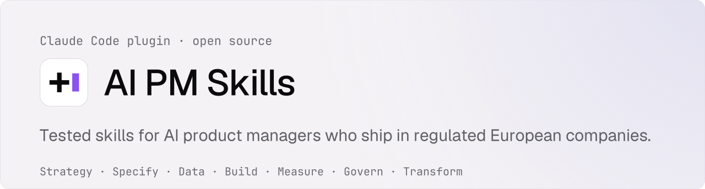
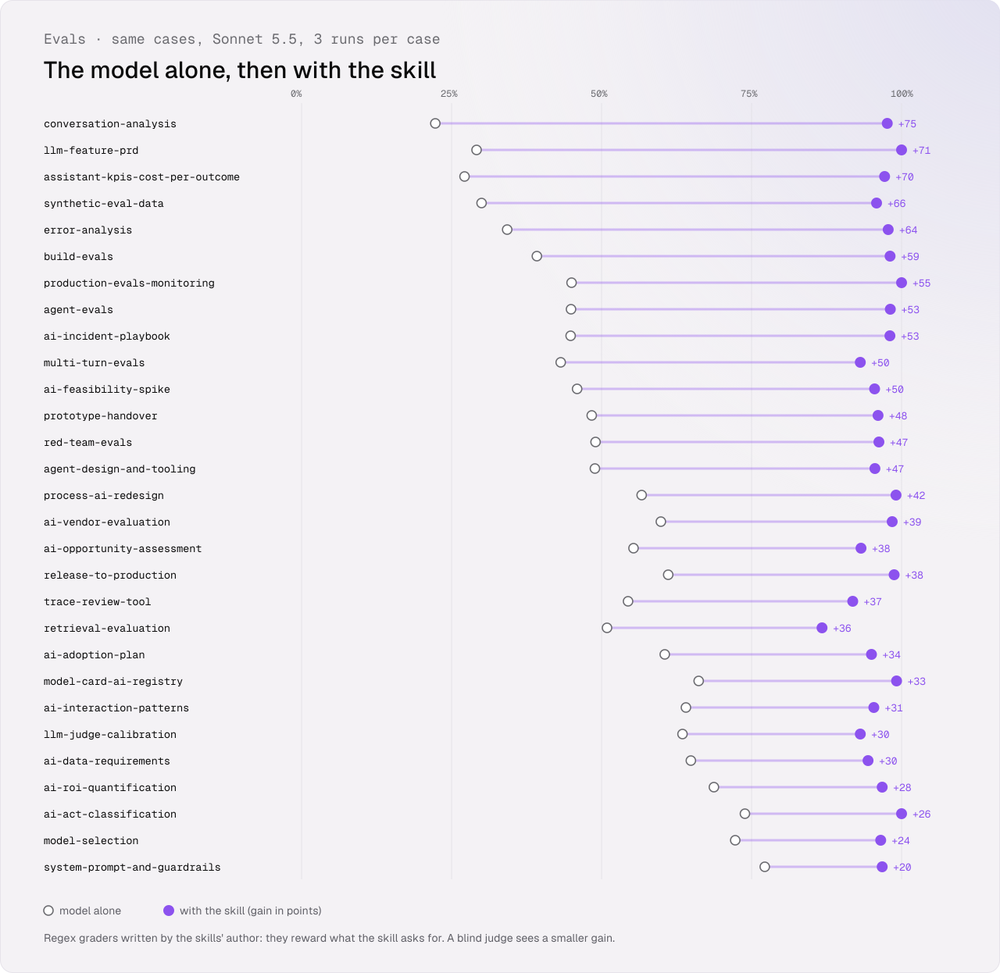

<p align="center"></p>

<p align="center"><b>Evals as evidence.</b> Agent Skills that help AI product managers build to learn, then prove a feature works, what each correct answer costs, and what the regulator will ask for. Every skill is scored with and without it, and by blind judges from three vendors; a few also against their own output template. All of it is published, including where the gain is small.</p>

<!-- gains:start -->
| Test performed | Model alone | Skill's template only | With the skill | Gain over the model alone | Gain over the template |
| --- | --- | --- | --- | --- | --- |
| Regex graders: 29 skills, 109 cases × 3 runs | 52% | — | **96%** | +44 pts | — |
| Regex graders, the 3 skills also run with their template only: 9 cases | 43% | 82% | 99% | +56 pts | +17 pts |
| Blind LLM judge, Haiku 5.5: 11 of these skills, 40 cases, earlier runs | 70% | — | 79% | +9 pts | — |
| Blind LLM judge, Sonnet 5.5: 9 of these skills, 29 cases, earlier runs | 72% | — | 82% | +10 pts | — |
| Blind LLM judge, openai/gpt-6.1-sol: 29 of these skills, 109 cases, recorded runs | 63% | — | 70% | +7 pts | — |
| Blind decision model, typesafe/jev-1.14: 29 of these skills, 109 cases, recorded runs | 80% | — | 89% | +9 pts | — |
| Red lines held (the one thing the answer must never do) | 71% | — | **100%** | | |
| Cost per correct answer, API equivalent (19 skills) | $0.104 | — | **$0.077** | -26% | |
| Stays silent on near-miss requests | — | — | **100%** | | |

<sub>Sonnet 5.5 answers each case 3 times per arm. **Regex graders** check that the answer contains what the skill asks for; the skills' author wrote them, so they favour the skill. The **blind LLM judge** scores general quality without knowing the arm; it tends to favour longer answers, and on the legal skills it does not check legal correctness. Gains in points: each is the row's score with the skill minus the score it is compared with, on the same skills; 95% intervals are in the per-skill numbers. [How the skills are tested](docs/testing-approach.md) · [per-skill numbers](skill-eval-gains.md).</sub>
<!-- gains:end -->

## Why evals as evidence?

In a bank or an insurer, "is it good enough?" is not a feeling. Three readers ask for proof, and each asks a different question:

| Reader | Asks | Answered by |
| --- | --- | --- |
| The user, and the team that serves them | Does it give correct answers on the questions people really ask? | `error-analysis`, `build-evals`, `llm-judge-calibration`, `production-evals-monitoring` |
| The sponsor | What does one correct answer cost, and is it worth it? | `assistant-kpis-cost-per-outcome`, `ai-roi-quantification`, `model-selection` |
| The regulator, the auditor, counsel | Were the bars set before testing? Are the test data representative? Is performance watched after release? | `ai-act-classification`, `model-card-ai-registry`, `production-evals-monitoring` |

Engineering courses teach how to build evals. These skills encode the decisions around them, the way a PM has to take them in a regulated company: read real outputs before choosing metrics, validate a judge with TPR and TNR rather than raw agreement, give every score its number of cases and its interval, set thresholds per class before the run, gate an agent on pass^k, and turn the AI Act articles that ask for testing and monitoring (arts. 9, 10, 15, 17, 26, 72, 73) into a checklist for counsel, never a verdict. The frame fits on one page: [evals as evidence](foundations/evals-as-evidence.md); the numbers behind it on another: [eval statistics](foundations/eval-statistics.md).

What makes it different:

1. **Evaluation is the spine.** Thirteen of the 29 skills evaluate: error analysis, judge validation, synthetic data, agents, retrieval, attacks, whole conversations, vendors, release and production monitoring.
2. **Built for a PM who builds.** The Build block covers what a PM makes with a coding agent to get evidence (a feasibility spike, a prompt with its red-team set, an agent's tools, a trace review app) and the handover of that prototype into a bank's IT estate, where engineers own production.
3. **Tested, and the unfavourable results stay visible.** A skill that does not beat the model alone by at least 10 points stays in `drafts/`. The table above also shows blind judges from three vendors and, for a few skills, the skill's own output template; the [per-skill numbers](skill-eval-gains.md) add 95% intervals. [How a skill is evaluated](docs/evaluation.md).
4. **One AI Act skill, wired to the evidence.** `ai-act-classification` names the role, the risk category and the obligations, then maps each testing or monitoring duty to the eval artefact that answers it.
5. **No free-floating numbers.** Every gain traces to volume × quality × unit value − costs ([ROI model](foundations/roi-model.md)), and every autonomy step to the [ladder](foundations/autonomy-ladder.md) (L0 to L5).

## Four blocks, one loop

<p align="center"></p>

| Block | What it answers | You | The coding agent | AI engineers |
| --- | --- | --- | --- | --- |
| **Specify** | Should we use AI, what must it do, what does "correct" mean? | decide and sign the bar per class | drafts the PRD from your notes | review feasibility |
| **Build** | Can the model do it, at what cost per correct answer, and what does the prototype become? | set the question, the cases, the appetite and the kill date | writes the spike, the review app, the scripts; another session reviews them | own production code: integration, access, secrets, logging, hosting |
| **Evaluate** | Does it work, before and after release, with an interval on every score? | label, set thresholds before the run, read the failures | runs the suite and the scripts | run the pipeline and the monitoring |
| **Prove** | What does a correct answer cost, and what will the regulator ask for? | take the evidence to the sponsor and counsel | assembles the record | keep the logs the record cites |

**AI Builder**, as used here: a PM who builds prototypes, eval tooling and evidence with a coding agent; engineers build to earn, and own production. Build to learn is framed on one page: [build to learn](foundations/build-to-learn.md). Production failures and incidents come back as regression cases and new requirements, which is why the blocks form a loop.

Three ways in:

- **An idea:** `ai-opportunity-assessment` → `ai-feasibility-spike` → `llm-feature-prd`.
- **Is it good enough?** `trace-review-tool` → `error-analysis` → `build-evals` → `llm-judge-calibration`.
- **Ship it:** `prototype-handover` → `release-to-production` → `model-card-ai-registry`.

| You need to… | Run | Block |
| --- | --- | --- |
| Decide whether an AI idea is worth a PRD, and what to ask the sponsor | `/ai-pm-skills:ai-opportunity-assessment` | Specify |
| Write the PRD of a feature that generates, extracts, classifies or acts | `/ai-pm-skills:llm-feature-prd` | Specify |
| Test on the real model whether an idea holds, before writing the PRD | `/ai-pm-skills:ai-feasibility-spike` | Build |
| Decide what a prototype you built becomes: rebuilt, registered or retired | `/ai-pm-skills:prototype-handover` | Build |
| Find out how the feature really fails before choosing any metric | `/ai-pm-skills:error-analysis` | Evaluate |
| Decide whether the feature is good enough to ship | `/ai-pm-skills:build-evals` | Evaluate |
| Know whether an LLM judge can be trusted | `/ai-pm-skills:llm-judge-calibration` | Evaluate |
| Test an agent before it acts alone | `/ai-pm-skills:agent-evals` | Evaluate |
| Find out whether a RAG fails at retrieval or at generation | `/ai-pm-skills:retrieval-evaluation` | Evaluate |
| Choose an AI vendor on your own evidence | `/ai-pm-skills:ai-vendor-evaluation` | Evaluate |
| Show the comex whether the assistant helps, and what a correct answer costs | `/ai-pm-skills:assistant-kpis-cost-per-outcome` | Prove |
| Classify a use case under the EU AI Act and list the evidence it asks for | `/ai-pm-skills:ai-act-classification` | Prove |

You rarely need the command: skills load on their own when the request matches. The full list is in the [catalog](#catalog).

**Looking for discovery, roadmaps or positioning?** Not here on purpose: they read the same with or without AI, and Teresa Torres, Marty Cagan or [pm-skills](https://github.com/phuryn/pm-skills) already cover them. **Looking for how to build an eval harness?** Hamel Husain and Shreya Shankar's [evals course and skills](https://github.com/ai-evals-course/evals-skills) are the engineering reference; this repo is the decision side and credits them.

## How well the skills work

<p align="center"></p>

- **Every skill is scored twice on the same cases**, with and without it, three runs per case. It enters the catalog only if it clears its threshold in every case, holds every red line in every run, and beats the model alone by at least 10 points. The numbers shown are those of its last recorded run, kept pass or fail with a log of every run; the validator fails the build if a catalog skill's text or cases changed since that run, so no number here describes a text that is not the one you install.
- **The right skill fires when all 29 are installed.** A routing suite of 58 requests aimed at the known collision zones (spike vs opportunity vs model choice, eval set vs release, handover vs model card vs AI Act, attack campaign vs guardrails vs agent tests, whole conversations vs single answers, and out-of-scope requests) picked the expected skill, or none, in 172 of 174 runs on 2026-11-12; the 2 misses fired no skill at all ([results](routing/results-2026-11-12b.md)). The requests were written by the repo's author, so this rules out collisions on known pairs, not on every phrasing. A free lexical check (`scripts/routing_check.py`) guards the same cases on every push.
- **Three ways of scoring, side by side**, in the table at the top: regex graders, blind judges (Claude, OpenAI's GPT, TypeSafe's Jev), and, for a few skills, the skill's own template as a control. The judges see a much smaller gain than the regexes; that is published, not hidden.
- **What we fix when a run fails**: in the November 2026 runs, most failures were graders refusing correct wording, not weak skills. Every grader change is checked against the answers given without the skill, and real answers become fixtures. Two skills held the exact numbers their own cases asked for; they were rewritten. Details: [how the skills are tested](docs/testing-approach.md) and [per-skill numbers](skill-eval-gains.md).

## Install

Every skill follows the [Agent Skills](https://agentskills.io) standard, so any agent that reads `SKILL.md` folders can load it. The evals ran on Claude only: the numbers above do not carry over to other agents.

**Fastest path, any agent** ([skills CLI](https://github.com/vercel-labs/skills), third-party):

```bash
npx skills add alexandre-darmon/ai-pm-skills     # pick skills and agents from a list
```

Or use your tool's own installer. Only the Claude Code and claude.ai routes were run on this repo; the others follow vendor docs. Details, scopes, updates and limits: [docs/install.md](docs/install.md).

<details>
<summary><b>Claude Code (recommended)</b></summary>

```bash
claude plugin marketplace add alexandre-darmon/ai-pm-skills
claude plugin install ai-pm-skills@ai-pm-skills     # all 29
claude plugin install build-evals@ai-pm-skills      # or one skill, by its name
```

In a session, type the same commands after `/plugin`. More: [docs/install.md#claude-code](docs/install.md#claude-code)

</details>

<details>
<summary><b>claude.ai, the Claude apps, the Skills API</b></summary>

Download a skill's zip from the [latest release](https://github.com/alexandre-darmon/ai-pm-skills/releases/latest) and upload it under Customize > Skills. One zip per skill. More: [docs/install.md#claude-apps](docs/install.md#claude-apps)

</details>

<details>
<summary><b>OpenAI Codex</b></summary>

```bash
codex plugin marketplace add alexandre-darmon/ai-pm-skills
codex plugin add ai-pm-skills@ai-pm-skills
```

Codex CLI 0.131 or later; installs all 29. Start a new session and invoke a skill with `$ai-pm-skills:build-evals` (or type `$` or `@` and pick it), or just describe the task. More: [docs/install.md#codex](docs/install.md#codex)

</details>

<details>
<summary><b>Cursor</b></summary>

```bash
npx skills add alexandre-darmon/ai-pm-skills --skill '*' -a cursor -g
```

Installs all 29 into `~/.cursor/skills/` (use `--skill build-evals` for one); restart Cursor. More: [docs/install.md#cursor](docs/install.md#cursor)

</details>

<details>
<summary><b>GitHub Copilot</b></summary>

```bash
copilot plugin marketplace add alexandre-darmon/ai-pm-skills
copilot plugin install ai-pm-skills@ai-pm-skills
```

Copilot CLI, all 29 (or `build-evals@ai-pm-skills` for one). For VS Code and the cloud agent, use `gh skill`. More: [docs/install.md#github-copilot](docs/install.md#github-copilot)

</details>

<details>
<summary><b>Gemini CLI</b></summary>

```bash
gemini extensions install https://github.com/alexandre-darmon/ai-pm-skills
```

Installs all 29 as an extension. For one skill: `gemini skills install https://github.com/alexandre-darmon/ai-pm-skills.git --path skills/build-evals`. More: [docs/install.md#gemini-cli](docs/install.md#gemini-cli)

</details>

<details>
<summary><b>Google Antigravity</b></summary>

```bash
agy plugin install https://github.com/alexandre-darmon/ai-pm-skills
```

CLI, all 29; invoke a skill with `/build-evals`. For the IDE or one skill, copy the folder. More: [docs/install.md#antigravity](docs/install.md#antigravity)

</details>

<details>
<summary><b>Windsurf (now Devin)</b></summary>

```bash
devin plugins install alexandre-darmon/ai-pm-skills
```

Devin CLI, after `devin auth login`; installs all 29. More: [docs/install.md#devin-and-windsurf](docs/install.md#devin-and-windsurf)

</details>

<details>
<summary><b>Kiro</b></summary>

```bash
npx skills add alexandre-darmon/ai-pm-skills --skill '*' -a kiro-cli -g
```

Installs all 29 into `~/.kiro/skills/`, read by the IDE and the CLI (use `--skill build-evals` for one). More: [docs/install.md#kiro](docs/install.md#kiro)

</details>

<details>
<summary><b>OpenCode</b></summary>

```bash
npx skills add alexandre-darmon/ai-pm-skills --skill '*' -a opencode -g
```

Installs all 29 into `~/.config/opencode/skills/` (use `--skill build-evals` for one). More: [docs/install.md#opencode](docs/install.md#opencode)

</details>

<details>
<summary><b>Command Code</b></summary>

```bash
cmd skills add alexandre-darmon/ai-pm-skills -g
```

Pick skills from a list, for all your projects; `-s build-evals` installs one directly. More: [docs/install.md#command-code](docs/install.md#command-code)

</details>

<details>
<summary><b>Other agents (Amp, Goose, Roo Code, Cline, ...)</b></summary>

```bash
npx skills add alexandre-darmon/ai-pm-skills --skill '*' -a <agent> -g
```

Name your agent with `-a` (for example `amp`, `goose`, `roo`); about 70 are supported. More: [docs/install.md#other-agents](docs/install.md#other-agents)

</details>

## Catalog

<!-- catalog:start -->
29 skills in four blocks, hard cap 30. Each one owns its triggers: no two skills compete for the same request, and the validator flags descriptions that overlap. **Available** skills are in `skills/`: their last recorded run (three runs per case, on today's text and cases) passes, the validator checks it on every push, and they install from the marketplace. **Drafts** are written and pass the free checks, not yet the paid runs.

### Available (29)

| Skill | Block | What it does |
| --- | --- | --- |
| [`ai-opportunity-assessment`](skills/ai-opportunity-assessment/SKILL.md) | Specify | AI or not, in which form, and the dated ask with its stop conditions. |
| [`llm-feature-prd`](skills/llm-feature-prd/SKILL.md) | Specify | PRD for an LLM feature: autonomy level per step, failure paths, eval stub, guardrails, stop conditions. |
| [`process-ai-redesign`](skills/process-ai-redesign/SKILL.md) | Specify | Level per step for a whole process, gates, scenarios with ROI lines, migration path. |
| [`ai-data-requirements`](skills/ai-data-requirements/SKILL.md) | Specify | Fields and documents a feature reads and writes: owners, expiry, flows, lawful basis. |
| [`ai-interaction-patterns`](skills/ai-interaction-patterns/SKILL.md) | Specify | What users see: sources, confidence only when calibrated, correction, refusal, escalation. |
| [`agent-design-and-tooling`](skills/agent-design-and-tooling/SKILL.md) | Build | An agent's loop, tools, permission matrix, stop conditions and traces. |
| [`ai-feasibility-spike`](skills/ai-feasibility-spike/SKILL.md) | Build | A throwaway prototype on the real model: one question, appetite and bar set first, n of N with intervals, cost per correct answer. |
| [`system-prompt-and-guardrails`](skills/system-prompt-and-guardrails/SKILL.md) | Build | System prompt plus input, output and action guardrails, with a red-team set. |
| [`trace-review-tool`](skills/trace-review-tool/SKILL.md) | Build | A thin review app a coding agent builds over masked traces: pass/fail with critique, reviewer and time on every label. |
| [`prototype-handover`](skills/prototype-handover/SKILL.md) | Build | What a PM-built AI tool becomes in a bank: rebuilt, registered at its EUC tier or retired; suite and baseline as the contract. |
| [`build-evals`](skills/build-evals/SKILL.md) | Evaluate | Eval set, graders, per-class thresholds signed before the run, intervals, baseline; per-component checks. |
| [`error-analysis`](skills/error-analysis/SKILL.md) | Evaluate | Read real traces, find and price failure modes before choosing any metric or judge. |
| [`llm-judge-calibration`](skills/llm-judge-calibration/SKILL.md) | Evaluate | Validate an LLM judge with TPR and TNR on held-out labels; correct the rate it reports. |
| [`synthetic-eval-data`](skills/synthetic-eval-data/SKILL.md) | Evaluate | Synthetic inputs from dimensions grounded in real traffic, with the share declared; counterfactual variants. |
| [`agent-evals`](skills/agent-evals/SKILL.md) | Evaluate | End state, forbidden events, pass^k with bounds, prompt injection measured as utility under attack. |
| [`retrieval-evaluation`](skills/retrieval-evaluation/SKILL.md) | Evaluate | RAG evaluated in two stages: retrieval at the k sent, then generation on fixed contexts. |
| [`model-selection`](skills/model-selection/SKILL.md) | Evaluate | Choose a model on your own suite: cost per success, noise test, decision record. |
| [`ai-vendor-evaluation`](skills/ai-vendor-evaluation/SKILL.md) | Evaluate | Buy on your own bake-off: cost per correct outcome, benchmark audit, clauses that keep quality testable. |
| [`red-team-evals`](skills/red-team-evals/SKILL.md) | Evaluate | Plan and read an attack campaign on an assistant or RAG: classes, sizing, rates with intervals, residual-risk record. Never "robust". |
| [`multi-turn-evals`](skills/multi-turn-evals/SKILL.md) | Evaluate | Evaluate whole conversations: scripted and simulated cases, a validated simulator, conversation-level graders, pass^k. |
| [`release-to-production`](skills/release-to-production/SKILL.md) | Evaluate | Ship a change: offline gate, shadow, canary, A/B only if the sample allows. |
| [`production-evals-monitoring`](skills/production-evals-monitoring/SKILL.md) | Evaluate | Quality after release: sampled judges, control limits, owners, and the AI Act art. 72 plan. |
| [`conversation-analysis`](skills/conversation-analysis/SKILL.md) | Evaluate | What people really ask the assistant, and how it goes, with personal data masked first. |
| [`assistant-kpis-cost-per-outcome`](skills/assistant-kpis-cost-per-outcome/SKILL.md) | Prove | KPIs for an assistant or agent: quality by domain, adoption, cost per correct outcome. |
| [`ai-roi-quantification`](skills/ai-roi-quantification/SKILL.md) | Prove | ROI of a live AI product: volume × quality × unit value − costs, baseline, sensitivity. |
| [`ai-act-classification`](skills/ai-act-classification/SKILL.md) | Prove | EU AI Act role, risk category, obligations and the eval evidence each article asks for. Never a verdict. |
| [`model-card-ai-registry`](skills/model-card-ai-registry/SKILL.md) | Prove | The eval record of each version: results per class with intervals, judge, signed thresholds, limits. |
| [`ai-incident-playbook`](skills/ai-incident-playbook/SKILL.md) | Prove | Contain, roll back, report on time, and turn every incident into regression cases before the fix ships. |
| [`ai-adoption-plan`](skills/ai-adoption-plan/SKILL.md) | Prove | Adoption proven on correct outcomes, over-trust measured, training by role, AI Act art. 4 evidence. |
<!-- catalog:end -->

> **Not legal advice.** Skills marked `legal: true` (`ai-act-classification`, `ai-vendor-evaluation`, `model-card-ai-registry`, `production-evals-monitoring`, `ai-incident-playbook`) produce classifications, checklists and questions for counsel, never a conformity verdict.

## Contributing a skill

```bash
cp -r templates/skill drafts/<your-skill-name>
pip install pyyaml   # node is needed too; Python 3.10 or later
python3 scripts/validate_skills.py
```

The validator checks the frontmatter, the fixed body headings and the eval cases (PRD §7.2 and §11.1), and tests the graders for free against a good and a bad answer per case. [docs/evaluation.md](docs/evaluation.md) explains the whole evaluation process with diagrams. CI runs it on every push and pull request. To score a skill (paid, uses your Claude credentials):

```bash
claude plugin eval drafts/<your-skill-name> --runs 1
```

After a recorded run lands in `baselines/`, refresh the numbers above and [skill-eval-gains.md](skill-eval-gains.md):

```bash
python3 scripts/eval_gains.py
python3 scripts/readme_catalog.py
```

## Built on the work of

The skills cite these works by idea, in their own words ([full register](foundations/sources.md)):

- **Evaluation.** Hamel Husain and Shreya Shankar, [*AI Evals for Engineers and PMs*](https://maven.com/parlance-labs/evals) and their evals FAQ on [hamel.dev](https://hamel.dev) · Shankar et al., [*Who Validates the Validators?*](https://arxiv.org/abs/2404.12272) · Zheng et al., [*Judging LLM-as-a-Judge*](https://arxiv.org/abs/2306.05685) · Eugene Yan, [*Evaluating the Effectiveness of LLM-Evaluators*](https://eugeneyan.com/writing/llm-evaluators/) · Evan Miller, [*Adding Error Bars to Evals*](https://arxiv.org/abs/2411.00640) · Anthropic, [*Demystifying evals for AI agents*](https://www.anthropic.com/engineering/demystifying-evals-for-ai-agents) · Yao et al., [*τ-bench*](https://arxiv.org/abs/2406.12045) · Es et al., [*RAGAS*](https://arxiv.org/abs/2309.15217) · Manning, Raghavan, Schütze, [*Introduction to Information Retrieval*](https://nlp.stanford.edu/IR-book/)
- **Statistics.** Wilson (1927) and the rule of three · Rogan and Gladen (1978) on correcting a rate with a test's errors · Cohen's kappa (1960) · Efron and Tibshirani, *An Introduction to the Bootstrap* · Montgomery, *Introduction to Statistical Quality Control* · Kohavi, Tang, Xu, [*Trustworthy Online Controlled Experiments*](https://experimentguide.com)
- **Product.** Marty Cagan, [*Inspired*](https://svpg.com) · Teresa Torres, [*Continuous Discovery Habits*](https://www.producttalk.org) · Rob Fitzpatrick, [*The Mom Test*](https://www.momtestbook.com)
- **AI engineering and operations.** Anthropic, [*Building effective agents*](https://www.anthropic.com/engineering/building-effective-agents) · OWASP, [*Top 10 for LLM Applications*](https://genai.owasp.org/llm-top-10/) · Mitchell et al., [*Model Cards for Model Reporting*](https://arxiv.org/abs/1810.03993) · [OpenTelemetry GenAI conventions](https://opentelemetry.io/docs/specs/semconv/gen-ai/) · Beyer et al., [*Site Reliability Engineering*](https://sre.google/sre-book/table-of-contents/) · Microsoft, [*Guidelines for Human-AI Interaction*](https://www.microsoft.com/en-us/haxtoolkit/) · Google, [*People + AI Guidebook*](https://pair.withgoogle.com/guidebook/)
- **Regulation.** [EU AI Act](https://eur-lex.europa.eu/eli/reg/2024/1689/oj) as amended by Regulation (EU) 2026/1744 · [GDPR](https://eur-lex.europa.eu/eli/reg/2016/679/oj) · [DORA](https://eur-lex.europa.eu/eli/reg/2022/2554/oj) · EN 18286 (quality management for the AI Act)

## Author

Alex Darmon, AI and data product manager in banking and retail, with an analytics and observability background. The skills come from client missions on internal assistants, chat-with-your-data products and agents; client data never leaves the client. Writing at [aiunmagic.com](https://aiunmagic.com).

## License

Code (`scripts/`, `.github/`, `.claude-plugin/`) is MIT. Skills, foundations and docs are [CC BY 4.0](LICENSE-CC-BY-4.0): reuse and adapt them, with credit. See [LICENSE](LICENSE).
