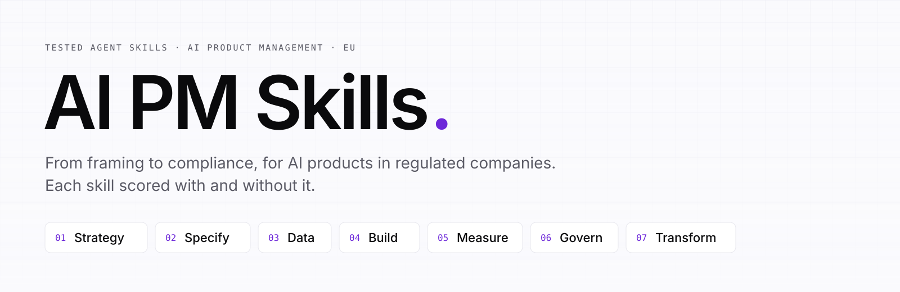
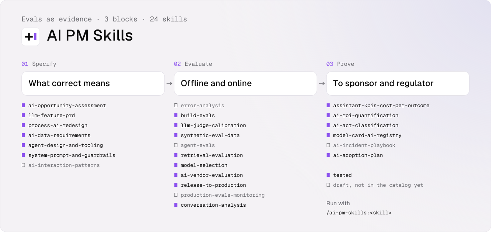

<p align="center"></p>

<p align="center"><b>Tested skills for AI product managers who ship in regulated European companies.</b><br>
Agent Skills for Claude Code, Codex, Cursor or your own agent. Every skill is scored with and without it.</p>

<!-- gains:start -->
| | Without skill | With skill |
| --- | --- | --- |
| Mean score on the scored cases | 45% | **99%** |
| Red lines held (the one thing the answer must never do) | 63% | **100%** |
| Stays silent on near-miss requests | — | **100%** |

<sub>6 skills, Sonnet 5.5, same cases with and without the skill. Per-skill numbers and method: [skill-eval-gains.md](skill-eval-gains.md).</sub>
<!-- gains:end -->

## Why AI PM Skills?

Generic AI gives you a plausible document. AI PM Skills gives you one that holds up in front of an engineering lead, a DPO and a works council.

Each skill encodes how an AI product is actually framed, specified, measured and governed in a bank, an insurer or an industrial group: an autonomy level per step, a gate before each level, cost per correct outcome instead of usage, and compliance as a checklist for counsel, never a verdict. The method comes from real deployments and from the work of Marty Cagan, Teresa Torres, Hamilton Helmer and the EU texts themselves, built into the agent instead of sitting on a shelf.

What makes it different:

1. **Tested.** Each skill ships with eval cases run by `claude plugin eval`, with and without the skill. A skill that does not beat the model alone stays in `drafts/`. [How a skill is evaluated](docs/evaluation.md).
2. **Compliance as skills.** AI Act classification, CSE consultation, DPIA pre-screen, model card, incident playbook: classifications, checklists and questions for counsel.
3. **One spine.** Every skill plugs into the same [autonomy ladder](foundations/autonomy-ladder.md) (L0 to L5) and [ROI model](foundations/roi-model.md) (volume × quality × unit value − costs).
4. **No free-floating numbers.** A gain that cannot be traced to volume, quality and unit value is rewritten or removed.

## The lifecycle

<p align="center"></p>

| You need to… | Run | Stage |
| --- | --- | --- |
| Write the PRD of a feature that generates, extracts, classifies or acts | `/ai-pm-skills:llm-feature-prd` | Specify |
| Decide whether the feature is good enough to ship | `/ai-pm-skills:build-evals` | Measure |
| Show the comex whether the assistant actually helps, and what a correct answer costs | `/ai-pm-skills:assistant-kpis-cost-per-outcome` | Measure |
| Find out what people really ask the assistant, and how it goes | `/ai-pm-skills:conversation-analysis` | Measure |
| Classify a use case under the EU AI Act | `/ai-pm-skills:ai-act-classification` | Govern |
| Know whether a French CSE must be informed or consulted | `/ai-pm-skills:cse-consultation` | Govern |

You rarely need the command: skills load on their own when the request matches. The other 20 skills are written and pass the free checks; they stay in [`drafts/`](drafts/) until their paid eval run. Below, what each one does.

**Looking for discovery?** Not here on purpose: generic discovery reads the same with or without AI, and Teresa Torres, Marty Cagan or [pm-skills](https://github.com/phuryn/pm-skills) already cover it. What AI changes is here: `ai-opportunity-assessment` checks that the problem is real and the data ready before you build, and `conversation-analysis` shows what people really ask once it runs.

## Install

Claude Code, no clone needed. Add the marketplace once:

```bash
claude plugin marketplace add alexandre-darmon/ai-pm-skills
```

Then install every tested skill:

```bash
claude plugin install ai-pm-skills@ai-pm-skills
```

Or a single skill, by its name:

```bash
claude plugin install llm-feature-prd@ai-pm-skills
```

Each per-skill plugin is named after its skill: `llm-feature-prd`, `build-evals`, `assistant-kpis-cost-per-outcome`, `conversation-analysis`, `ai-act-classification`, `cse-consultation`. Pick the bundle or single skills, not both. The bundle adds about 330 tokens to every session; a skill's full text loads only when it fires. Drafts are not installable: they join the marketplace once they pass their eval run.

Other agents (Codex, Cursor, custom): each folder in `skills/` follows the [Agent Skills](https://agentskills.io) standard and is self-contained; copy it into your agent's skills directory.

## Catalog

26 skills across 7 stages, hard cap 30. **Available** skills are in `skills/` with a passing eval suite. **Drafts** are written and pass the free checks, but have not been scored against the model yet.

### Available

| Skill | Stage | What it does |
| --- | --- | --- |
| [`llm-feature-prd`](skills/llm-feature-prd/SKILL.md) | Specify | PRD for an LLM feature: autonomy level per step, four failure paths, eval stub, guardrails, outcome KPIs, shadow → canary → GA. |
| [`build-evals`](skills/build-evals/SKILL.md) | Measure | Builds or reviews the eval set, graders, threshold and baseline that decide if an AI feature is good enough. |
| [`assistant-kpis-cost-per-outcome`](skills/assistant-kpis-cost-per-outcome/SKILL.md) | Measure | KPIs for an assistant or agent: quality by domain, adoption, cost per correct outcome, not usage alone. |
| [`conversation-analysis`](skills/conversation-analysis/SKILL.md) | Measure | Classifies conversations by use case, resolution and sentiment, PII masked, to learn what people use the assistant for. |
| [`ai-act-classification`](skills/ai-act-classification/SKILL.md) | Govern | EU AI Act role, risk category, obligations and dated questions for counsel. Never a compliance verdict. |
| [`cse-consultation`](skills/cse-consultation/SKILL.md) | Govern | Whether an AI tool in a French company needs CSE information or consultation, and the file to prepare. |

### Drafts

| Stage | Skills |
| --- | --- |
| Strategy | `ai-opportunity-assessment` (AI or not, in which form) · `ai-initiative-pitch` (one-pager with anchored numbers and one dated ask) · `ai-moat-7-powers` (where defensibility lies when the model is a commodity) |
| Specify | `ai-data-requirements` (fields, quality bar, legal basis, owner) · `chat-with-your-data-scoping` (bounded text-to-SQL with a golden set) · `ai-interaction-patterns` (trust calibration, correction, refusal UX) |
| Data & Knowledge | `semantic-layer-design` (one definition and one owner per metric, exported in Apache Ossie) · `agent-knowledge-base` (source register, owners, expiry) |
| Build | `prd-to-claude-code` (brief an agentic coding tool) · `system-prompt-and-guardrails` (prompt plus input, output and action guardrails) · `agent-design-and-tooling` (loop, tools, permission matrix) |
| Measure | `model-selection` (cost per success on your suite, sovereignty as a filter) · `release-to-production` (shadow, canary, A/B) · `ai-roi-quantification` (volume × quality × value − costs) |
| Govern | `dpia-prescreen` (the nine EDPB criteria) · `model-card-ai-registry` · `ai-incident-playbook` |
| Transform | `process-ai-redesign` (flagship: level per step, gates, three scenarios) · `ai-adoption-plan` · `ai-literacy-program` (AI Act art. 4) |

Re-confirmation pending (paid runs paused): `build-evals` and `conversation-analysis` each missed a red line once in their last 3-run check; their graders were refitted and checked for free since. `llm-feature-prd` changed after its last run.

> **Not legal advice.** Govern skills produce classifications, checklists and questions for counsel, never a conformity verdict.

## Contributing a skill

```bash
cp -r templates/skill drafts/<your-skill-name>
pip install pyyaml   # node is needed too
python3 scripts/validate_skills.py
```

The validator checks the frontmatter, the fixed body headings and the eval cases (PRD §7.2 and §11.1), and tests the graders for free against a good and a bad answer per case. [docs/evaluation.md](docs/evaluation.md) explains the whole evaluation process with diagrams. CI runs it on every push and pull request. To score a skill (paid, uses your Claude credentials):

```bash
claude plugin eval drafts/<your-skill-name> --runs 1
```

After a scoring run is frozen in `baselines/`, refresh the numbers above and [skill-eval-gains.md](skill-eval-gains.md):

```bash
python3 scripts/eval_gains.py
```

## Built on the work of

This repo evolves with product practice, AI capabilities and the law. The skills cite these works by idea, in their own words ([full register](foundations/sources.md)):

- **Product.** Marty Cagan, [*Inspired*](https://svpg.com) · Teresa Torres, [*Continuous Discovery Habits*](https://www.producttalk.org) · Rob Fitzpatrick, [*The Mom Test*](https://www.momtestbook.com) · Hamilton Helmer, [*7 Powers*](https://7powers.com) · Ron Kohavi, Diane Tang, Ya Xu, [*Trustworthy Online Controlled Experiments*](https://experimentguide.com)
- **Persuasion and change.** Robert Cialdini, [*Influence*](https://www.influenceatwork.com) · Nicolas Cole, *The Art and Business of Online Writing* · John Hagel et al., *The Power of Pull* · John Kotter, *Leading Change* · Everett Rogers, *Diffusion of Innovations* · Michael Hammer, James Champy, *Reengineering the Corporation*
- **AI engineering.** Anthropic, [*Building effective agents*](https://www.anthropic.com/engineering/building-effective-agents) · OWASP, [*Top 10 for LLM Applications*](https://genai.owasp.org/llm-top-10/) · Mitchell et al., [*Model Cards for Model Reporting*](https://arxiv.org/abs/1810.03993) · Microsoft, [*Guidelines for Human-AI Interaction*](https://www.microsoft.com/en-us/haxtoolkit/) · Google, [*People + AI Guidebook*](https://pair.withgoogle.com/guidebook/) · [OpenTelemetry GenAI conventions](https://opentelemetry.io/docs/specs/semconv/gen-ai/) · [dbt Semantic Layer](https://docs.getdbt.com/docs/use-dbt-semantic-layer/dbt-sl) · [Apache Ossie](https://ossie.apache.org/) · DAMA, [*DMBOK*](https://www.dama.org/cpages/body-of-knowledge)
- **Regulation.** [EU AI Act](https://eur-lex.europa.eu/eli/reg/2024/1689/oj) · [GDPR](https://eur-lex.europa.eu/eli/reg/2016/679/oj) · [EDPB](https://www.edpb.europa.eu) guidelines on DPIA · [CNIL](https://www.cnil.fr/fr/intelligence-artificielle) on AI and employee monitoring · French [Code du travail](https://www.legifrance.gouv.fr/codes/texte_lc/LEGITEXT000006072050)

## License

Code (`scripts/`, `.github/`, `.claude-plugin/`) is MIT. Skills, foundations and docs are [CC BY 4.0](LICENSE-CC-BY-4.0): reuse and adapt them, with credit. See [LICENSE](LICENSE).
