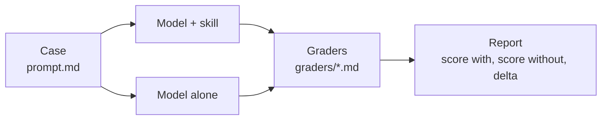
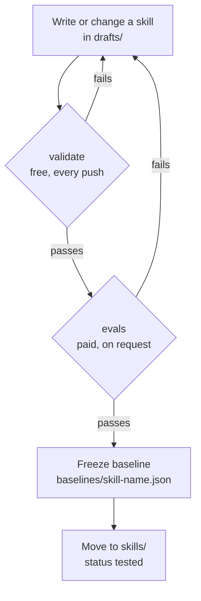
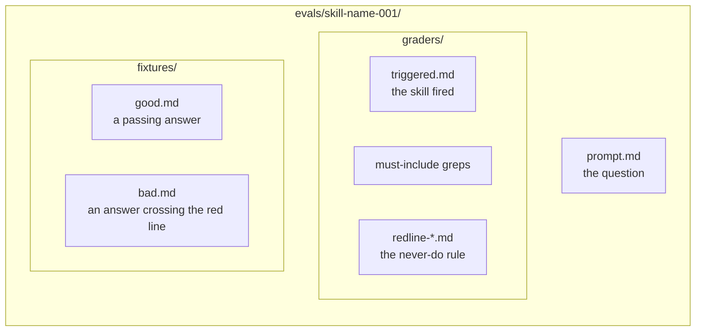
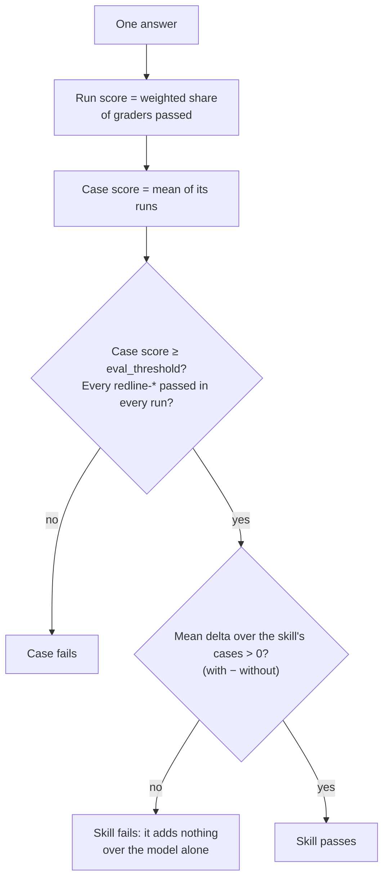
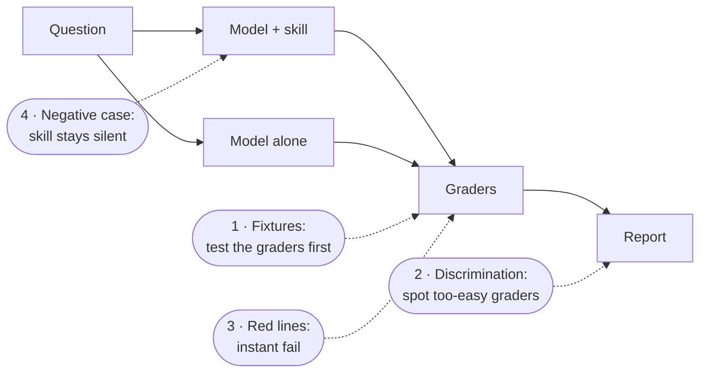
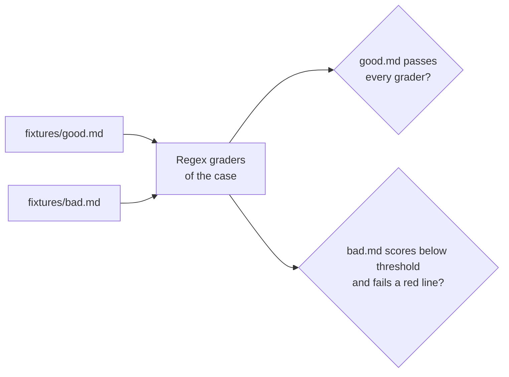

# How a skill is evaluated

This page explains the evaluation process with diagrams. The rules themselves live in [`foundations/eval-conventions.md`](../foundations/eval-conventions.md) (working reference) and [PRD §11](../PRD.md#11-evaluation-strategy) (rationale). When they change, update this page too.

## The idea in one picture

A skill is a cheat sheet for the model. To know if it helps, we ask the same question to the model **with** the skill and **without** it, and grade both answers with the same marking rules (the graders). A skill is worth keeping only if the answer with the skill scores better.



## The life of a skill

Free checks run on every push and catch most mistakes before any money is spent. Paid runs happen only on request: the `run-evals` label on a pull request, or a manual run after a major change.



| Step | Command | Cost | What it checks |
| --- | --- | --- | --- |
| validate | `python3 scripts/validate_skills.py` (needs Python with pyyaml, and node) | free | structure, the harness schema (unknown keys fail the load), plus the free checks below |
| evals | `python3 scripts/run_evals.py --full drafts/<skill>` | a few cents per case | real answers, with and without the skill |

## Anatomy of a case



- `prompt.md` is the question, written like a real request. It never names the skill: triggering is part of the test.
- `graders/` holds the marking rules: greps (`regex`) first, a judge (`llm`) only when a grep cannot decide.
- `fixtures/` holds the answers that test the graders themselves: `good.md` and `bad.md` written by hand, plus real answers saved from paid runs (`good-<run>.md`, and `bad-<run>.md` for a model-alone answer that crosses a red line). The model never sees them, and they do not count in the eval hash.

## How an answer is scored



The `triggered` grader is not part of the score: it reports whether the skill fired. Negative cases are left out of the delta, because without the skill they cannot fire.

## The four free checks

Paid runs can only be trusted if the marking rules are right. Four checks protect them, and three of them cost nothing.



| # | Check | Where it runs | Cost | It catches |
| --- | --- | --- | --- | --- |
| 1 | Grader fixtures, prompt echo | `validate_skills.py`, every push | free | a grader too narrow to accept a good answer, too loose to reject a bad one, or matching words the prompt already contains |
| 2 | Discrimination report | `run_evals.py`, after a paid run | free (reuses the run) | a grader that passes, or fails, with and without the skill: it measures the model, not the skill |
| 3 | Red lines | weight in `validate_skills.py`, every run in `run_evals.py` | free | a never-do rule hidden by the average of good marks elsewhere |
| 4 | Negative case | a paid case per skill | about 5 cents | a skill that fires on a request belonging to another skill |

### 1. Test the graders first



The validator also checks that each must-include grep does not match the prompt itself: if it does, an answer that repeats the brief passes. Example: a grader looking for `30%` when the brief says "30% productivity" proves nothing; it must look for the challenge ("the 30% is unanchored").

The greps run with JavaScript RegExp through `node`, exactly as the harness runs them (Python's `re` disagrees on accents next to `\b`, on some flags and on some syntax). `llm` graders cannot run offline, so they count as passed in both fixtures: the greps alone must reject the bad answer.

### 2. Spot the graders that do not tell the arms apart

After a paid run, the report lists each grader that passed in every run of both arms ("measures the model, not the skill") or failed in every run of both arms ("check the grader"). It is a warning, not a failure: such a grader can stay as a regression guard. With one run per case it is a hint; confirm with `python3 scripts/run_evals.py --full --runs 3 drafts/<skill>`.

### 3. A red line means instant fail

A grader named `graders/redline-*.md` is a never-do rule. Two rules apply:

- **Weight** (validator): a red line must weigh more than `W × (1 − t) / t`, where `W` is the sum of the other scored weights and `t` the threshold. At 0.80 that is a quarter of the other weights, at 0.90 a ninth. One miss then fails the case on its own.
- **Every run** (`run_evals.py`): a red line missed in any run with the skill fails the case, even when the mean of the runs is above the threshold.

A case tagged `red-line` must have at least one `redline-*` grader.

### 4. The skill stays in the bag

Every skill has at least one case tagged `negative`: a request close to its job but covered by one of its "Do not use" bullets. Its only grader (the validator enforces it) checks that the skill was **not** called, and an errored run fails the case too: silence must be shown, not assumed.

```yaml
type: tool_used
tool: Skill
input_match: '"skill"\s*:\s*"(?:[\w-]+:)?build-evals"'
min: 0   # the default min is 1, so without it the grader could never pass
max: 0
arm: both
```

`input_match` is anchored on the whole skill name, in every case, and every `tool: Skill` grader must use exactly this form. The Skill tool input reaches the grader as JSON (`{"skill":"build-evals"}`), so a bare `build-evals` would also match a sibling such as `build-evals-lite`.
